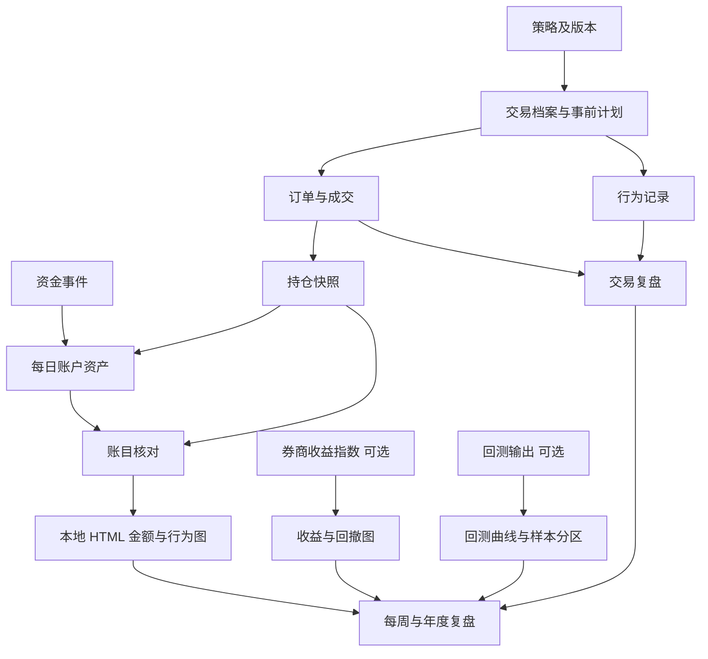
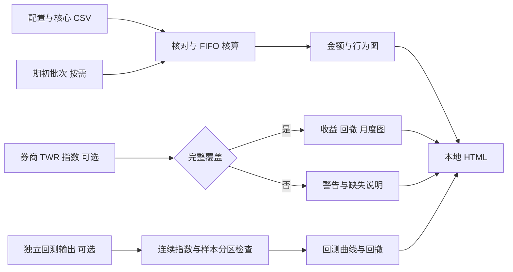

# Repository Copy Contents 全部文件复制版

仓库：CJA231/Backtest-Review-System。以下均为可发布模板、代码和虚构数据。每个标题是应建立的相对路径；复制对应代码框中的全部内容。COPY_CONTENTS.md 是本复制指南本身，无须将它递归复制到自身。

推荐下载压缩包批量上传，避免长 HTML 手动复制时遗漏。

## .github/workflows/check.yml

````yaml
name: Validate trading journal

on: [push, pull_request, workflow_dispatch]

permissions:
  contents: read

jobs:
  checks:
    runs-on: ubuntu-latest
    steps:
      - uses: actions/checkout@v6
      - uses: actions/setup-python@v6
        with:
          python-version: "3.11"
      - name: Check accounting rules
        run: python -B -m unittest discover -s tests -v
      - name: Generate fictional report
        run: python -B -m trading_journal --data-dir examples/2026 --output output/demo-report.html --backtest-dir examples/backtests/demo-run
````

## .gitignore

````text
# Local personal records; browser uploads still need manual checks.
/private/
/records/
/journal/
/reports/
/output/
/strategies/
.env
.env.*
!.env.example
.DS_Store
__pycache__/
*.pyc
````

## README.md

````markdown
# Backtest-Review-System

个人交易与资产管理仓库，管理交易记录、资产变化、交易频次、行为偏差和复盘。一个账户可以使用多种策略；账户资产曲线连续记录，每笔交易归属明确的策略版本。

## Introduction 简介

本版使用 Markdown 与 CSV 记录，使用 Python 标准库核对账目并生成离线 HTML 图表。无需安装第三方库，无需行情 API、AI API 或付费账户；券商原始记录仍是数据依据。

适用范围：单一账户、单一记账币种、做多普通股票的现金账户。示例采用 MYR、Asia/Kuala_Lumpur 时区和虚构标的。多账户、多币种、融资、做空、期权和拆股等复杂事件需要扩展数据结构后使用。

开始使用：[逐步建立流程](docs/github-setup.md) → [完整文件清单](docs/file-manifest.md) → [字段字典](docs/data-dictionary.md) → [核算规则](docs/accounting-rules.md) → [图表指南](docs/visualization-guide.md)。

项目仓库：[CJA231/Backtest-Review-System](https://github.com/CJA231/Backtest-Review-System)。公开仓库用于模板、程序和虚构示例，真实交易记录与生成报告应保存在私密目录或单独的 Private 仓库。

立即预览：在仓库首页点击 **Code → Download ZIP**，解压后双击 `demo/report.html`，使用浏览器打开预生成的虚构报告。这一步无需 Python；普通 GitHub 文件页面显示 HTML 源码，不代表网站已经发布。

自行生成：在包含 `trading_journal/` 的项目文件夹打开终端，运行：

```bash
python3 -m trading_journal --data-dir examples/2026 --output output/demo-report.html --backtest-dir examples/backtests/demo-run
```

然后在浏览器打开 `output/demo-report.html`。这是本地报告；将源文件上传到 GitHub 不会自动运行程序或发布网站。

## Concepts 概念

| 对象 | 定义 |
|---|---|
| 成交 Fill | 一次实际成交；同一订单可能有多次成交 |
| 订单 Order | 发给券商的一条订单；本版记录已成交订单编号 |
| 完整交易 Trade | 一个策略持仓从首次建仓到完全平仓的过程 |
| 策略版本 | 固定的入场、退出与风险规则，例如 TREND/v1 |
| 外部资金流 | 入金与出金；不包括买卖、股息和利息 |
| 净资产 NAV | 现金加持仓市值；本版现金账户没有融资负债 |
| 策略贡献 | 归属于该策略的净损益金额；不等于策略收益率 |
| 期初基准 | daily-assets.csv 第一行的日末估值；后续变化按这个起点核算 |
| 收益指数 | 券商或回测工具提供的连续指数，区别于直接受到入出金影响的资产金额 |

改变规则时建立新版本，新交易使用新版本。旧记录保留原归属；持仓中途换规则要记录变更事件，不能直接改写历史。最小版避免同一持仓跨策略转移；采用新规则的持仓另外分配 trade_id，并记录真实成交或明确的内部转移扩展账本。

## Architecture 架构

| 模块 | 文件与输出 |
|---|---|
| 记录 | dataset.json 配置与七张核心 CSV；可选期初批次与券商收益指数 |
| 资产 | 每日账户资产、持仓快照与 FIFO 成本核对 |
| 复盘 | 交易、每周和年度 Markdown 模板 |
| 核对 | trading_journal/ledger.py 检查编号、关联、资金、数量、成本和净资产 |
| 可视化 | trading_journal/charts.py 将核对后的结果嵌入 HTML，无远程图表资源 |
| 回测展示 | 读取独立的 metadata.json 与 equity.csv；不生成交易信号或执行回测 |

| 架构项目 | 本版安排 |
|---|---|
| 数据流 | 券商导出 → 手动录入 → 程序核对 → 本地图表 → 人工复盘 |
| Agent flow | 人工维护及核实；本版没有 AI 代理或模型调用 |
| 数据库 | CSV 是结构化记录；未来可导入 DuckDB |
| 缓存 | 无实时行情缓存 |
| 记忆 | 事前计划、策略版本、行为记录与历史复盘 |
| API | 无；未来可接券商只读接口 |
| 部署 | GitHub 保存模板与源代码；Python 在自己的电脑生成报告 |
| 监控 | 生成时检查记录错误；收益指数覆盖不完整时警告并停用相关收益图 |
| 日志 | 券商原始文件加 Git 变更历史；Git 不能证明计划一定在成交前填写 |
| 安全 | 公开仓库只放模板与虚构示例；真实记录使用私有仓库 |

## Best Practices 最佳实践

1. 先写交易计划，再录入成交，最后写复盘。计划修改保留时间和原因。
2. 一笔交易关联多个成交；不要将每次加减仓都当成新的完整交易。
3. 每个交易日保存账户与持仓快照，持续到年底；没有交易也记录资产。
4. 采用同一估值时点和币种。示例以当日收盘且当天现金事件入账后为准。
5. 先对上数量和现金，再对上净资产，最后分析收益。
6. 规则遵守与盈亏分别评价；未记录计划的交易标为未知。
7. 更正错误时在 Git 提交说明写明原因，保留券商依据。
8. 定期导出备份；GitHub 编辑历史不能替代券商原始成交证据。
9. 第一张资产快照是日末基准，核心资金和成交文件只填基准日之后的事件；有期初持仓时填写 opening-lots.csv。
10. 缺失收益数据时保留金额图，不能用零代替未知，也不能把净资产涨幅冒充投资收益率。

## Examples 示例

[examples/2026](examples/2026) 是虚构的短期例子，不代表全年业绩。

| 核对项目 | 示例结果 |
|---|---:|
| 期初净资产 | 100000 MYR |
| 入金 | 10000 MYR |
| 利息 | 20 MYR |
| 趋势交易 TR-001 已实现净损益 | +196 MYR |
| 突破交易 TR-002 已实现净损益 | -204 MYR |
| 趋势交易 TR-003 未实现净损益 | +99 MYR |
| 期末现金 | 107011 MYR |
| 期末持仓市值 | 3100 MYR |
| 期末净资产 | 110111 MYR |
| 扣除外部资金流后的净损益 | +111 MYR |

完整计算见 [示例复盘](examples/2026/review.md)。不要将这些示例行复制进真实年度数据。

示例券商收益指数与示例回测也是虚构数据，只演示不同图表和覆盖标签。回测文件位于 `examples/backtests/demo-run/`，与真实账户记录分别读取。

```text
Backtest-Review-System/
├── README.md
├── .gitignore
├── docs/                   # 流程、字段、核算、图表和完整文件清单
├── templates/              # 空白记录表、配置与复盘模板
├── examples/
│   ├── 2026/               # 虚构账户数据
│   └── backtests/demo-run/ # 虚构回测输出
├── trading_journal/        # 核对与报告生成程序
└── tests/                  # 核算及报告行为验证
```

代码职责：`__main__.py` 处理命令与输入输出，`ledger.py` 核算账目和指标，`charts.py` 生成 SVG 和 HTML，`__init__.py` 定义程序包。只需 Python；本版没有前端构建或 TypeScript 运行环境。

## Workflow 工作流程

| 流程 | 输入 | 输出 | 依赖 | 预计耗时 | 成本与风险 | 自动化可能性 |
|---|---|---|---|---|---|---|
| 建立仓库 | 全部项目文件 | 可维护仓库 | GitHub 账户 | 批量上传 15–30 分钟；逐文件复制约 1–2 小时 | 无 API 费用；文件遗漏 | 可批量上传 |
| 生成示例报告 | 示例 CSV 与配置 | output/demo-report.html | Python 3.11+ 建议 | 小样本通常数秒 | 无 API 费用；路径错误 | 一条命令生成 |
| 交易前 | 策略规则与候选标的 | 交易档案与计划 | 明确风险预算 | 每笔 3–5 分钟 | 决策风险 | 计划可辅助生成 |
| 成交后 | 券商成交记录 | 成交行及行为事件 | 成交与订单编号 | 每笔 1–3 分钟 | 重复或漏记 | 可只读导入 |
| 收盘后 | 券商账户与持仓 | 两类每日快照与本地报告 | 一致估值时点 | 每日 5–10 分钟 | 估值不一致 | 报告已可自动生成 |
| 每周 | 本周记录 | 周复盘 | 核对后的账目 | 20–30 分钟 | 错误归因 | 统计可自动化 |
| 年度 | 全年记录 | 年度图表及复盘 | 完整资金流和快照 | 复盘 1–2 小时起 | 缺失导致偏差 | 图表已可自动生成 |

具体顺序：建立策略 → 写事前计划并创建 trade_id → 录入成交 → 记录行为 → 核对每日资产 → 平仓复盘 → 每周检查 → 年度归档。

真实数据的报告命令：

```bash
python3 -m trading_journal --data-dir records/2026 --output output/2026-report.html
```

程序核对通过才生成本次报告。失败时按提示修正 CSV 后重跑；旧 HTML 不会因此变成新报告，查看报告时确认区间与生成时间。

## Diagrams 数据关系



## Checklist 检查清单

- [ ] 成交编号唯一，订单编号和交易编号可追溯。
- [ ] 全部交易关联有效策略及版本。
- [ ] 交易计划包含固定风险预算，缺失时 R 指标留空。
- [ ] 数量、持仓成本、现金和净资产与券商一致。
- [ ] 每日资金流只包含入金和出金，费用没有重复扣除。
- [ ] 已实现与未实现损益都纳入报告。
- [ ] 没有独立策略资本账本时，只比较策略贡献金额。
- [ ] 公开文件全部是模板或虚构数据。
- [ ] dataset.json 的账户、币种和时区与记录一致。
- [ ] 有期初持仓时，每个历史批次的数量和成本均已提供。
- [ ] 收益指数与回测曲线注明来源、覆盖范围、成本和数据性质。
- [ ] 月度图显示实际覆盖期间，没有把短期示例称为全年收益。

## Common Mistakes 常见错误

| 错误 | 修正 |
|---|---|
| 把入金当成收益 | 单独记录外部资金流 |
| 成交次数当成交易次数 | 分别统计 fill、order、trade |
| 持仓上涨但未卖出就不记录 | 每日按市值估值 |
| 已经扣费的损益再次扣费 | fees_ytd 仅供展示 |
| 为了让某策略更好看而改标签 | 保留当时策略版本 |
| 两种策略收益率直接相加 | 使用贡献金额，或建立独立资本账本 |
| 所有亏损都归因于情绪 | 对照事前计划，不能确定时写未知 |
| 以为 .gitignore 能阻止网页上传 | 网页操作时人工检查文件范围 |
| 上传 Python 后认为 GitHub 会自动生成图表 | 下载到本地运行，再用浏览器打开 HTML |
| 回测曲线重置后仍连接成一条线 | 提供连续收益指数；无法确认时不生成合并收益图 |
| 回测图看起来平稳就认定策略有效 | 核实样本外、成本、成交假设及来源，图表本身不验证优势 |

## FAQ 常见问题

**必须全年只用一种策略吗？** 不需要。账户表现是全年所有交易与资金事件的综合结果。策略变化使用新版本记录。

**同一只股票可以有两种策略吗？** 可以，但分别创建 trade_id，分配成交数量和费用。本版一条成交行只归属一个 trade_id；实际单笔成交若需要拆分归属，先扩展分配账本，避免重复录入。

**没有历史每日净值怎么办？** 优先从券商取得历史报表；若无法恢复，标明缺失，不能声称完整年度回撤或精确 TWR。

**取消订单算交易频次吗？** 本版不保存未成交订单，所以订单频次仅代表已成交订单。要分析频繁撤单，另外扩展订单事件表。

**能直接得到收益图表吗？** 金额、频次和行为图由核心记录生成；收益、基准、回撤和月度收益图需要完整的券商 TWR 指数。程序不会从日末净资产猜测精确 TWR。

**这个项目会帮我运行回测吗？** 本版读取其他工具已经生成的连续回测指数，展示曲线、回撤及 IS/OOS 标签。它不是回测引擎，也没有参数搜索、交易自动下单或行情获取。

**电脑上必须安装什么？** 建议 Python 3.11 或以上，以及用于打开 HTML 的浏览器。标准库即可运行，无需 pip 安装。GitHub 网页不是程序运行环境。

## Summary 版本范围与后续优化

| 功能或工具 | 使用安排 |
|---|---|
| TradingView 与 Screening | 外部筛选和图表；信号出处写进交易计划 |
| Risk Management | 固定风险预算、退出规则和行为检查 |
| Portfolio | 每日资产、持仓、市值与策略贡献 |
| Backtesting | 读取回测输出与连续指数；保留版本、成本、来源及样本分区 |
| Optimization | 优先提高记录与核算质量；参数优化不在本版功能范围 |
| Visualization | 本地 SVG＋HTML；图表目录见图表指南 |
| Reporting | 交易、每周和年度模板，以及自动生成的 HTML |
| Notion | 可用于编辑计划；仓库保存归档版本 |
| Telegram | 未来发送个人提醒；本版没有接入 |
| Automation | 已有账目核对与报告生成；只读导入可以后续增加 |

进阶方向：多账户、多币种、策略资本转移、公司行动、订单事件、真实回测引擎和更丰富的交互。数据量较大时可将 CSV 导入 Polars 与 DuckDB；需要网站、实时服务或数据库时再评估 FastAPI、React、PostgreSQL、Redis、Docker 与 GitHub Actions，不为当前离线报告增加安装负担。
````

## demo/report.html

````html
<!DOCTYPE html><html lang="zh-CN"><head><meta charset="utf-8"><meta name="viewport" content="width=device-width,initial-scale=1"><meta http-equiv="Content-Security-Policy" content="default-src 'none'; style-src 'unsafe-inline'; img-src data:; base-uri 'none'; form-action 'none'"><title>个人交易与资产报告</title><style>
:root{color-scheme:light;--ink:#192d40;--muted:#546779;--border:#dce5eb;--page:#f3f6f8;--positive:#087f8c;--negative:#bc3c47}
*{box-sizing:border-box}body{margin:0;background:var(--page);color:var(--ink);font-family:system-ui,-apple-system,"Noto Sans CJK SC","Microsoft YaHei",sans-serif;line-height:1.55}
main{max-width:1520px;margin:0 auto;padding:36px 28px 60px}h1{font-size:30px;line-height:1.3;margin:12px 0}h2{font-size:23px;margin:30px 0 15px}h3{font-size:18px;margin:0 0 14px;line-height:1.4}
.eyebrow{font-size:13px;color:var(--muted);letter-spacing:.04em}.meta{display:flex;flex-wrap:wrap;gap:9px 20px;color:var(--muted);font-size:14px}.badge{display:inline-block;border-radius:6px;padding:5px 10px;background:#e7eef4;font-size:13px;font-weight:650}.fictional{background:#fff0cd;color:#735109}
.lead,.scope{color:var(--muted);max-width:1120px}.scope{font-size:14px}.kpis{display:grid;grid-template-columns:repeat(3,minmax(0,1fr));gap:14px;margin-top:24px}.kpi{background:white;border:1px solid var(--border);padding:18px;border-radius:12px}.kpi-label{font-size:13px;color:var(--muted)}.kpi-value{font-size:26px;font-weight:700;line-height:1.35;margin-top:4px}.kpi-note{font-size:12px;color:var(--muted);margin-top:5px}
.grid{display:grid;grid-template-columns:repeat(2,minmax(0,1fr));gap:18px}.card{background:white;border:1px solid var(--border);border-radius:12px;padding:21px;min-width:0}.wide{grid-column:1/-1}.empty p{color:var(--muted);font-size:14px;min-height:95px;margin:25px 0}.caption{font-size:13px;color:var(--muted);margin:12px 0 0}.legend{display:flex;flex-wrap:wrap;gap:8px 18px;margin-bottom:8px;font-size:13px;color:var(--muted)}.legend span{display:inline-flex;align-items:center;gap:7px}.legend i{width:11px;height:11px;border-radius:2px;display:inline-block}
.svg-wrap{width:100%;overflow-x:auto;overscroll-behavior-x:contain}svg{display:block;width:100%;min-width:610px;height:auto}svg text{fill:#43586a;font-size:15px;font-family:system-ui,-apple-system,"Microsoft YaHei",sans-serif}.axis-unit{font-size:14px}.value{font-size:14px;fill:#253f53}.category{font-size:16px}.phase{font-size:13px;fill:#5c696b}
.notice{margin:16px 0;padding:16px 18px;border:1px solid #ead7a7;border-radius:10px;background:#fff9ea;font-size:14px}.notice p{margin:4px 0}.notice ul{margin:8px 0;padding-left:23px}.details-meta{border-left:3px solid #087f8c;padding-left:15px;margin:12px 0 18px;color:var(--muted);font-size:14px}.details-meta p{margin:4px 0}
.data-table{margin-top:16px;background:white;border:1px solid var(--border);border-radius:10px;padding:13px 18px}.data-table summary{cursor:pointer;font-weight:600;font-size:14px}.table-wrap{overflow:auto;margin-top:12px}table{width:100%;border-collapse:collapse;font-size:13px;text-align:left}th,td{padding:10px 12px;border-bottom:1px solid #e6edf1;white-space:nowrap}th{background:#f4f7f9}footer{margin-top:32px;font-size:13px;color:var(--muted);border-top:1px solid var(--border);padding-top:18px}
@media(min-width:1280px){svg{min-width:0}}@media(max-width:900px){.grid{grid-template-columns:1fr}.kpis{grid-template-columns:repeat(2,minmax(0,1fr))}main{padding:24px 16px 40px}.wide{grid-column:auto}}@media(max-width:480px){h1{font-size:24px}.card{padding:16px}.kpi{padding:13px}.kpi-value{font-size:22px}}
@media print{body{background:white}main{padding:0;max-width:none}.grid{display:block}.card{break-inside:avoid;margin:12px 0}svg{min-width:0}.kpis{grid-template-columns:repeat(3,1fr)}.data-table{break-inside:avoid}.notice{break-inside:avoid}}
</style></head><body><main><header><div class="eyebrow">PERSONAL TRADING JOURNAL · 离线报告</div><h1>个人交易与资产报告</h1><span class="badge fictional">虚构示例数据 · 非实际账户</span><p class="meta"><span>账户：DEMO-01</span><span>区间：2025-12-31 至 2026-01-12</span><span>记账币种：MYR</span></p><p class="lead">从资产变化到交易频次，再到行为复盘。所有图表基于已提供记录；缺失的收益率与回测数据不作推断。</p><p class="scope">当前核算范围：单币种、做多现金股票账户。图表展示已记录时点；不将缺失日期补成零，也不代表未记录期间。</p></header><div class="notice"><p>本报告仅演示记录与图表口径。示例覆盖有限交易日期，不代表全年表现或任何实际策略收益。</p></div><aside class="notice" aria-label="数据检查提示"><strong>数据检查提示</strong><ul><li>报告为单账户、单币种、做多现金股票的记录分析；不包含自动下单、税务核算或自动回测。</li><li>快照日期由用户提供，程序不能核实交易日历与券商数据是否完整；报告仅覆盖标注区间。</li><li>行为图展示记录次数，不将无记录视为合规，也不把涉及损益解释为偏差造成的损失。</li></ul></aside><div class="kpis"><div class="kpi"><div class="kpi-label">期末净资产</div><div class="kpi-value">110,111.00 <small>MYR</small></div><div class="kpi-note">现金＋持仓市值</div></div><div class="kpi"><div class="kpi-label">期间净投资损益</div><div class="kpi-value">111.00 <small>MYR</small></div><div class="kpi-note">扣除外部资金流影响的金额</div></div><div class="kpi"><div class="kpi-label">净外部资金流</div><div class="kpi-value">10,000.00 <small>MYR</small></div><div class="kpi-note">入金减出金；不算投资收益</div></div><div class="kpi"><div class="kpi-label">成交次数</div><div class="kpi-value">7 <small>次</small></div><div class="kpi-note">按成交编号统计</div></div><div class="kpi"><div class="kpi-label">已成交订单数</div><div class="kpi-value">6 <small>个</small></div><div class="kpi-note">全区间订单编号去重</div></div><div class="kpi"><div class="kpi-label">完全平仓交易数</div><div class="kpi-value">2 <small>笔</small></div><div class="kpi-note">与成交次数分别统计</div></div></div><h2>资产与金额贡献</h2><div class="grid"><section class="card wide"><h3>净资产与资金投入参考线</h3><div class="legend"><span><i style="background:#087f8c"></i>账户净资产</span><span><i style="background:#4169b1"></i>期初资产＋累计净外部资金流</span></div><div class="svg-wrap"><svg xmlns="http://www.w3.org/2000/svg" viewBox="0 0 800 360" role="img" aria-label="净资产与资金投入参考线。两条线的金额差反映累计净投资损益；参考线不是账户成本基础。净资产曲线受入出金影响，不能直接当作收益或投资回撤曲线。纵轴未必从零开始。"><title>净资产与资金投入参考线</title><desc>两条线的金额差反映累计净投资损益；参考线不是账户成本基础。净资产曲线受入出金影响，不能直接当作收益或投资回撤曲线。纵轴未必从零开始。</desc><text x="92.00" y="21.00" text-anchor="start" class="axis-unit">MYR</text><line x1="92.00" y1="294.00" x2="770.00" y2="294.00" stroke="#dbe2e9" stroke-width="1"/><text x="80.00" y="299.00" text-anchor="end" class="axis">99.0k</text><line x1="92.00" y1="229.50" x2="770.00" y2="229.50" stroke="#dbe2e9" stroke-width="1"/><text x="80.00" y="234.50" text-anchor="end" class="axis">102.0k</text><line x1="92.00" y1="165.00" x2="770.00" y2="165.00" stroke="#dbe2e9" stroke-width="1"/><text x="80.00" y="170.00" text-anchor="end" class="axis">105.1k</text><line x1="92.00" y1="100.50" x2="770.00" y2="100.50" stroke="#dbe2e9" stroke-width="1"/><text x="80.00" y="105.50" text-anchor="end" class="axis">108.1k</text><line x1="92.00" y1="36.00" x2="770.00" y2="36.00" stroke="#dbe2e9" stroke-width="1"/><text x="80.00" y="41.00" text-anchor="end" class="axis">111.1k</text><circle cx="92.00" cy="272.33" r="3.5" fill="#087f8c" stroke="white" stroke-width="1.3"><title>2025-12-31 · 账户净资产: 100,000.00</title></circle><circle cx="205.00" cy="272.33" r="3.5" fill="#087f8c" stroke="white" stroke-width="1.3"><title>2026-01-02 · 账户净资产: 100,000.00</title></circle><circle cx="374.50" cy="271.95" r="3.5" fill="#087f8c" stroke="white" stroke-width="1.3"><title>2026-01-05 · 账户净资产: 100,018.00</title></circle><circle cx="431.00" cy="268.57" r="3.5" fill="#087f8c" stroke="white" stroke-width="1.3"><title>2026-01-06 · 账户净资产: 100,177.00</title></circle><circle cx="487.50" cy="268.17" r="3.5" fill="#087f8c" stroke="white" stroke-width="1.3"><title>2026-01-07 · 账户净资产: 100,196.00</title></circle><circle cx="544.00" cy="268.21" r="3.5" fill="#087f8c" stroke="white" stroke-width="1.3"><title>2026-01-08 · 账户净资产: 100,194.00</title></circle><circle cx="600.50" cy="272.50" r="3.5" fill="#087f8c" stroke="white" stroke-width="1.3"><title>2026-01-09 · 账户净资产: 99,992.00</title></circle><circle cx="770.00" cy="57.50" r="3.5" fill="#087f8c" stroke="white" stroke-width="1.3"><title>2026-01-12 · 账户净资产: 110,111.00</title></circle><path d="M 92.00,272.33 L 205.00,272.33 L 374.50,271.95 L 431.00,268.57 L 487.50,268.17 L 544.00,268.21 L 600.50,272.50 L 770.00,57.50" fill="none" stroke="#087f8c" stroke-width="2.6" opacity="1" stroke-linejoin="round"/><circle cx="92.00" cy="272.33" r="3.5" fill="#4169b1" stroke="white" stroke-width="1.3"><title>2025-12-31 · 期初资产＋累计净外部资金流: 100,000.00</title></circle><circle cx="205.00" cy="272.33" r="3.5" fill="#4169b1" stroke="white" stroke-width="1.3"><title>2026-01-02 · 期初资产＋累计净外部资金流: 100,000.00</title></circle><circle cx="374.50" cy="272.33" r="3.5" fill="#4169b1" stroke="white" stroke-width="1.3"><title>2026-01-05 · 期初资产＋累计净外部资金流: 100,000.00</title></circle><circle cx="431.00" cy="272.33" r="3.5" fill="#4169b1" stroke="white" stroke-width="1.3"><title>2026-01-06 · 期初资产＋累计净外部资金流: 100,000.00</title></circle><circle cx="487.50" cy="272.33" r="3.5" fill="#4169b1" stroke="white" stroke-width="1.3"><title>2026-01-07 · 期初资产＋累计净外部资金流: 100,000.00</title></circle><circle cx="544.00" cy="272.33" r="3.5" fill="#4169b1" stroke="white" stroke-width="1.3"><title>2026-01-08 · 期初资产＋累计净外部资金流: 100,000.00</title></circle><circle cx="600.50" cy="272.33" r="3.5" fill="#4169b1" stroke="white" stroke-width="1.3"><title>2026-01-09 · 期初资产＋累计净外部资金流: 100,000.00</title></circle><circle cx="770.00" cy="59.86" r="3.5" fill="#4169b1" stroke="white" stroke-width="1.3"><title>2026-01-12 · 期初资产＋累计净外部资金流: 110,000.00</title></circle><path d="M 92.00,272.33 L 205.00,272.33 L 374.50,272.33 L 431.00,272.33 L 487.50,272.33 L 544.00,272.33 L 600.50,272.33 L 770.00,59.86" fill="none" stroke="#4169b1" stroke-width="2.6" opacity="1" stroke-linejoin="round" stroke-dasharray="7 5"/><text x="92.00" y="331.00" text-anchor="start" class="axis">2025-12-31</text><text x="205.00" y="331.00" text-anchor="middle" class="axis">2026-01-02</text><text x="431.00" y="331.00" text-anchor="middle" class="axis">2026-01-06</text><text x="487.50" y="331.00" text-anchor="middle" class="axis">2026-01-07</text><text x="600.50" y="331.00" text-anchor="middle" class="axis">2026-01-09</text><text x="770.00" y="331.00" text-anchor="end" class="axis">2026-01-12</text></svg></div><p class="caption">两条线的金额差反映累计净投资损益；参考线不是账户成本基础。净资产曲线受入出金影响，不能直接当作收益或投资回撤曲线。纵轴未必从零开始。</p></section><section class="card"><h3>资产构成：现金与持仓市值</h3><div class="legend"><span><i style="background:#4169b1"></i>现金</span><span><i style="background:#087f8c"></i>持仓市值</span></div><div class="svg-wrap"><svg xmlns="http://www.w3.org/2000/svg" viewBox="0 0 800 360" role="img" aria-label="资产构成：现金与持仓市值。以金额堆叠，现金＋持仓市值构成净资产。面积变化可能包含入出金，不代表投资收益率。"><title>资产构成：现金与持仓市值</title><desc>以金额堆叠，现金＋持仓市值构成净资产。面积变化可能包含入出金，不代表投资收益率。</desc><path d="M 92.00,294.00 L 92.00,77.05 L 205.00,77.05 L 374.50,81.43 L 431.00,79.05 L 487.50,76.62 L 544.00,85.30 L 600.50,77.06 L 770.00,61.84 L 770.00,294.00 Z" fill="#4169b1" stroke="#4169b1" stroke-width="1" opacity="0.3" stroke-linejoin="round"/><path d="M 92.00,77.05 L 205.00,77.05 L 374.50,77.01 L 431.00,76.66 L 487.50,76.62 L 544.00,76.63 L 600.50,77.06 L 770.00,55.11 L 770.00,61.84 L 600.50,77.06 L 544.00,85.30 L 487.50,76.62 L 431.00,79.05 L 374.50,81.43 L 205.00,77.05 L 92.00,77.05 Z" fill="#087f8c" stroke="#087f8c" stroke-width="1" opacity="0.47" stroke-linejoin="round"/><text x="92.00" y="21.00" text-anchor="start" class="axis-unit">MYR</text><line x1="92.00" y1="294.00" x2="770.00" y2="294.00" stroke="#dbe2e9" stroke-width="1"/><text x="80.00" y="299.00" text-anchor="end" class="axis">0.0</text><line x1="92.00" y1="229.50" x2="770.00" y2="229.50" stroke="#dbe2e9" stroke-width="1"/><text x="80.00" y="234.50" text-anchor="end" class="axis">29.7k</text><line x1="92.00" y1="165.00" x2="770.00" y2="165.00" stroke="#dbe2e9" stroke-width="1"/><text x="80.00" y="170.00" text-anchor="end" class="axis">59.5k</text><line x1="92.00" y1="100.50" x2="770.00" y2="100.50" stroke="#dbe2e9" stroke-width="1"/><text x="80.00" y="105.50" text-anchor="end" class="axis">89.2k</text><line x1="92.00" y1="36.00" x2="770.00" y2="36.00" stroke="#dbe2e9" stroke-width="1"/><text x="80.00" y="41.00" text-anchor="end" class="axis">118.9k</text><line x1="92.00" y1="294.00" x2="770.00" y2="294.00" stroke="#627284" stroke-width="1.5"/><path d="M 92.00,77.05 L 205.00,77.05 L 374.50,77.01 L 431.00,76.66 L 487.50,76.62 L 544.00,76.63 L 600.50,77.06 L 770.00,55.11" fill="none" stroke="#087f8c" stroke-width="2.6" opacity="1" stroke-linejoin="round"/><circle cx="92.00" cy="77.05" r="3" fill="#087f8c" stroke="white" stroke-width="1.3"><title>2025-12-31 · 现金 100,000.00 / 持仓 0.00 MYR</title></circle><circle cx="205.00" cy="77.05" r="3" fill="#087f8c" stroke="white" stroke-width="1.3"><title>2026-01-02 · 现金 100,000.00 / 持仓 0.00 MYR</title></circle><circle cx="374.50" cy="77.01" r="3" fill="#087f8c" stroke="white" stroke-width="1.3"><title>2026-01-05 · 现金 97,978.00 / 持仓 2,040.00 MYR</title></circle><circle cx="431.00" cy="76.66" r="3" fill="#087f8c" stroke="white" stroke-width="1.3"><title>2026-01-06 · 现金 99,077.00 / 持仓 1,100.00 MYR</title></circle><circle cx="487.50" cy="76.62" r="3" fill="#087f8c" stroke="white" stroke-width="1.3"><title>2026-01-07 · 现金 100,196.00 / 持仓 0.00 MYR</title></circle><circle cx="544.00" cy="76.63" r="3" fill="#087f8c" stroke="white" stroke-width="1.3"><title>2026-01-08 · 现金 96,194.00 / 持仓 4,000.00 MYR</title></circle><circle cx="600.50" cy="77.06" r="3" fill="#087f8c" stroke="white" stroke-width="1.3"><title>2026-01-09 · 现金 99,992.00 / 持仓 0.00 MYR</title></circle><circle cx="770.00" cy="55.11" r="3" fill="#087f8c" stroke="white" stroke-width="1.3"><title>2026-01-12 · 现金 107,011.00 / 持仓 3,100.00 MYR</title></circle><text x="92.00" y="331.00" text-anchor="start" class="axis">2025-12-31</text><text x="205.00" y="331.00" text-anchor="middle" class="axis">2026-01-02</text><text x="431.00" y="331.00" text-anchor="middle" class="axis">2026-01-06</text><text x="487.50" y="331.00" text-anchor="middle" class="axis">2026-01-07</text><text x="600.50" y="331.00" text-anchor="middle" class="axis">2026-01-09</text><text x="770.00" y="331.00" text-anchor="end" class="axis">2026-01-12</text></svg></div><p class="caption">以金额堆叠，现金＋持仓市值构成净资产。面积变化可能包含入出金，不代表投资收益率。</p></section><section class="card"><h3>资产变化对账瀑布图</h3><div class="legend"><span><i style="background:#4169b1"></i>资产总额</span><span><i style="background:#087f8c"></i>正向变化</span><span><i style="background:#bc3c47"></i>负向变化</span></div><div class="svg-wrap"><svg xmlns="http://www.w3.org/2000/svg" viewBox="0 0 800 360" role="img" aria-label="资产变化对账瀑布图。期初净资产＋净外部资金流＋策略损益＋账户其他损益＝期末净资产。图中金额由账本模块提供。"><title>资产变化对账瀑布图</title><desc>期初净资产＋净外部资金流＋策略损益＋账户其他损益＝期末净资产。图中金额由账本模块提供。</desc><text x="92.00" y="21.00" text-anchor="start" class="axis-unit">MYR</text><line x1="92.00" y1="294.00" x2="770.00" y2="294.00" stroke="#dbe2e9" stroke-width="1"/><text x="80.00" y="299.00" text-anchor="end" class="axis">0.0</text><line x1="92.00" y1="229.50" x2="770.00" y2="229.50" stroke="#dbe2e9" stroke-width="1"/><text x="80.00" y="234.50" text-anchor="end" class="axis">30.3k</text><line x1="92.00" y1="165.00" x2="770.00" y2="165.00" stroke="#dbe2e9" stroke-width="1"/><text x="80.00" y="170.00" text-anchor="end" class="axis">60.6k</text><line x1="92.00" y1="100.50" x2="770.00" y2="100.50" stroke="#dbe2e9" stroke-width="1"/><text x="80.00" y="105.50" text-anchor="end" class="axis">90.8k</text><line x1="92.00" y1="36.00" x2="770.00" y2="36.00" stroke="#dbe2e9" stroke-width="1"/><text x="80.00" y="41.00" text-anchor="end" class="axis">121.1k</text><line x1="92.00" y1="294.00" x2="770.00" y2="294.00" stroke="#627284" stroke-width="1.5"/><rect x="114.50" y="80.99" width="68.00" height="213.01" fill="#4169b1" opacity="1" rx="2"><title>期初资产: 100,000.00 MYR</title></rect><line x1="182.50" y1="80.99" x2="227.50" y2="80.99" stroke="#738293" stroke-width="1" stroke-dasharray="6 5"/><text x="148.50" y="71.99" text-anchor="middle" class="value">100,000</text><text x="148.50" y="317.00" text-anchor="middle" class="axis">期初资产</text><rect x="227.50" y="59.69" width="68.00" height="21.30" fill="#087f8c" opacity="1" rx="2"><title>净外部资金流: 10,000.00 MYR</title></rect><line x1="295.50" y1="59.69" x2="340.50" y2="59.69" stroke="#738293" stroke-width="1" stroke-dasharray="6 5"/><text x="261.50" y="50.69" text-anchor="middle" class="value">10,000</text><text x="261.50" y="317.00" text-anchor="middle" class="axis">净外部资金流</text><rect x="340.50" y="59.69" width="68.00" height="2.00" fill="#bc3c47" opacity="1" rx="2"><title>BREAKOUT/v1: -204.00 MYR</title></rect><line x1="408.50" y1="60.13" x2="453.50" y2="60.13" stroke="#738293" stroke-width="1" stroke-dasharray="6 5"/><text x="374.50" y="50.69" text-anchor="middle" class="value">-204</text><text x="374.50" y="317.00" text-anchor="middle" class="axis">BREAKOUT…</text><rect x="453.50" y="59.50" width="68.00" height="2.00" fill="#087f8c" opacity="1" rx="2"><title>TREND/v1: 295.00 MYR</title></rect><line x1="521.50" y1="59.50" x2="566.50" y2="59.50" stroke="#738293" stroke-width="1" stroke-dasharray="6 5"/><text x="487.50" y="50.50" text-anchor="middle" class="value">295</text><text x="487.50" y="317.00" text-anchor="middle" class="axis">TREND/v1</text><rect x="566.50" y="59.45" width="68.00" height="2.00" fill="#087f8c" opacity="1" rx="2"><title>ACCOUNT_OTHER / 账户其他: 20.00 MYR</title></rect><line x1="634.50" y1="59.45" x2="679.50" y2="59.45" stroke="#738293" stroke-width="1" stroke-dasharray="6 5"/><text x="600.50" y="50.45" text-anchor="middle" class="value">20</text><text x="600.50" y="317.00" text-anchor="middle" class="axis">ACCOUNT_…</text><rect x="679.50" y="59.45" width="68.00" height="234.55" fill="#4169b1" opacity="1" rx="2"><title>期末资产: 110,111.00 MYR</title></rect><text x="713.50" y="50.45" text-anchor="middle" class="value">110,111</text><text x="713.50" y="317.00" text-anchor="middle" class="axis">期末资产</text></svg></div><p class="caption">期初净资产＋净外部资金流＋策略损益＋账户其他损益＝期末净资产。图中金额由账本模块提供。</p></section><section class="card"><h3>各策略期间净损益贡献</h3><div class="svg-wrap"><svg xmlns="http://www.w3.org/2000/svg" viewBox="0 0 800 270" role="img" aria-label="各策略期间净损益贡献。金额贡献包含期间已实现损益与未实现损益变化，及可归属股息与费用；账户其他项单列。共享资金下的金额贡献不等于策略收益率。"><title>各策略期间净损益贡献</title><desc>金额贡献包含期间已实现损益与未实现损益变化，及可归属股息与费用；账户其他项单列。共享资金下的金额贡献不等于策略收益率。</desc><text x="215.00" y="23.00" text-anchor="start" class="axis-unit">MYR</text><line x1="215.00" y1="35.00" x2="215.00" y2="226.00" stroke="#dbe2e9" stroke-width="1"/><text x="215.00" y="253.00" text-anchor="middle" class="axis">-254</text><line x1="351.75" y1="35.00" x2="351.75" y2="226.00" stroke="#dbe2e9" stroke-width="1"/><text x="351.75" y="253.00" text-anchor="middle" class="axis">-98</text><line x1="488.50" y1="35.00" x2="488.50" y2="226.00" stroke="#dbe2e9" stroke-width="1"/><text x="488.50" y="253.00" text-anchor="middle" class="axis">58</text><line x1="625.25" y1="35.00" x2="625.25" y2="226.00" stroke="#dbe2e9" stroke-width="1"/><text x="625.25" y="253.00" text-anchor="middle" class="axis">214</text><line x1="762.00" y1="35.00" x2="762.00" y2="226.00" stroke="#dbe2e9" stroke-width="1"/><text x="762.00" y="253.00" text-anchor="middle" class="axis">370</text><line x1="437.66" y1="35.00" x2="437.66" y2="226.00" stroke="#627284" stroke-width="1.5"/><text x="203.00" y="72.00" text-anchor="end" class="category">BREAKOUT/v1</text><rect x="258.76" y="56.00" width="178.90" height="17.00" fill="#bc3c47" opacity="1" rx="2"><title>BREAKOUT/v1 · 净损益贡献: -204.00 MYR</title></rect><text x="252.76" y="70.00" text-anchor="end" class="value">-204.00</text><text x="203.00" y="136.00" text-anchor="end" class="category">TREND/v1</text><rect x="437.66" y="120.00" width="258.70" height="17.00" fill="#087f8c" opacity="1" rx="2"><title>TREND/v1 · 净损益贡献: 295.00 MYR</title></rect><text x="702.36" y="134.00" text-anchor="start" class="value">295.00</text><text x="203.00" y="200.00" text-anchor="end" class="category">ACCOUNT_OTH…</text><rect x="437.66" y="184.00" width="17.54" height="17.00" fill="#087f8c" opacity="1" rx="2"><title>ACCOUNT_OTHER / 账户其他 · 净损益贡献: 20.00 MYR</title></rect><text x="461.20" y="198.00" text-anchor="start" class="value">20.00</text></svg></div><p class="caption">金额贡献包含期间已实现损益与未实现损益变化，及可归属股息与费用；账户其他项单列。共享资金下的金额贡献不等于策略收益率。</p></section></div><details class="data-table"><summary>资产快照明细（8 行）</summary><p class="caption">保留原记录日期，未插值生成额外资产快照。</p><div class="table-wrap"><table><thead><tr><th scope="col">日期</th><th scope="col">现金 MYR</th><th scope="col">持仓市值 MYR</th><th scope="col">净资产 MYR</th><th scope="col">资金投入参考线 MYR</th></tr></thead><tbody><tr><td>2025-12-31</td><td>100,000.00</td><td>0.00</td><td>100,000.00</td><td>100,000.00</td></tr><tr><td>2026-01-02</td><td>100,000.00</td><td>0.00</td><td>100,000.00</td><td>100,000.00</td></tr><tr><td>2026-01-05</td><td>97,978.00</td><td>2,040.00</td><td>100,018.00</td><td>100,000.00</td></tr><tr><td>2026-01-06</td><td>99,077.00</td><td>1,100.00</td><td>100,177.00</td><td>100,000.00</td></tr><tr><td>2026-01-07</td><td>100,196.00</td><td>0.00</td><td>100,196.00</td><td>100,000.00</td></tr><tr><td>2026-01-08</td><td>96,194.00</td><td>4,000.00</td><td>100,194.00</td><td>100,000.00</td></tr><tr><td>2026-01-09</td><td>99,992.00</td><td>0.00</td><td>99,992.00</td><td>100,000.00</td></tr><tr><td>2026-01-12</td><td>107,011.00</td><td>3,100.00</td><td>110,111.00</td><td>110,000.00</td></tr></tbody></table></div></details><h2>收益率与风险</h2><div class="grid"><section class="card wide"><h3>排除外部资金流影响的收益净值</h3><div class="legend"><span><i style="background:#087f8c"></i>账户 TWR 净值</span><span><i style="background:#4169b1"></i>基准净值</span></div><div class="svg-wrap"><svg xmlns="http://www.w3.org/2000/svg" viewBox="0 0 800 360" role="img" aria-label="排除外部资金流影响的收益净值。来源：Fictional supplied index; Jan12 deposit at start of day。区间 TWR：0.10%。此图只展示已提供的 TWR_INDEX，不从资产快照推算。"><title>排除外部资金流影响的收益净值</title><desc>来源：Fictional supplied index; Jan12 deposit at start of day。区间 TWR：0.10%。此图只展示已提供的 TWR_INDEX，不从资产快照推算。</desc><text x="92.00" y="21.00" text-anchor="start" class="axis-unit">归一化指数（起点＝100）</text><line x1="92.00" y1="294.00" x2="770.00" y2="294.00" stroke="#dbe2e9" stroke-width="1"/><text x="80.00" y="299.00" text-anchor="end" class="axis">100</text><line x1="92.00" y1="229.50" x2="770.00" y2="229.50" stroke="#dbe2e9" stroke-width="1"/><text x="80.00" y="234.50" text-anchor="end" class="axis">100</text><line x1="92.00" y1="165.00" x2="770.00" y2="165.00" stroke="#dbe2e9" stroke-width="1"/><text x="80.00" y="170.00" text-anchor="end" class="axis">100</text><line x1="92.00" y1="100.50" x2="770.00" y2="100.50" stroke="#dbe2e9" stroke-width="1"/><text x="80.00" y="105.50" text-anchor="end" class="axis">101</text><line x1="92.00" y1="36.00" x2="770.00" y2="36.00" stroke="#dbe2e9" stroke-width="1"/><text x="80.00" y="41.00" text-anchor="end" class="axis">101</text><circle cx="92.00" cy="270.07" r="3.5" fill="#087f8c" stroke="white" stroke-width="1.3"><title>2025-12-31 · 账户 TWR 净值: 100.00</title></circle><circle cx="205.00" cy="270.07" r="3.5" fill="#087f8c" stroke="white" stroke-width="1.3"><title>2026-01-02 · 账户 TWR 净值: 100.00</title></circle><circle cx="374.50" cy="264.60" r="3.5" fill="#087f8c" stroke="white" stroke-width="1.3"><title>2026-01-05 · 账户 TWR 净值: 100.02</title></circle><circle cx="431.00" cy="216.32" r="3.5" fill="#087f8c" stroke="white" stroke-width="1.3"><title>2026-01-06 · 账户 TWR 净值: 100.18</title></circle><circle cx="487.50" cy="210.55" r="3.5" fill="#087f8c" stroke="white" stroke-width="1.3"><title>2026-01-07 · 账户 TWR 净值: 100.20</title></circle><circle cx="544.00" cy="211.16" r="3.5" fill="#087f8c" stroke="white" stroke-width="1.3"><title>2026-01-08 · 账户 TWR 净值: 100.19</title></circle><circle cx="600.50" cy="272.50" r="3.5" fill="#087f8c" stroke="white" stroke-width="1.3"><title>2026-01-09 · 账户 TWR 净值: 99.99</title></circle><circle cx="770.00" cy="239.65" r="3.5" fill="#087f8c" stroke="white" stroke-width="1.3"><title>2026-01-12 · 账户 TWR 净值: 100.10</title></circle><path d="M 92.00,270.07 L 205.00,270.07 L 374.50,264.60 L 431.00,216.32 L 487.50,210.55 L 544.00,211.16 L 600.50,272.50 L 770.00,239.65" fill="none" stroke="#087f8c" stroke-width="2.6" opacity="1" stroke-linejoin="round"/><circle cx="92.00" cy="270.07" r="3.5" fill="#4169b1" stroke="white" stroke-width="1.3"><title>2025-12-31 · 基准净值: 100.00</title></circle><circle cx="205.00" cy="239.70" r="3.5" fill="#4169b1" stroke="white" stroke-width="1.3"><title>2026-01-02 · 基准净值: 100.10</title></circle><circle cx="374.50" cy="209.34" r="3.5" fill="#4169b1" stroke="white" stroke-width="1.3"><title>2026-01-05 · 基准净值: 100.20</title></circle><circle cx="431.00" cy="178.97" r="3.5" fill="#4169b1" stroke="white" stroke-width="1.3"><title>2026-01-06 · 基准净值: 100.30</title></circle><circle cx="487.50" cy="148.60" r="3.5" fill="#4169b1" stroke="white" stroke-width="1.3"><title>2026-01-07 · 基准净值: 100.40</title></circle><circle cx="544.00" cy="118.23" r="3.5" fill="#4169b1" stroke="white" stroke-width="1.3"><title>2026-01-08 · 基准净值: 100.50</title></circle><circle cx="600.50" cy="87.87" r="3.5" fill="#4169b1" stroke="white" stroke-width="1.3"><title>2026-01-09 · 基准净值: 100.60</title></circle><circle cx="770.00" cy="57.50" r="3.5" fill="#4169b1" stroke="white" stroke-width="1.3"><title>2026-01-12 · 基准净值: 100.70</title></circle><path d="M 92.00,270.07 L 205.00,239.70 L 374.50,209.34 L 431.00,178.97 L 487.50,148.60 L 544.00,118.23 L 600.50,87.87 L 770.00,57.50" fill="none" stroke="#4169b1" stroke-width="2.6" opacity="1" stroke-linejoin="round"/><text x="92.00" y="331.00" text-anchor="start" class="axis">2025-12-31</text><text x="205.00" y="331.00" text-anchor="middle" class="axis">2026-01-02</text><text x="431.00" y="331.00" text-anchor="middle" class="axis">2026-01-06</text><text x="487.50" y="331.00" text-anchor="middle" class="axis">2026-01-07</text><text x="600.50" y="331.00" text-anchor="middle" class="axis">2026-01-09</text><text x="770.00" y="331.00" text-anchor="end" class="axis">2026-01-12</text></svg></div><p class="caption">来源：Fictional supplied index; Jan12 deposit at start of day。区间 TWR：0.10%。此图只展示已提供的 TWR_INDEX，不从资产快照推算。</p></section><section class="card"><h3>账户收益净值回撤</h3><div class="svg-wrap"><svg xmlns="http://www.w3.org/2000/svg" viewBox="0 0 800 360" role="img" aria-label="账户收益净值回撤。按已记录的 TWR_INDEX 观察点计算。已记录指数点的最大回撤：-0.20%。观察点之间遗漏的高点或低点可能使全期间回撤被低估；缺失日期不补零。"><title>账户收益净值回撤</title><desc>按已记录的 TWR_INDEX 观察点计算。已记录指数点的最大回撤：-0.20%。观察点之间遗漏的高点或低点可能使全期间回撤被低估；缺失日期不补零。</desc><path d="M 92.00,36.00 L 92.00,36.00 L 205.00,36.00 L 374.50,36.00 L 431.00,36.00 L 487.50,36.00 L 544.00,38.34 L 600.50,274.89 L 770.00,148.21 L 770.00,36.00 Z" fill="#bc3c47" stroke="#bc3c47" stroke-width="1" opacity="0.17" stroke-linejoin="round"/><text x="92.00" y="21.00" text-anchor="start" class="axis-unit">回撤（%）</text><line x1="92.00" y1="294.00" x2="770.00" y2="294.00" stroke="#dbe2e9" stroke-width="1"/><text x="80.00" y="299.00" text-anchor="end" class="axis">-0.2%</text><line x1="92.00" y1="229.50" x2="770.00" y2="229.50" stroke="#dbe2e9" stroke-width="1"/><text x="80.00" y="234.50" text-anchor="end" class="axis">-0.2%</text><line x1="92.00" y1="165.00" x2="770.00" y2="165.00" stroke="#dbe2e9" stroke-width="1"/><text x="80.00" y="170.00" text-anchor="end" class="axis">-0.1%</text><line x1="92.00" y1="100.50" x2="770.00" y2="100.50" stroke="#dbe2e9" stroke-width="1"/><text x="80.00" y="105.50" text-anchor="end" class="axis">-0.1%</text><line x1="92.00" y1="36.00" x2="770.00" y2="36.00" stroke="#dbe2e9" stroke-width="1"/><text x="80.00" y="41.00" text-anchor="end" class="axis">0.0%</text><line x1="92.00" y1="36.00" x2="770.00" y2="36.00" stroke="#627284" stroke-width="1.5"/><path d="M 92.00,36.00 L 205.00,36.00 L 374.50,36.00 L 431.00,36.00 L 487.50,36.00 L 544.00,38.34 L 600.50,274.89 L 770.00,148.21" fill="none" stroke="#bc3c47" stroke-width="2.6" opacity="1" stroke-linejoin="round"/><circle cx="92.00" cy="36.00" r="3" fill="#bc3c47" stroke="white" stroke-width="1.3"><title>2025-12-31 · 回撤 0.00%</title></circle><circle cx="205.00" cy="36.00" r="3" fill="#bc3c47" stroke="white" stroke-width="1.3"><title>2026-01-02 · 回撤 0.00%</title></circle><circle cx="374.50" cy="36.00" r="3" fill="#bc3c47" stroke="white" stroke-width="1.3"><title>2026-01-05 · 回撤 0.00%</title></circle><circle cx="431.00" cy="36.00" r="3" fill="#bc3c47" stroke="white" stroke-width="1.3"><title>2026-01-06 · 回撤 0.00%</title></circle><circle cx="487.50" cy="36.00" r="3" fill="#bc3c47" stroke="white" stroke-width="1.3"><title>2026-01-07 · 回撤 0.00%</title></circle><circle cx="544.00" cy="38.34" r="3" fill="#bc3c47" stroke="white" stroke-width="1.3"><title>2026-01-08 · 回撤 -0.00%</title></circle><circle cx="600.50" cy="274.89" r="3" fill="#bc3c47" stroke="white" stroke-width="1.3"><title>2026-01-09 · 回撤 -0.20%</title></circle><circle cx="770.00" cy="148.21" r="3" fill="#bc3c47" stroke="white" stroke-width="1.3"><title>2026-01-12 · 回撤 -0.10%</title></circle><text x="92.00" y="331.00" text-anchor="start" class="axis">2025-12-31</text><text x="205.00" y="331.00" text-anchor="middle" class="axis">2026-01-02</text><text x="431.00" y="331.00" text-anchor="middle" class="axis">2026-01-06</text><text x="487.50" y="331.00" text-anchor="middle" class="axis">2026-01-07</text><text x="600.50" y="331.00" text-anchor="middle" class="axis">2026-01-09</text><text x="770.00" y="331.00" text-anchor="end" class="axis">2026-01-12</text></svg></div><p class="caption">按已记录的 TWR_INDEX 观察点计算。已记录指数点的最大回撤：-0.20%。观察点之间遗漏的高点或低点可能使全期间回撤被低估；缺失日期不补零。</p></section><section class="card"><h3>月度收益率（标明实际覆盖区间）</h3><div class="svg-wrap"><svg xmlns="http://www.w3.org/2000/svg" viewBox="0 0 800 360" role="img" aria-label="月度收益率（标明实际覆盖区间）。数值由绩效模块提供，不将每日百分比直接相加。不完整月份只代表覆盖区间；每月精确日期见下方表格。"><title>月度收益率（标明实际覆盖区间）</title><desc>数值由绩效模块提供，不将每日百分比直接相加。不完整月份只代表覆盖区间；每月精确日期见下方表格。</desc><text x="92.00" y="21.00" text-anchor="start" class="axis-unit">TWR 收益率（%）</text><line x1="92.00" y1="294.00" x2="770.00" y2="294.00" stroke="#dbe2e9" stroke-width="1"/><text x="80.00" y="299.00" text-anchor="end" class="axis">0.0%</text><line x1="92.00" y1="229.50" x2="770.00" y2="229.50" stroke="#dbe2e9" stroke-width="1"/><text x="80.00" y="234.50" text-anchor="end" class="axis">0.0%</text><line x1="92.00" y1="165.00" x2="770.00" y2="165.00" stroke="#dbe2e9" stroke-width="1"/><text x="80.00" y="170.00" text-anchor="end" class="axis">0.1%</text><line x1="92.00" y1="100.50" x2="770.00" y2="100.50" stroke="#dbe2e9" stroke-width="1"/><text x="80.00" y="105.50" text-anchor="end" class="axis">0.1%</text><line x1="92.00" y1="36.00" x2="770.00" y2="36.00" stroke="#dbe2e9" stroke-width="1"/><text x="80.00" y="41.00" text-anchor="end" class="axis">0.1%</text><line x1="92.00" y1="294.00" x2="770.00" y2="294.00" stroke="#627284" stroke-width="1.5"/><rect x="400.00" y="59.45" width="62.00" height="234.55" fill="#087f8c" opacity="1" rx="2"><title>2026-01（月内覆盖区间）: 0.10% · 2025-12-31 至 2026-01-12</title></rect><text x="431.00" y="50.45" text-anchor="middle" class="value">0.10%</text><text x="431.00" y="329.00" text-anchor="middle" class="axis">2026-01</text></svg></div><p class="caption">数值由绩效模块提供，不将每日百分比直接相加。不完整月份只代表覆盖区间；每月精确日期见下方表格。</p></section></div><details class="data-table"><summary>月度收益实际覆盖范围（1 行）</summary><p class="caption">部分月份明确标注区间，不把部分月份结果称为整月收益。</p><div class="table-wrap"><table><thead><tr><th scope="col">月份与覆盖说明</th><th scope="col">起始日期</th><th scope="col">结束日期</th><th scope="col">收益率</th></tr></thead><tbody><tr><td>2026-01（月内覆盖区间）</td><td>2025-12-31</td><td>2026-01-12</td><td>0.10%</td></tr></tbody></table></div></details><h2>交易频次与行为复盘</h2><div class="grid"><section class="card"><h3>月度交易频次：四种口径分别统计</h3><div class="legend"><span><i style="background:#087f8c"></i>成交数</span><span><i style="background:#4169b1"></i>已成交订单数</span><span><i style="background:#b46a1f"></i>新建交易数</span><span><i style="background:#8055a3"></i>完全平仓交易数</span></div><div class="svg-wrap"><svg xmlns="http://www.w3.org/2000/svg" viewBox="0 0 800 360" role="img" aria-label="月度交易频次：四种口径分别统计。成交、订单和完整交易不是同一单位，使用分组柱形而非相加堆叠。订单按每月去重，跨月订单不应机械累计为全年订单数。"><title>月度交易频次：四种口径分别统计</title><desc>成交、订单和完整交易不是同一单位，使用分组柱形而非相加堆叠。订单按每月去重，跨月订单不应机械累计为全年订单数。</desc><text x="92.00" y="21.00" text-anchor="start" class="axis-unit">次数</text><line x1="92.00" y1="294.00" x2="770.00" y2="294.00" stroke="#dbe2e9" stroke-width="1"/><text x="80.00" y="299.00" text-anchor="end" class="axis">0</text><line x1="92.00" y1="231.53" x2="770.00" y2="231.53" stroke="#dbe2e9" stroke-width="1"/><text x="80.00" y="236.53" text-anchor="end" class="axis">2</text><line x1="92.00" y1="169.06" x2="770.00" y2="169.06" stroke="#dbe2e9" stroke-width="1"/><text x="80.00" y="174.06" text-anchor="end" class="axis">4</text><line x1="92.00" y1="106.59" x2="770.00" y2="106.59" stroke="#dbe2e9" stroke-width="1"/><text x="80.00" y="111.59" text-anchor="end" class="axis">6</text><line x1="92.00" y1="44.12" x2="770.00" y2="44.12" stroke="#dbe2e9" stroke-width="1"/><text x="80.00" y="49.12" text-anchor="end" class="axis">8</text><line x1="92.00" y1="294.00" x2="770.00" y2="294.00" stroke="#627284" stroke-width="1.5"/><rect x="375.00" y="75.36" width="26.00" height="218.64" fill="#087f8c" opacity="1" rx="2"><title>2026-01 · 成交数: 7</title></rect><text x="388.00" y="67.36" text-anchor="middle" class="value">7</text><rect x="403.00" y="106.59" width="26.00" height="187.41" fill="#4169b1" opacity="1" rx="2"><title>2026-01 · 已成交订单数: 6</title></rect><text x="416.00" y="98.59" text-anchor="middle" class="value">6</text><rect x="431.00" y="200.30" width="26.00" height="93.70" fill="#b46a1f" opacity="1" rx="2"><title>2026-01 · 新建交易数: 3</title></rect><text x="444.00" y="192.30" text-anchor="middle" class="value">3</text><rect x="459.00" y="231.53" width="26.00" height="62.47" fill="#8055a3" opacity="1" rx="2"><title>2026-01 · 完全平仓交易数: 2</title></rect><text x="472.00" y="223.53" text-anchor="middle" class="value">2</text><text x="431.00" y="328.00" text-anchor="middle" class="axis">2026-01</text></svg></div><p class="caption">成交、订单和完整交易不是同一单位，使用分组柱形而非相加堆叠。订单按每月去重，跨月订单不应机械累计为全年订单数。</p></section><section class="card"><h3>完全平仓交易：净 R 分布</h3><div class="svg-wrap"><svg xmlns="http://www.w3.org/2000/svg" viewBox="0 0 800 360" role="img" aria-label="完全平仓交易：净 R 分布。有效样本 2 笔；风险预算缺失 0 笔已排除。只纳入完全平仓交易，净损益已计费用。少量样本仅用于描述。"><title>完全平仓交易：净 R 分布</title><desc>有效样本 2 笔；风险预算缺失 0 笔已排除。只纳入完全平仓交易，净损益已计费用。少量样本仅用于描述。</desc><text x="92.00" y="21.00" text-anchor="start" class="axis-unit">交易笔数</text><line x1="92.00" y1="294.00" x2="770.00" y2="294.00" stroke="#dbe2e9" stroke-width="1"/><text x="80.00" y="299.00" text-anchor="end" class="axis">0</text><line x1="92.00" y1="87.60" x2="770.00" y2="87.60" stroke="#dbe2e9" stroke-width="1"/><text x="80.00" y="92.60" text-anchor="end" class="axis">1</text><line x1="92.00" y1="294.00" x2="770.00" y2="294.00" stroke="#627284" stroke-width="1.5"/><rect x="94.00" y="87.60" width="222.00" height="206.40" fill="#bc3c47" opacity="1" rx="2"><title>[-0.82, -0.28) R：1 笔</title></rect><text x="205.00" y="79.60" text-anchor="middle" class="value">1</text><text x="205.00" y="327.00" text-anchor="middle" class="axis">-0.8–-0.3</text><rect x="320.00" y="294.00" width="222.00" height="0.00" fill="#4169b1" opacity="1" rx="2"><title>[-0.28, 0.25) R：0 笔</title></rect><text x="431.00" y="286.00" text-anchor="middle" class="value">0</text><text x="431.00" y="327.00" text-anchor="middle" class="axis">-0.3–0.3</text><rect x="546.00" y="87.60" width="222.00" height="206.40" fill="#087f8c" opacity="1" rx="2"><title>[0.25, 0.78] R：1 笔</title></rect><text x="657.00" y="79.60" text-anchor="middle" class="value">1</text><text x="657.00" y="327.00" text-anchor="middle" class="axis">0.3–0.8</text><line x1="437.78" y1="36.00" x2="437.78" y2="294.00" stroke="#738293" stroke-width="1" stroke-dasharray="6 5"/><text x="770.00" y="349.00" text-anchor="end" class="axis-unit">净损益 / 固定初始风险（R）</text></svg></div><p class="caption">有效样本 2 笔；风险预算缺失 0 笔已排除。只纳入完全平仓交易，净损益已计费用。少量样本仅用于描述。</p></section><section class="card"><h3>持有时间与净 R</h3><div class="legend"><span><i style="background:#087f8c"></i>TREND/v1</span><span><i style="background:#4169b1"></i>BREAKOUT/v1</span></div><div class="svg-wrap"><svg xmlns="http://www.w3.org/2000/svg" viewBox="0 0 800 360" role="img" aria-label="持有时间与净 R。有效样本 2 笔；只展示完全平仓且初始风险已知的交易。散点关系用于观察，不说明持有时间造成收益变化。"><title>持有时间与净 R</title><desc>有效样本 2 笔；只展示完全平仓且初始风险已知的交易。散点关系用于观察，不说明持有时间造成收益变化。</desc><text x="92.00" y="21.00" text-anchor="start" class="axis-unit">净 R</text><line x1="92.00" y1="294.00" x2="770.00" y2="294.00" stroke="#dbe2e9" stroke-width="1"/><text x="80.00" y="299.00" text-anchor="end" class="axis">-1.0</text><line x1="92.00" y1="229.50" x2="770.00" y2="229.50" stroke="#dbe2e9" stroke-width="1"/><text x="80.00" y="234.50" text-anchor="end" class="axis">-0.5</text><line x1="92.00" y1="165.00" x2="770.00" y2="165.00" stroke="#dbe2e9" stroke-width="1"/><text x="80.00" y="170.00" text-anchor="end" class="axis">-0.0</text><line x1="92.00" y1="100.50" x2="770.00" y2="100.50" stroke="#dbe2e9" stroke-width="1"/><text x="80.00" y="105.50" text-anchor="end" class="axis">0.5</text><line x1="92.00" y1="36.00" x2="770.00" y2="36.00" stroke="#dbe2e9" stroke-width="1"/><text x="80.00" y="41.00" text-anchor="end" class="axis">0.9</text><line x1="92.00" y1="162.85" x2="770.00" y2="162.85" stroke="#627284" stroke-width="1.5"/><text x="92.00" y="330.00" text-anchor="middle" class="axis">0.0</text><text x="261.50" y="330.00" text-anchor="middle" class="axis">0.6</text><text x="431.00" y="330.00" text-anchor="middle" class="axis">1.1</text><text x="600.50" y="330.00" text-anchor="middle" class="axis">1.7</text><text x="770.00" y="330.00" text-anchor="middle" class="axis">2.2</text><circle cx="708.36" cy="57.50" r="6" fill="#087f8c" stroke="white" stroke-width="1.3"><title>TR-001 · TREND/v1 · 持有 2.00 天 · 0.78 R</title></circle><circle cx="400.18" cy="272.50" r="6" fill="#4169b1" stroke="white" stroke-width="1.3"><title>TR-002 · BREAKOUT/v1 · 持有 1.00 天 · -0.82 R</title></circle><text x="770.00" y="351.00" text-anchor="end" class="axis-unit">持有时间（天）</text></svg></div><p class="caption">有效样本 2 笔；只展示完全平仓且初始风险已知的交易。散点关系用于观察，不说明持有时间造成收益变化。</p></section><section class="card"><h3>行为偏差：事件数与涉及交易数</h3><div class="legend"><span><i style="background:#b46a1f"></i>偏差事件数</span><span><i style="background:#8055a3"></i>涉及交易数</span></div><div class="svg-wrap"><svg xmlns="http://www.w3.org/2000/svg" viewBox="0 0 800 270" role="img" aria-label="行为偏差：事件数与涉及交易数。一笔交易可以有多次偏差，同一交易也可能出现在多个类别。没有行为记录不等于遵守规则；这里不推断遵守率，也不将交易损失直接归因给偏差。"><title>行为偏差：事件数与涉及交易数</title><desc>一笔交易可以有多次偏差，同一交易也可能出现在多个类别。没有行为记录不等于遵守规则；这里不推断遵守率，也不将交易损失直接归因给偏差。</desc><text x="215.00" y="23.00" text-anchor="start" class="axis-unit">次数 / 笔数</text><line x1="215.00" y1="35.00" x2="215.00" y2="226.00" stroke="#dbe2e9" stroke-width="1"/><text x="215.00" y="253.00" text-anchor="middle" class="axis">0.0</text><line x1="351.75" y1="35.00" x2="351.75" y2="226.00" stroke="#dbe2e9" stroke-width="1"/><text x="351.75" y="253.00" text-anchor="middle" class="axis">0.3</text><line x1="488.50" y1="35.00" x2="488.50" y2="226.00" stroke="#dbe2e9" stroke-width="1"/><text x="488.50" y="253.00" text-anchor="middle" class="axis">0.6</text><line x1="625.25" y1="35.00" x2="625.25" y2="226.00" stroke="#dbe2e9" stroke-width="1"/><text x="625.25" y="253.00" text-anchor="middle" class="axis">0.9</text><line x1="762.00" y1="35.00" x2="762.00" y2="226.00" stroke="#dbe2e9" stroke-width="1"/><text x="762.00" y="253.00" text-anchor="middle" class="axis">1.1</text><line x1="215.00" y1="35.00" x2="215.00" y2="226.00" stroke="#627284" stroke-width="1.5"/><text x="203.00" y="88.00" text-anchor="end" class="category">EARLY_EXIT …</text><rect x="215.00" y="61.00" width="475.65" height="17.00" fill="#b46a1f" opacity="1" rx="2"><title>EARLY_EXIT / true · 偏差事件数: 1 次数 / 笔数</title></rect><text x="696.65" y="75.00" text-anchor="start" class="value">1</text><rect x="215.00" y="83.00" width="475.65" height="17.00" fill="#8055a3" opacity="1" rx="2"><title>EARLY_EXIT / true · 涉及交易数: 1 次数 / 笔数</title></rect><text x="696.65" y="97.00" text-anchor="start" class="value">1</text><text x="203.00" y="184.00" text-anchor="end" class="category">PLAN_ADHERE…</text><rect x="215.00" y="157.00" width="475.65" height="17.00" fill="#b46a1f" opacity="1" rx="2"><title>PLAN_ADHERENCE / false · 偏差事件数: 1 次数 / 笔数</title></rect><text x="696.65" y="171.00" text-anchor="start" class="value">1</text><rect x="215.00" y="179.00" width="475.65" height="17.00" fill="#8055a3" opacity="1" rx="2"><title>PLAN_ADHERENCE / false · 涉及交易数: 1 次数 / 笔数</title></rect><text x="696.65" y="193.00" text-anchor="start" class="value">1</text></svg></div><p class="caption">一笔交易可以有多次偏差，同一交易也可能出现在多个类别。没有行为记录不等于遵守规则；这里不推断遵守率，也不将交易损失直接归因给偏差。</p></section></div><details class="data-table"><summary>完全平仓交易明细（2 行）</summary><p class="caption">未平仓交易不纳入该表；风险预算未知的交易保留金额损益，但 R 显示为缺失。</p><div class="table-wrap"><table><thead><tr><th scope="col">交易编号</th><th scope="col">策略与版本</th><th scope="col">净损益 MYR</th><th scope="col">净 R</th><th scope="col">持有天数</th></tr></thead><tbody><tr><td>TR-001</td><td>TREND/v1</td><td>196.00</td><td>0.78</td><td>2.00</td></tr><tr><td>TR-002</td><td>BREAKOUT/v1</td><td>-204.00</td><td>-0.82</td><td>1.00</td></tr></tbody></table></div></details><h2>回测验证</h2><div class="details-meta"><p><strong>运行编号：</strong>SYNTHETIC-DEMO-001</p><p><strong>名称：</strong>Fictional backtest chart demonstration</p><p><strong>策略：</strong>DEMO-TREND/v1</p><p><strong>来源：</strong>Manually constructed synthetic monthly index points; no market data or backtest engine</p><p><strong>成本假设：</strong>{&#x27;commission&#x27;: &#x27;No executed simulation; synthetic net index for UI demonstration only&#x27;, &#x27;slippage&#x27;: &#x27;No executed simulation; no execution-quality evidence&#x27;}</p><p><strong>说明：</strong>Fictional index values and fictional IS/OOS labels. Sparse monthly observations understate any unobserved drawdowns. This sample does not establish a trading edge.</p></div><div class="grid"><section class="card"><h3>回测净值：样本内与样本外</h3><div class="legend"><span><i style="background:#087f8c"></i>回测策略净值</span><span><i style="background:#4169b1"></i>回测基准净值</span></div><div class="svg-wrap"><svg xmlns="http://www.w3.org/2000/svg" viewBox="0 0 800 360" role="img" aria-label="回测净值：样本内与样本外。模拟结果，币种 MYR；区间收益 14.00%。底色区分 IS 与 OOS；样本外表现仍需实盘验证。"><title>回测净值：样本内与样本外</title><desc>模拟结果，币种 MYR；区间收益 14.00%。底色区分 IS 与 OOS；样本外表现仍需实盘验证。</desc><rect x="92.00" y="36.00" width="365.01" height="258.00" fill="#ede9e2" opacity="1" rx="2"><title>IS: 2024-12-31 至 2025-06-30</title></rect><text x="274.50" y="55.00" text-anchor="middle" class="phase">样本内 IS</text><rect x="457.01" y="36.00" width="312.99" height="258.00" fill="#e1f1ee" opacity="1" rx="2"><title>OOS: 2025-07-31 至 2025-12-31</title></rect><text x="613.50" y="55.00" text-anchor="middle" class="phase">样本外 OOS</text><text x="92.00" y="21.00" text-anchor="start" class="axis-unit">归一化指数（起点＝100）</text><line x1="92.00" y1="294.00" x2="770.00" y2="294.00" stroke="#dbe2e9" stroke-width="1"/><text x="80.00" y="299.00" text-anchor="end" class="axis">99</text><line x1="92.00" y1="229.50" x2="770.00" y2="229.50" stroke="#dbe2e9" stroke-width="1"/><text x="80.00" y="234.50" text-anchor="end" class="axis">103</text><line x1="92.00" y1="165.00" x2="770.00" y2="165.00" stroke="#dbe2e9" stroke-width="1"/><text x="80.00" y="170.00" text-anchor="end" class="axis">107</text><line x1="92.00" y1="100.50" x2="770.00" y2="100.50" stroke="#dbe2e9" stroke-width="1"/><text x="80.00" y="105.50" text-anchor="end" class="axis">111</text><line x1="92.00" y1="36.00" x2="770.00" y2="36.00" stroke="#dbe2e9" stroke-width="1"/><text x="80.00" y="41.00" text-anchor="end" class="axis">115</text><circle cx="92.00" cy="272.50" r="3.5" fill="#087f8c" stroke="white" stroke-width="1.3"><title>2024-12-31 · 回测策略净值: 100.00</title></circle><circle cx="149.58" cy="241.79" r="3.5" fill="#087f8c" stroke="white" stroke-width="1.3"><title>2025-01-31 · 回测策略净值: 102.00</title></circle><circle cx="201.59" cy="257.14" r="3.5" fill="#087f8c" stroke="white" stroke-width="1.3"><title>2025-02-28 · 回测策略净值: 101.00</title></circle><circle cx="259.18" cy="195.71" r="3.5" fill="#087f8c" stroke="white" stroke-width="1.3"><title>2025-03-31 · 回测策略净值: 105.00</title></circle><circle cx="314.90" cy="226.43" r="3.5" fill="#087f8c" stroke="white" stroke-width="1.3"><title>2025-04-30 · 回测策略净值: 103.00</title></circle><circle cx="372.49" cy="165.00" r="3.5" fill="#087f8c" stroke="white" stroke-width="1.3"><title>2025-05-31 · 回测策略净值: 107.00</title></circle><circle cx="428.21" cy="149.64" r="3.5" fill="#087f8c" stroke="white" stroke-width="1.3"><title>2025-06-30 · 回测策略净值: 108.00</title></circle><circle cx="485.80" cy="180.36" r="3.5" fill="#087f8c" stroke="white" stroke-width="1.3"><title>2025-07-31 · 回测策略净值: 106.00</title></circle><circle cx="543.38" cy="118.93" r="3.5" fill="#087f8c" stroke="white" stroke-width="1.3"><title>2025-08-31 · 回测策略净值: 110.00</title></circle><circle cx="599.11" cy="134.29" r="3.5" fill="#087f8c" stroke="white" stroke-width="1.3"><title>2025-09-30 · 回测策略净值: 109.00</title></circle><circle cx="656.69" cy="88.21" r="3.5" fill="#087f8c" stroke="white" stroke-width="1.3"><title>2025-10-31 · 回测策略净值: 112.00</title></circle><circle cx="712.42" cy="103.57" r="3.5" fill="#087f8c" stroke="white" stroke-width="1.3"><title>2025-11-30 · 回测策略净值: 111.00</title></circle><circle cx="770.00" cy="57.50" r="3.5" fill="#087f8c" stroke="white" stroke-width="1.3"><title>2025-12-31 · 回测策略净值: 114.00</title></circle><path d="M 92.00,272.50 L 149.58,241.79 L 201.59,257.14 L 259.18,195.71 L 314.90,226.43 L 372.49,165.00 L 428.21,149.64 L 485.80,180.36 L 543.38,118.93 L 599.11,134.29 L 656.69,88.21 L 712.42,103.57 L 770.00,57.50" fill="none" stroke="#087f8c" stroke-width="2.6" opacity="1" stroke-linejoin="round"/><circle cx="92.00" cy="272.50" r="3.5" fill="#4169b1" stroke="white" stroke-width="1.3"><title>2024-12-31 · 回测基准净值: 100.00</title></circle><circle cx="149.58" cy="257.14" r="3.5" fill="#4169b1" stroke="white" stroke-width="1.3"><title>2025-01-31 · 回测基准净值: 101.00</title></circle><circle cx="201.59" cy="264.82" r="3.5" fill="#4169b1" stroke="white" stroke-width="1.3"><title>2025-02-28 · 回测基准净值: 100.50</title></circle><circle cx="259.18" cy="226.43" r="3.5" fill="#4169b1" stroke="white" stroke-width="1.3"><title>2025-03-31 · 回测基准净值: 103.00</title></circle><circle cx="314.90" cy="241.79" r="3.5" fill="#4169b1" stroke="white" stroke-width="1.3"><title>2025-04-30 · 回测基准净值: 102.00</title></circle><circle cx="372.49" cy="211.07" r="3.5" fill="#4169b1" stroke="white" stroke-width="1.3"><title>2025-05-31 · 回测基准净值: 104.00</title></circle><circle cx="428.21" cy="195.71" r="3.5" fill="#4169b1" stroke="white" stroke-width="1.3"><title>2025-06-30 · 回测基准净值: 105.00</title></circle><circle cx="485.80" cy="211.07" r="3.5" fill="#4169b1" stroke="white" stroke-width="1.3"><title>2025-07-31 · 回测基准净值: 104.00</title></circle><circle cx="543.38" cy="180.36" r="3.5" fill="#4169b1" stroke="white" stroke-width="1.3"><title>2025-08-31 · 回测基准净值: 106.00</title></circle><circle cx="599.11" cy="165.00" r="3.5" fill="#4169b1" stroke="white" stroke-width="1.3"><title>2025-09-30 · 回测基准净值: 107.00</title></circle><circle cx="656.69" cy="180.36" r="3.5" fill="#4169b1" stroke="white" stroke-width="1.3"><title>2025-10-31 · 回测基准净值: 106.00</title></circle><circle cx="712.42" cy="149.64" r="3.5" fill="#4169b1" stroke="white" stroke-width="1.3"><title>2025-11-30 · 回测基准净值: 108.00</title></circle><circle cx="770.00" cy="134.29" r="3.5" fill="#4169b1" stroke="white" stroke-width="1.3"><title>2025-12-31 · 回测基准净值: 109.00</title></circle><path d="M 92.00,272.50 L 149.58,257.14 L 201.59,264.82 L 259.18,226.43 L 314.90,241.79 L 372.49,211.07 L 428.21,195.71 L 485.80,211.07 L 543.38,180.36 L 599.11,165.00 L 656.69,180.36 L 712.42,149.64 L 770.00,134.29" fill="none" stroke="#4169b1" stroke-width="2.6" opacity="1" stroke-linejoin="round"/><text x="92.00" y="331.00" text-anchor="start" class="axis">2024-12-31</text><text x="201.59" y="331.00" text-anchor="middle" class="axis">2025-02-28</text><text x="372.49" y="331.00" text-anchor="middle" class="axis">2025-05-31</text><text x="485.80" y="331.00" text-anchor="middle" class="axis">2025-07-31</text><text x="656.69" y="331.00" text-anchor="middle" class="axis">2025-10-31</text><text x="770.00" y="331.00" text-anchor="end" class="axis">2025-12-31</text></svg></div><p class="caption">模拟结果，币种 MYR；区间收益 14.00%。底色区分 IS 与 OOS；样本外表现仍需实盘验证。</p></section><section class="card"><h3>回测回撤</h3><div class="svg-wrap"><svg xmlns="http://www.w3.org/2000/svg" viewBox="0 0 800 360" role="img" aria-label="回测回撤。按已记录的回测指数观察点计算。已记录指数点的最大回撤：-1.90%。观察点之间遗漏的高点或低点可能使全期间回撤被低估；缺失日期不补零。底色区分样本内 IS 与样本外 OOS。"><title>回测回撤</title><desc>按已记录的回测指数观察点计算。已记录指数点的最大回撤：-1.90%。观察点之间遗漏的高点或低点可能使全期间回撤被低估；缺失日期不补零。底色区分样本内 IS 与样本外 OOS。</desc><rect x="92.00" y="36.00" width="365.01" height="258.00" fill="#ede9e2" opacity="1" rx="2"><title>IS: 2024-12-31 至 2025-06-30</title></rect><text x="274.50" y="55.00" text-anchor="middle" class="phase">样本内 IS</text><rect x="457.01" y="36.00" width="312.99" height="258.00" fill="#e1f1ee" opacity="1" rx="2"><title>OOS: 2025-07-31 至 2025-12-31</title></rect><text x="613.50" y="55.00" text-anchor="middle" class="phase">样本外 OOS</text><path d="M 92.00,36.00 L 92.00,36.00 L 149.58,36.00 L 201.59,158.96 L 259.18,36.00 L 314.90,274.89 L 372.49,36.00 L 428.21,36.00 L 485.80,268.25 L 543.38,36.00 L 599.11,150.02 L 656.69,36.00 L 712.42,147.98 L 770.00,36.00 L 770.00,36.00 Z" fill="#bc3c47" stroke="#bc3c47" stroke-width="1" opacity="0.17" stroke-linejoin="round"/><text x="92.00" y="21.00" text-anchor="start" class="axis-unit">回撤（%）</text><line x1="92.00" y1="294.00" x2="770.00" y2="294.00" stroke="#dbe2e9" stroke-width="1"/><text x="80.00" y="299.00" text-anchor="end" class="axis">-2.1%</text><line x1="92.00" y1="229.50" x2="770.00" y2="229.50" stroke="#dbe2e9" stroke-width="1"/><text x="80.00" y="234.50" text-anchor="end" class="axis">-1.5%</text><line x1="92.00" y1="165.00" x2="770.00" y2="165.00" stroke="#dbe2e9" stroke-width="1"/><text x="80.00" y="170.00" text-anchor="end" class="axis">-1.0%</text><line x1="92.00" y1="100.50" x2="770.00" y2="100.50" stroke="#dbe2e9" stroke-width="1"/><text x="80.00" y="105.50" text-anchor="end" class="axis">-0.5%</text><line x1="92.00" y1="36.00" x2="770.00" y2="36.00" stroke="#dbe2e9" stroke-width="1"/><text x="80.00" y="41.00" text-anchor="end" class="axis">0.0%</text><line x1="92.00" y1="36.00" x2="770.00" y2="36.00" stroke="#627284" stroke-width="1.5"/><path d="M 92.00,36.00 L 149.58,36.00 L 201.59,158.96 L 259.18,36.00 L 314.90,274.89 L 372.49,36.00 L 428.21,36.00 L 485.80,268.25 L 543.38,36.00 L 599.11,150.02 L 656.69,36.00 L 712.42,147.98 L 770.00,36.00" fill="none" stroke="#bc3c47" stroke-width="2.6" opacity="1" stroke-linejoin="round"/><circle cx="92.00" cy="36.00" r="3" fill="#bc3c47" stroke="white" stroke-width="1.3"><title>2024-12-31 · 回撤 0.00%</title></circle><circle cx="149.58" cy="36.00" r="3" fill="#bc3c47" stroke="white" stroke-width="1.3"><title>2025-01-31 · 回撤 0.00%</title></circle><circle cx="201.59" cy="158.96" r="3" fill="#bc3c47" stroke="white" stroke-width="1.3"><title>2025-02-28 · 回撤 -0.98%</title></circle><circle cx="259.18" cy="36.00" r="3" fill="#bc3c47" stroke="white" stroke-width="1.3"><title>2025-03-31 · 回撤 0.00%</title></circle><circle cx="314.90" cy="274.89" r="3" fill="#bc3c47" stroke="white" stroke-width="1.3"><title>2025-04-30 · 回撤 -1.90%</title></circle><circle cx="372.49" cy="36.00" r="3" fill="#bc3c47" stroke="white" stroke-width="1.3"><title>2025-05-31 · 回撤 0.00%</title></circle><circle cx="428.21" cy="36.00" r="3" fill="#bc3c47" stroke="white" stroke-width="1.3"><title>2025-06-30 · 回撤 0.00%</title></circle><circle cx="485.80" cy="268.25" r="3" fill="#bc3c47" stroke="white" stroke-width="1.3"><title>2025-07-31 · 回撤 -1.85%</title></circle><circle cx="543.38" cy="36.00" r="3" fill="#bc3c47" stroke="white" stroke-width="1.3"><title>2025-08-31 · 回撤 0.00%</title></circle><circle cx="599.11" cy="150.02" r="3" fill="#bc3c47" stroke="white" stroke-width="1.3"><title>2025-09-30 · 回撤 -0.91%</title></circle><circle cx="656.69" cy="36.00" r="3" fill="#bc3c47" stroke="white" stroke-width="1.3"><title>2025-10-31 · 回撤 0.00%</title></circle><circle cx="712.42" cy="147.98" r="3" fill="#bc3c47" stroke="white" stroke-width="1.3"><title>2025-11-30 · 回撤 -0.89%</title></circle><circle cx="770.00" cy="36.00" r="3" fill="#bc3c47" stroke="white" stroke-width="1.3"><title>2025-12-31 · 回撤 0.00%</title></circle><text x="92.00" y="331.00" text-anchor="start" class="axis">2024-12-31</text><text x="201.59" y="331.00" text-anchor="middle" class="axis">2025-02-28</text><text x="372.49" y="331.00" text-anchor="middle" class="axis">2025-05-31</text><text x="485.80" y="331.00" text-anchor="middle" class="axis">2025-07-31</text><text x="656.69" y="331.00" text-anchor="middle" class="axis">2025-10-31</text><text x="770.00" y="331.00" text-anchor="end" class="axis">2025-12-31</text></svg></div><p class="caption">按已记录的回测指数观察点计算。已记录指数点的最大回撤：-1.90%。观察点之间遗漏的高点或低点可能使全期间回撤被低估；缺失日期不补零。底色区分样本内 IS 与样本外 OOS。</p></section></div><footer>核算由交易账本模块完成；图表模块仅显示提供的数值。期间已记录费用 9.00 MYR，费用为信息字段，已扣费损益不再次扣除。报告完全离线，无外部字体、脚本、CDN 或 API。</footer></main></body></html>
````

## docs/accounting-rules.md

````markdown
# 核算和绩效口径

## 账户与持仓核对

本版为单币种做多现金股票账户，统一采用经济现金口径：未结算买卖已经按成交计入现金，券商若仅提供已结算现金，先加减未结算应收应付款再比较。

```text
买入现金变化 = -(数量 × 价格 + 成交费)
卖出现金变化 = 数量 × 价格 - 成交费
当日期末现金 = 上一期现金 + 当期成交现金变化 + 当期非买卖现金事件
持仓市值 = Σ(剩余数量 × 估值价格)
账户净资产 = 现金 + 持仓市值
期间净投资损益 = 期末净资产 - 期初净资产 - 期间净外部资金流
```

时间范围统一采用 `(期初估值时点, 期末估值时点]`，期初余额本身不是期间入金。如果从零账户开始，用存入之前的零余额作为基准，并单独记录启动入金。

## 本版输入基准

daily-assets.csv 的第一行是当地日末基准；本版不重放基准当天或之前的成交与资金事件。这些已反映在起始现金和持仓中。核心事件 CSV 只填写基准日期之后的记录，避免重复计算。

| 情况 | 输入安排 |
|---|---|
| 期初仅有现金 | 基准资产快照；该日没有持仓行，无需期初批次 |
| 期初有持仓 | 基准账户、完整持仓快照与 opening-lots.csv 三者同时提供 |
| 年中开始 | 基准行保留当年此前 YTD 值；报告金额贡献只统计基准之后区间 |
| 跨年 | 同一年的 YTD 在基准值上继续累计；进入新年重置已实现及费用累计，未实现不重置 |

opening-lots 记录基准时仍保留的历史批次及含费成本，与基准持仓数量和总成本一致。历史已卖出的部分不再列入，历史买入也不再次录入 fills。期初持仓缺少批次成本时，程序应拒绝核算，不能把成本当零。

资产快照日期上，程序核对累计事件、FIFO 剩余数量与成本、现金、市值、未实现及净资产。日末快照不包含账户外的资金、未记录的负债或复杂金融产品；无法对齐时先补充真实记录，而不是添加虚构“调整收益”。

## 手续费与部分平仓

示例采用 FIFO 先入先出核算批次。买入费用计入批次成本；部分卖出时按数量分配该批次成本，卖出费用从收入中扣除。剩余买入费用保留在未平仓成本内。

```text
已实现净损益 = 卖出金额 - 卖出费 - 卖出批次的含费成本
未实现净损益 = 剩余市值 - 剩余含费成本
```

程序目前只实现 FIFO。券商使用平均成本或其他批次法时，应先扩展并验证核算实现，或另行保留 FIFO 账本与券商口径差异，不能只修改配置名称。公司行动、融资费用、税务成本另行扩展。

fees_ytd 是信息字段，不从已经扣费的损益再次扣除。ACCOUNT_FEE 在现金事件中只记录一次；股息、利息及账户费也不重复记为入出金。

## 多策略贡献

每笔交易固定策略归属。对同一期间，策略贡献计算为：

```text
策略贡献 = 本期已实现净损益
          + 期末未实现净损益 - 期初未实现净损益
          + 本期归属股息 - 本期归属独立费用
```

利息和无法合理归属的费用留在“账户层其他损益”，不要强行分配。

```text
期间账户净投资损益 = 各策略贡献之和 + 账户层其他损益
```

同一只股票不同策略持有时，各自保留 trade_id 和数量。实际卖出归属在下单前明确；数量和费用合计应等于券商成交。此版本未包含共享成交分配表，因此涉及一笔成交跨多个策略时先扩展分配账本，不直接复制成交行。

没有策略资本与内部转移账本时，不发布每种策略的收益率、净值曲线或回撤。内部策略转移不是整个账户的外部资金流。

## 账户收益率

没有期间外部资金流且期初净资产大于零时：

```text
期间收益率 = 期末净资产 / 期初净资产 - 1
```

存在入出金时，这个简单公式无效。TWR 用于尽量排除外部资金流时点影响；MWR/XIRR 用于反映实际投入金额与时间的回报。本版读取券商提供的 TWR 指数，不从日末资产 CSV 自动猜测 TWR，也没有 XIRR 计算功能。

精确 TWR 需要资金流前后估值或明确的资金流时点约定。日末快照加当日净资金流不足以保证精确的日内 TWR，也可能掩盖同日先出后入。XIRR 使用每笔有日期的外部资金流和期末价值，而非手续费或每次买卖；注意日期、符号与可能的无解或多解。

不要把“净利润 ÷ 全年入金总额”当标准年度收益率，不要将不同策略收益率直接相加。

参考：[IBKR PortfolioAnalyst 绩效与资金流说明](https://www.ibkrguides.com/portfolioanalyst/pa-white-papers-sg.pdf)。

## 收益指数、覆盖与基准

可选 broker-performance.csv 必须声明 TWR_INDEX，第一点为 baseline，其余完整区间为 complete，并与账户估值日期对齐。指数缺失、覆盖断点或中途重建基准时，金额核算可以保留，但合并收益图停用并警告。程序不自动插值、不生成零收益补点。

```text
展示净值 = 本期指数 / 首点指数 × 100
覆盖期间收益率 = 末点指数 / 首点指数 - 1
收益净值回撤 = 当前指数 / 截至当时最高指数 - 1
```

基准指数仅在全区间可用时一起展示，并独立从 100 归一。币种、价格或总回报口径、股息再投资规则应由输入者核实；相同起点不保证基准合适。

月度收益使用实际提供的覆盖边界。首月或末月可能仅覆盖部分月份，图标题或标签必须写明日期；单一短期示例不能称为全年收益。全年完整月收益可以复利相连，但不能简单相加；本版不为缺失区间推算年化表现。

## 频次与行为

| 指标 | 固定定义 |
|---|---|
| 成交次数 | 期间 fill_id 数量 |
| 已成交订单数 | 期间不同 broker_order_id 数量；编号缺失时报告覆盖率 |
| 新建交易数 | opened_at 落在期间的 trade_id 数量 |
| 完全平仓交易数 | closed_at 落在期间的 trade_id 数量 |
| 平均持有时间 | 已完全平仓交易的 closed_at 减 opened_at |
| 周转率 | 期间买卖成交金额合计 ÷ 期间平均净资产；标为双边口径，不含手续费 |
| 规则遵守率 | 已核实无偏差交易数 ÷ 已审查且计划充分的交易数 |
| 单笔 R | 完全平仓交易净损益 ÷ 固定 initial_risk |

同一订单跨两个统计期间成交，会出现在两个期间的订单数中；全年订单数重新去重，不能机械相加月度订单数。单笔胜率只统计完全平仓交易，未平仓交易和风险未知交易分别报告。

某个偏差交易的净亏损不能直接称为该偏差造成的损失。判断人工干预增减收益，需要原计划、同期信号和合理成交对照；本版统计行为事件与涉及交易数，不计算因果损失。

R 分布与持有时间散点只纳入本目录内有完整生命周期成交、已经完全平仓、initial_risk 为正的交易。基准前已持有的交易可能曾部分平仓；只有期初剩余批次不足以恢复生命周期总损益，应排除其完整交易 R，而仍然统计本期策略金额贡献。未平仓交易和风险未知交易分别披露，不能填为 0R。

## 年度回撤

入出金会改变资产金额曲线。评价投资回撤应使用排除外部资金流影响的收益净值曲线，如券商提供的 TWR 曲线；金额曲线的下降可能含出金，不直接称为投资回撤。数据不完整时明确缺失范围。

跨年持仓的年度贡献包含未实现损益的变化，不能把累计持仓浮盈全算为当年利润。

## 独立回测展示

metadata.json 声明策略版本、来源、资本、费用与滑点；equity.csv 提供已经反映这些假设的连续收益指数。flow_policy 为 NONE，continuous_index 为 true；本版不能处理回测期间资本进出，也不会再次扣除已反映的成本。

IS/OOS 标签来自研究工具，图表展示其区间。样本外开始时重新从 100 起算的曲线应单独报告，不能拼成连续全期曲线。程序无法由图表判断未来数据泄漏、幸存者偏差或过拟合；这些由独立研究和验证流程处理。

本版提供回测报告读取和可视化，没有回测引擎、参数优化、蒙特卡洛路径、行情 API 或自动交易。
````

## docs/data-dictionary.md

````markdown
# 数据字段与填写规则

CSV 使用 UTF-8、英文逗号、点号小数，无千位分隔符；空值代表未知，不用零代替未知。金额保留适合币种的精度。示例所有金额为 MYR；其他币种替换前先统一券商记账口径。

时间采用 ISO 8601，例如 `2026-01-05T10:00:00+08:00`。日期采用 `YYYY-MM-DD`。编号不含个人账户信息，示例账户使用 `DEMO-01`。自由文字如含逗号、双引号或换行，按 CSV 规则引用；手动录入时尽量使用简短说明。

## 数据目录与配置 dataset.json

每个 `--data-dir` 指定的目录包含 dataset.json 和以下七张核心表；即使没有事件，也保留 CSV 表头：cash-events、fills、trades、strategies、daily-assets、positions-daily、behavior-events。

```json
{
  "schema_version": 2,
  "account_id": "DEMO-01",
  "currency": "MYR",
  "timezone_offset": "+08:00",
  "fictional": true,
  "cost_method": "FIFO"
}
```

| 字段 | 规则 |
|---|---|
| schema_version | 本版为 2 |
| account_id | 所有账户字段一致；使用账户别名 |
| currency | 单一记账币种，例如 MYR；本版不进行汇率转换 |
| timezone_offset | 统一时区偏移，例如 +08:00；事件按该时区归属日期 |
| fictional | JSON 布尔值 true/false；真实数据设 false |
| cost_method | 本版只支持 FIFO；其他成本法需扩展程序 |

JSON 使用双引号，不允许注释和尾逗号。时间字段应包含明确时区；每日日期对应配置中的当地日末。

第一张 daily-assets 快照是日末基准，不是程序重放交易的第一天。资金事件和成交只录入**基准日期之后**的记录；历史持仓通过 opening-lots 提供成本。快照基准的同日交易已经反映在余额中，不应再次录入。

## 资金事件 cash-events.csv

| 字段 | 含义 |
|---|---|
| event_id | 唯一编号 |
| timestamp | 入账时间 |
| account_id | 账户别名 |
| event_type | DEPOSIT / WITHDRAWAL / DIVIDEND / INTEREST / ACCOUNT_FEE |
| amount | 有符号金额；入金、股息、利息为正，出金、账户费为负 |
| trade_id | 股息可关联交易；无法明确归属则留空 |
| note | 原始报表依据或简短说明 |

只记录非买卖现金事件。成交现金变动及成交手续费仅记录在 fills.csv。尚未到账的应计股息、利息不纳入此最小版；如券商净资产含应计款，先扩展应收项目并核对。

## 成交 fills.csv

| 字段 | 含义 |
|---|---|
| fill_id | 本账本唯一成交编号 |
| broker_fill_id | 券商成交编号，缺失时留空并注明依据 |
| broker_order_id | 券商订单编号；多次部分成交可共用订单编号 |
| trade_id | 关联完整交易 |
| timestamp | 实际成交时间 |
| side | BUY / SELL |
| quantity | 正数数量 |
| price | 单位成交价 |
| fees | 本次成交全部交易费用，非负；不含另列的账户费 |

标的和策略通过 trade_id 查询。手续费若券商按订单合计收费，按成交数量比例分配，尾差归最后一笔；分配合计必须等于原费用。一条真实成交在最小版中只归属一个 trade_id，不得复制给多个策略。

## 交易 trades.csv

| 字段 | 含义 |
|---|---|
| trade_id | 完整交易唯一编号 |
| account_id / symbol | 账户别名和标的 |
| strategy_id / strategy_version | 对应 strategies.csv 的有效组合 |
| opened_at / closed_at | 第一笔买入及最终平仓时间；未平仓 closed_at 留空 |
| planned_entry / planned_stop | 事前参考入场与失效价格；非价格止损可留空并在计划中解释 |
| initial_risk | 事前为完整交易确定的风险预算金额，包含计划加仓；R 分母固定 |
| status | OPEN / CLOSED |
| plan_path | 仓库内计划及复盘文件相对路径 |

模板仅适用于真实已建仓交易；未成交的候选计划单独保存在计划文档中。新增计划外风险记录行为偏差，不调大历史 initial_risk。初始风险未知时留空，不计算 R。

## 策略 strategies.csv

| 字段 | 含义 |
|---|---|
| strategy_id / version | 联合唯一键 |
| name | 策略名称 |
| active_from / active_to | 新交易使用该版本的起止日期；持续使用时终止日期留空 |
| rules_path | 完整策略规则文档路径 |

两个版本的有效期可重叠，但每笔交易只关联一个版本。版本停用后，旧持仓可以继续按旧规则管理；不要为匹配当前版本而改写旧交易。

## 每日账户资产 daily-assets.csv

| 字段 | 含义 |
|---|---|
| date / account_id | 每日每账户唯一键 |
| cash | 同一估值时点的现金，包含应收应付买卖结算款后的经济现金 |
| positions_market_value | 所有持仓当日市值合计 |
| nav | cash + positions_market_value |
| external_flow | 当日入金减出金；与资金事件核对 |
| realized_pnl_ytd | 年初至今累计已实现交易净损益，含已平仓批次分配的买卖费 |
| unrealized_pnl | 当前全部持仓的未实现净损益，剩余买入费计入成本 |
| fees_ytd | 年初至今成交费用和账户费用总额，仅供信息展示 |
| source | 估值和报表依据 |

完整年度报告需保存年初之前最近一个可用期初快照。也可以从年中某个日末开始，报告只代表之后提供的区间。基准行的 realized_pnl_ytd 和 fees_ytd 可包含该年度此前累计数值；后续同年核对从其上继续累积，跨年按新年口径重置。未实现损益不重置；年度贡献比较期初与期末未实现损益。源字段使用别名或相对路径，不放敏感信息。

## 每日持仓 positions-daily.csv

| 字段 | 含义 |
|---|---|
| date / account_id / trade_id | 联合唯一键 |
| symbol / quantity | 标的与当前剩余数量 |
| mark_price | 当日估值价格 |
| cost_basis | 剩余持仓总成本，包含分配后的买入手续费 |
| market_value | quantity × mark_price |
| unrealized_pnl | market_value - cost_basis |
| source | 估值依据 |

每个账户快照日期都提交完整持仓列表。当天无持仓则没有该日持仓行，daily-assets.positions_market_value 必须为零。未平仓交易各自一行；同一标的不同策略分别列出后再汇总。

## 行为事件 behavior-events.csv

| 字段 | 含义 |
|---|---|
| behavior_id | 唯一编号 |
| event_at / recorded_at | 行为发生时间及录入时间，避免事后记录伪装成事前记录 |
| trade_id | 关联交易 |
| behavior_type | EARLY_EXIT / UNPLANNED_ENTRY / STOP_MOVED / UNPLANNED_ADD / OVERTRADING / PLAN_ADHERENCE / OTHER |
| is_deviation | true / false / unknown，按事前计划判断 |
| description | 当时行为与依据，不凭亏损推测情绪 |
| review_path | 复盘文档路径，可留空 |

同一交易可有多个事件。没有偏差事件不代表已核实遵守计划；周报另外记录已审查交易数量和资料缺失数量。

## 可选期初批次 opening-lots.csv

期初无持仓时文件可以省略或只含表头；有期初持仓时必须提供可核对的批次。

| 字段 | 含义 |
|---|---|
| lot_id | 批次唯一编号 |
| trade_id | 关联仍持有的完整交易 |
| acquired_at | 实际历史买入时间，不能晚于期初基准；不早于交易 opened_at |
| quantity | 基准时该批次仍持有的正数数量 |
| cost_basis | 基准时该批次剩余总成本，含分配后的买入费用 |

它是**基准日剩余批次**，不是把全部历史买单重新录入。按 trade_id 合计的数量与 cost_basis 必须等于第一张 positions-daily 快照。多个历史批次分别保留时间以确定 FIFO 顺序，不合并成虚构的新买入。

跨年使用同一 trade_id、原始 opened_at 和剩余历史批次；新年度卖出使用保留的成本核算。完全平仓交易的完整生命周期 R，需要足够的生命周期记录；年度片段不能冒充完整交易。

## 可选券商收益指数 broker-performance.csv

| 字段 | 含义 |
|---|---|
| date | 当地估值日期，覆盖相同账户快照区间 |
| account_id | 与 dataset.json 一致 |
| return_index | 正数、连续的券商账户 TWR 指数，不是净资产金额 |
| benchmark_index | 同期正数基准指数；可以留空，缺失时不展示基准线 |
| currency | 与配置一致；基准应使用可比较的币种与收益口径 |
| basis | 固定为 TWR_INDEX |
| coverage | 第一行 baseline，后续 complete；complete 表示自上一点至本点的完整区间 |
| source | 券商报告或导出依据；示例明确为虚构 |

该文件的指数应在账户快照日期上完整对齐。第一行 baseline 建立指数起点；后续不能重设基准、拼接不同来源或跨越未知收益期间。`complete` 是输入者对区间完整性的声明，程序无法证明数据来源真实。

缺少日期、重复 baseline 或存在非 complete 区间时，报告警告并停用合并收益曲线、收益回撤和月度收益图，保留金额及行为图。基准只要不完整，就省略整条基准线，不用插值补造。

指数可以从 100 或其他正数开始；展示时归一到 100。月度图计算实际覆盖区间的首末指数变化，明确写出起止日期，不把部分月份称为完整月收益。回撤只针对提供的指数历史计算，不代表更早时期的回撤。

## 可选回测目录

回测属于独立数据源，不混入真实成交表。通过 `--backtest-dir` 指定包含 metadata.json 和 equity.csv 的目录。空白模板位于 `templates/backtest/`，示例位于 `examples/backtests/demo-run/`。

### metadata.json

| 字段 | 含义 |
|---|---|
| schema_version | 2 |
| run_id / label | 本次运行编号与显示名称 |
| currency | 回测记账币种 |
| strategy_id / strategy_version | 回测策略及版本 |
| source | 回测工具、导出文件或研究依据 |
| costs.commission / costs.slippage | 明确说明手续费和滑点假设；不是由本程序补扣费用 |
| notes | 数据、估值、成交模型、样本限制等说明 |
| initial_capital | 正数期初模拟资本，用于标示回测背景 |
| flow_policy | 固定 NONE；本版回测文件不支持期间资金进出 |
| continuous_index | 必须为 true；确认指数连续，样本分区没有重置本金或净值 |

### equity.csv

| 字段 | 含义 |
|---|---|
| run_id | 与 metadata.json 相同 |
| date | 唯一且递增的估值日期 |
| return_index | 正数、连续、已反映元数据所列成本的回测指数 |
| benchmark_index | 可选正数同期基准指数；不完整时省略基准 |
| phase | IS（样本内）或 OOS（样本外），按真实测试设计填写 |

IS/OOS 是来源提供的分区标签，本程序只负责展示。它不实施训练、不检查模型是否偷看未来、不验证参数稳健性，也不自动执行回测。不同运行或重新开始的 OOS 曲线不能靠标注 continuous_index 强行连接。
````

## docs/file-manifest.md

````markdown
# Complete File Manifest 完整文件清单

本清单对应 Backtest-Review-System 的全部发布文件。真实账户记录和 Python 缓存不属于发布内容。

| 文件 | 用途 |
|---|---|
| [`.github/workflows/check.yml`](../.github/workflows/check.yml) | GitHub 自动检查 |
| [`.gitignore`](../.gitignore) | 真实记录及本地产物排除规则 |
| [`COPY_CONTENTS.md`](../COPY_CONTENTS.md) | 全部文件的手动复制版本 |
| [`README.md`](../README.md) | 项目入口与使用说明 |
| [`demo/report.html`](../demo/report.html) | 13 张图表的虚构离线报告 |
| [`docs/accounting-rules.md`](../docs/accounting-rules.md) | 使用与技术说明 |
| [`docs/data-dictionary.md`](../docs/data-dictionary.md) | 使用与技术说明 |
| [`docs/file-manifest.md`](../docs/file-manifest.md) | 完整文件清单 |
| [`docs/github-setup.md`](../docs/github-setup.md) | 使用与技术说明 |
| [`docs/visualization-guide.md`](../docs/visualization-guide.md) | 使用与技术说明 |
| [`examples/2026/behavior-events.csv`](../examples/2026/behavior-events.csv) | 虚构示例数据 |
| [`examples/2026/broker-performance.csv`](../examples/2026/broker-performance.csv) | 虚构示例数据 |
| [`examples/2026/cash-events.csv`](../examples/2026/cash-events.csv) | 虚构示例数据 |
| [`examples/2026/daily-assets.csv`](../examples/2026/daily-assets.csv) | 虚构示例数据 |
| [`examples/2026/dataset.json`](../examples/2026/dataset.json) | 虚构示例数据 |
| [`examples/2026/fills.csv`](../examples/2026/fills.csv) | 虚构示例数据 |
| [`examples/2026/opening-lots.csv`](../examples/2026/opening-lots.csv) | 虚构示例数据 |
| [`examples/2026/positions-daily.csv`](../examples/2026/positions-daily.csv) | 虚构示例数据 |
| [`examples/2026/review.md`](../examples/2026/review.md) | 虚构示例数据 |
| [`examples/2026/strategies.csv`](../examples/2026/strategies.csv) | 虚构示例数据 |
| [`examples/2026/trade-TR-001.md`](../examples/2026/trade-TR-001.md) | 虚构示例数据 |
| [`examples/2026/trades.csv`](../examples/2026/trades.csv) | 虚构示例数据 |
| [`examples/backtests/demo-run/equity.csv`](../examples/backtests/demo-run/equity.csv) | 虚构示例数据 |
| [`examples/backtests/demo-run/metadata.json`](../examples/backtests/demo-run/metadata.json) | 虚构示例数据 |
| [`templates/annual-review.md`](../templates/annual-review.md) | 空白记录或配置模板 |
| [`templates/backtest/equity.csv`](../templates/backtest/equity.csv) | 空白记录或配置模板 |
| [`templates/backtest/metadata.json`](../templates/backtest/metadata.json) | 空白记录或配置模板 |
| [`templates/behavior-events.csv`](../templates/behavior-events.csv) | 空白记录或配置模板 |
| [`templates/broker-performance.csv`](../templates/broker-performance.csv) | 空白记录或配置模板 |
| [`templates/cash-events.csv`](../templates/cash-events.csv) | 空白记录或配置模板 |
| [`templates/daily-assets.csv`](../templates/daily-assets.csv) | 空白记录或配置模板 |
| [`templates/dataset.json`](../templates/dataset.json) | 空白记录或配置模板 |
| [`templates/fills.csv`](../templates/fills.csv) | 空白记录或配置模板 |
| [`templates/opening-lots.csv`](../templates/opening-lots.csv) | 空白记录或配置模板 |
| [`templates/positions-daily.csv`](../templates/positions-daily.csv) | 空白记录或配置模板 |
| [`templates/strategies.csv`](../templates/strategies.csv) | 空白记录或配置模板 |
| [`templates/strategy.md`](../templates/strategy.md) | 空白记录或配置模板 |
| [`templates/trade-review.md`](../templates/trade-review.md) | 空白记录或配置模板 |
| [`templates/trades.csv`](../templates/trades.csv) | 空白记录或配置模板 |
| [`templates/weekly-review.md`](../templates/weekly-review.md) | 空白记录或配置模板 |
| [`tests/__init__.py`](../tests/__init__.py) | 核算验证 |
| [`tests/test_ledger.py`](../tests/test_ledger.py) | 核算验证 |
| [`trading_journal/__init__.py`](../trading_journal/__init__.py) | 核算与报告程序 |
| [`trading_journal/__main__.py`](../trading_journal/__main__.py) | 核算与报告程序 |
| [`trading_journal/charts.py`](../trading_journal/charts.py) | 核算与报告程序 |
| [`trading_journal/ledger.py`](../trading_journal/ledger.py) | 核算与报告程序 |

共 **46 个文件**。GitHub 网页中的 HTML 是源文件；下载整个仓库后打开 `demo/report.html` 即可看到图表。

创建真实记录时，复制 templates 中的核心 CSV、dataset.json 及可选文件到本地 records/2026；不要用 examples 的虚构行代替自己的记录。
````

## docs/github-setup.md

````markdown
# 一步一步建立 GitHub 项目

本次目标仓库：[CJA231/Backtest-Review-System](https://github.com/CJA231/Backtest-Review-System)。该仓库已由你创建并选定，公开仓库只上传模板、程序与虚构示例。直接从第 3 步添加文件；第 2 步用于以后新建仓库时参考。

## 输入、结果与预计成本

| 项目 | 说明 |
|---|---|
| 输入 | GitHub 账户、本项目全部文件、自己的电脑 |
| 结果 | 模板与程序仓库，以及可在浏览器查看的本地 HTML 报告 |
| 建立时间 | 批量上传约 15–30 分钟；逐文件复制约 1–2 小时 |
| 依赖 | 浏览器、网络；运行程序建议 Python 3.11+ |
| API 成本 | 无行情或 AI API 费用 |
| 风险 | 文件遗漏、CSV 数据错误、个人资料误上传、旧报告被当作新结果 |
| 自动化 | 本版可核对记录并生成报告；没有自动下载行情或交易下单 |

GitHub 保存与展示源文件。Python 在自己的电脑执行，生成的 HTML 在自己的浏览器打开；上传文件不等于发布可运行的网站。本流程没有配置 GitHub Pages。

## 1 确定仓库用途

| 用途 | 可见性 | 应放内容 |
|---|---|---|
| 发布模板和程序 | Public | 模板、说明、程序、测试、虚构示例 |
| 管理自己的真实交易 | Private | 上述文件加自己的真实记录和报告 |

需要公开分享项目，同时管理真实交易时，建议保留一个 Public 模板仓库，再建立一个 Private 个人仓库。模板仓库不上传券商原始文件、真实持仓、账户编号和密钥。

## 2 创建仓库

打开 [GitHub 新建仓库](https://github.com/new)。

| 项目 | 建议填写 |
|---|---|
| Repository name | `Backtest-Review-System` |
| Description | `Trading records, asset tracking, behavior reviews and offline visualization.` |
| Visibility | 按第 1 步选择 Public 或 Private |
| README | 手动复制流程可勾选初始化 README，稍后替换 |
| License | 按自己希望授权的使用范围选择；不确定时先不添加 |

点击 **Create repository**。公开可见不等于已授予开源使用许可；选择许可证是独立决定。[GitHub 创建仓库说明](https://docs.github.com/en/repositories/creating-and-managing-repositories/creating-a-new-repository)

## 3A 逐个手动复制文件

这是你希望自己复制建立项目的方式。

1. 打开交付的 `COPY_CONTENTS.md`，先看对应文件路径，再复制该文件的完整内容。
2. 仓库首页打开 `README.md`，点击编辑图标，替换正文，预览后点击 **Commit changes**。
3. 其他文件点击 **Add file → Create new file**。
4. 文件名填写完整相对路径，例如 `trading_journal/ledger.py`。
5. 粘贴对应文件内容。只复制内容，不复制包围内容的反引号围栏。
6. 点击 **Commit changes**，提交说明写明新增的文件或模块。
7. 重复，直到 [完整文件清单](file-manifest.md) 中的项目文件全部建立。

GitHub 会根据文件名中的 `/` 创建文件夹；也能创建 `.gitignore` 和 `.github/workflows/check.yml`。本版没有需要手动创建的空文件夹。

简单个人仓库可以提交到当前分支；有分支保护时建立新分支，再创建并合并 pull request。[GitHub 创建文件说明](https://docs.github.com/en/repositories/working-with-files/managing-files/creating-new-files)

推荐顺序：

| 顺序 | 文件组 | 原因 |
|---|---|---|
| 1 | README.md、.gitignore | 建立首页和本地忽略规则 |
| 2 | docs/ | 建立流程、数据与图表说明 |
| 3 | templates/ | 空白配置、七张核心 CSV、可选表和文档模板 |
| 4 | trading_journal/ | 添加完整报告程序，四个文件都需要 |
| 5 | examples/2026/ | 添加可直接运行的虚构账户示例 |
| 6 | examples/backtests/demo-run/ | 添加独立回测展示示例 |
| 7 | tests/、.github/workflows/check.yml | 添加自动检查 |
| 8 | demo/report.html | 可选预生成示例；本地打开即可查看 |

`COPY_CONTENTS.md` 是复制辅助文件，可不上传。其正文中的相对链接按目标文件的位置解释，不是按复制包的位置解释。CSV 保留第一行表头及字段顺序；JSON 不能加入注释或尾逗号；Python 文件保留缩进。

## 3B 使用压缩包批量上传

如果逐个复制太耗时，可以使用这条路径：

1. 下载并解压交付的项目压缩包。
2. 进入包含 `README.md` 与 `trading_journal/` 的项目目录。
3. 在 GitHub 点击 **Add file → Upload files**。
4. 上传项目目录内的文件和子目录，使 `README.md` 位于仓库根目录，避免多包一层目录。
5. 显示隐藏文件，单独检查 `.gitignore` 与 `.github/workflows/check.yml`；遗漏时按 3A 创建。
6. 提交前检查上传列表，确认只有模板、代码和虚构示例。

GitHub 网页上传有数量和大小限制，遇到提示时分批上传。[GitHub 上传文件说明](https://docs.github.com/en/repositories/working-with-files/managing-files/adding-a-file-to-a-repository)

## 4 检查 GitHub 文件是否齐全

- [ ] README 的文档链接和 Mermaid 图正常显示。
- [ ] `trading_journal/` 的四个程序文件齐全。
- [ ] 七张核心 CSV、dataset.json 和示例文件与文件清单一致。
- [ ] 示例账户是 DEMO-01，真实资料未混入。
- [ ] 期初净资产 100000 MYR，期末 110111 MYR，扣除净入金后损益 111 MYR。
- [ ] GitHub 的 Actions 页面可以看到检查结果；若失败，先阅读错误再修正文件。

网页检查只能确认文件和自动检查状态；本地报告仍要按后续步骤实际运行。

## 5 下载到自己的电脑

打开 [Backtest-Review-System 仓库](https://github.com/CJA231/Backtest-Review-System)，点击 **Code → Download ZIP**，解压到你容易找到的位置。[GitHub 下载源代码说明](https://docs.github.com/en/repositories/working-with-files/using-files/downloading-source-code-archives)

**立即预览无需安装 Python：**解压后进入项目目录，双击 `demo/report.html`，用浏览器打开预生成的虚构报告。下载的 ZIP 常使用 `Backtest-Review-System-main` 等目录名，以实际分支为准。这个报告在本地浏览，不是已发布的在线网站。

打开解压后的文件夹，确认其中直接包含：

```text
README.md
templates/
examples/
trading_journal/
tests/
```

在这个文件夹中打开终端。macOS/Linux 使用下面的命令；Windows 可把 `python3` 替换为 `py -3`，或使用已配置的 `python`。

```bash
python3 --version
```

建议版本为 3.11 或以上。如未安装，从 [Python 官方下载页](https://www.python.org/downloads/) 安装，再重新打开终端。本项目没有 `pip install` 步骤。

## 6 运行虚构示例

```bash
python3 -m trading_journal --data-dir examples/2026 --output output/demo-report.html --backtest-dir examples/backtests/demo-run
```

成功后双击 `output/demo-report.html`，使用浏览器打开。报告将展示资产、现金与持仓、资金变化、策略金额贡献、频次、行为、R 分布、持有时间、券商示例收益指数及回测示例。

也可直接下载 `demo/report.html` 并在本地打开预生成示例。GitHub 普通文件页面展示 HTML 源码，不会把它自动变成交互网页。

运行项目检查：

```bash
python3 -m unittest discover -s tests -v
```

检查结果用于发现核算和程序问题，不代表策略收益有效，也不验证输入来源的真实性。

## 7 创建自己的真实记录

在 Private 仓库或自己电脑的私密目录中建立：

```text
records/2026/              # dataset.json、七张核心 CSV、需要时的可选表
strategies/               # 策略及版本文档
journal/2026/             # 事前计划与每笔复盘
reports/2026/weekly/      # 每周 Markdown 复盘
reports/2026/annual.md    # 年度 Markdown 复盘
private/broker-exports/   # 原始券商文件，只做私密保存
```

具体操作：

1. 从 `templates/` 复制 dataset.json 和七张仅含表头的核心 CSV 到 `records/2026/`。
2. 修改配置中的 `account_id`、`currency`、`timezone_offset`；真实记录设 `fictional: false`，保留 `cost_method: "FIFO"`。
3. 填写第一个日末资产快照，作为期间基准。有持仓时，同时填写该日完整持仓和 opening-lots.csv 的历史批次。
4. 资金与成交 CSV 只填写基准日之后的事件；已有持仓成本由期初批次提供，不重复录入旧买单。
5. 建立策略版本和交易资料，复制策略与复盘文档模板。跨年未平仓交易保持原 trade_id。
6. 后续每个交易日保存完整资产和持仓；无持仓时资产表的持仓市值为零，不添加零数量持仓行。
7. 有可靠券商 TWR 指数时添加 broker-performance.csv；没有时可暂不提供，不影响金额及行为图。

不要把虚构示例改成真实交易来省步骤，也不要把未知字段填零。[字段字典](data-dictionary.md) 解释每个文件，[核算规则](accounting-rules.md) 解释期初和跨年处理。

`.gitignore` 忽略本地 records、private、output 等目录，避免常规 Git 操作误提交。**它不阻止网页手动上传，也不会删除已经提交的历史。**确实希望在 Private 仓库通过 Git 同步记录时，先确认仓库私有，再有选择地修改对应忽略项；券商原始文件仍建议独立私密备份。[GitHub 忽略文件说明](https://docs.github.com/en/get-started/git-basics/ignoring-files)

## 8 生成真实报告

```bash
python3 -m trading_journal --data-dir records/2026 --output output/2026-report.html
```

打开输出文件，先看数据性质、区间和核对状态，再看图表。数据错误时程序提示具体文件或记录，按券商依据修正后重跑。失败后已有的旧 HTML 可能仍在，不能当成最新报告。

收益数据缺失或存在覆盖断点时，会保留金额及行为图，提示收益图不可用。需要展示独立回测时，按 [图表指南](visualization-guide.md) 准备回测目录，然后附加 `--backtest-dir` 参数。

## 9 日常、每周与年度维护

| 时间 | 操作 | 输出 |
|---|---|---|
| 交易前 | 写计划，固定策略版本和 initial_risk | 可追溯交易依据 |
| 成交后 | 更新成交和交易状态，记录行为 | 完整成交链 |
| 收盘后 | 更新资金、账户、持仓，重跑报告 | 最新资产图与核对结果 |
| 每周 | 查看频次和行为，填写周复盘 | reports/2026/weekly/YYYY-Www.md |
| 年末 | 归档全年图表和原始证据，填写年度复盘 | 年度报告与下一年期初数据 |

跨年时，用上一年末可用日末估值作为下一年基准，复制仍未平仓的交易资料和历史批次，保留真实成本。跨年资料重复引用不算新建交易。未实现损益不清零，已实现和费用 YTD 按新年度口径处理。

## 10 常见问题

| 情况 | 处理 |
|---|---|
| `No module named trading_journal` | 确认终端当前目录直接包含 trading_journal 文件夹，检查四个文件是否齐全 |
| 提示没有 dataset.json | 将配置放在 --data-dir 指定目录内，而不是仓库根目录 |
| CSV 核对失败 | 按错误核对编号、时间、费用、期初批次、数量和现金，不为通过检查而改造原始事实 |
| 找不到报告 | 检查命令是否成功，以及 output 文件夹；失败不会产生新的有效报告 |
| 没有收益和回撤图 | 检查 broker-performance 的 TWR_INDEX、baseline、complete 覆盖和连续性 |
| 月度图只显示部分月份 | 数据只能覆盖所提供的期间，部分月份会明确标注 |
| GitHub 中打开 HTML 看到代码 | 下载后在自己的浏览器打开；普通仓库页面不运行 HTML 应用 |
| 想发布在线仪表板 | 作为后续部署工作单独处理；公开模板仓库不应直接使用真实资产数据 |
````

## docs/visualization-guide.md

````markdown
# 图表、数据来源与阅读流程

## Introduction 简介

本版在自己的电脑读取 CSV，经账目核对后生成一个离线 HTML 文件。图表使用嵌入 SVG，没有远程图表库、行情连接或第三方分析服务。可用浏览器查看，悬停图形可读取数值；本版没有缩放筛选仪表板或自动交易接口。

一个报告分为账户金额、交易与行为、券商收益、独立回测。各部分的数据来源与口径分别标示，虚构示例明确标注。

## Concepts 概念

| 指标 | 含义 | 不能替代什么 |
|---|---|---|
| 净资产金额 | 现金＋持仓市值 | 排除资金流影响的收益率 |
| 净投资损益 | 期末 NAV－期初 NAV－期间净入金 | 策略收益率或年化表现 |
| 策略金额贡献 | 已实现变化＋未实现变化＋归属现金收益 | 缺少独立资本账本的策略回报率 |
| TWR 指数 | 券商排除外部资金流影响的连续收益指数 | 未核实来源的净资产列 |
| 收益回撤 | 指数距提供区间内历史高点的跌幅 | 原始资产金额跌幅、未来风险上限 |
| 完整交易 R | 完整净损益÷事前固定风险预算 | 每次部分成交的收益率 |

## Architecture 架构

| 模块 | 输入 | 输出 |
|---|---|---|
| 配置 | dataset.json | 账户、币种、时区、虚构标记与 FIFO 方法 |
| 核算 | 七张核心 CSV；有期初持仓时加 opening-lots | 已核对的金额、持仓和期间贡献 |
| 行为 | trades、fills、behavior-events | 频次、R 样本、持有时间及偏差次数 |
| 券商收益 | 可选 broker-performance | 完整覆盖时生成收益、基准、回撤与月度图 |
| 回测读取 | 可选独立 metadata 与 equity | 连续指数、回撤与 IS/OOS 图 |
| 输出 | 上述核对结果 | 嵌入 SVG 的本地 HTML |

CSV 是数据库来源，原始券商文件是外部证据；没有 Redis 缓存、模型记忆、代理协作或 API。日志由命令错误与原始记录、Git 历史构成；本版没有持续运行的监控服务。安全上将真实数据和报告私密保存。

## 图表目录

### 已实现的核心图

| 图表 | 数据 | 主要问题 | 阅读限制 |
|---|---|---|---|
| 净资产折线 | daily-assets | 账户有多少钱，资产如何变化？ | 入出金影响金额，不直接代表收益率 |
| 现金与持仓堆叠图 | daily-assets | 现金占用和持仓金额如何变化？ | 金额构成，不是各策略收益率叠加 |
| 资产变化瀑布图 | 期初期末资产＋cash-events | 资产变化来自资金流还是投资损益？ | 起止时间以报告基准为准 |
| 策略贡献横条 | trades、fills、positions、cash-events | 哪个策略贡献或拖累本期损益？ | 正负金额；未分配现金收益留在账户层 |
| 月度频次分组柱 | fills、trades | 成交、订单、新建和平仓交易是否增多？ | 订单仅含已成交订单，每月去重不能直接加成全年数 |
| R 分布直方图 | 完整平仓交易与 initial_risk | 盈亏尾部是什么样？ | 期初已有持仓、未平仓或风险未知的交易排除 |
| 持有时间 × R 散点 | 同上及 opened_at/closed_at | 持有时间和结果有何关联？ | 样本少时只作记录观察，不做因果判断 |
| 行为偏差横条 | behavior-events | 哪些偏差频繁出现？ | 分别显示事件数和涉及交易数；同一笔交易可有多个事件 |

### 满足可选数据条件后显示

| 图表 | 必要条件 | 阅读限制 |
|---|---|---|
| 账户收益指数折线 | 完整 broker TWR 指数，与账户日期对齐 | 区间从 100 归一，不能当策略独立净值 |
| 同期基准线 | 基准指数全区间可用 | 输入者核实币种、股息和指数适用性 |
| 收益回撤面积 | 完整账户收益指数 | 最大回撤仅针对提供的区间 |
| 月度覆盖收益柱 | 完整账户收益指数 | 显示覆盖起止日期，部分月份不冒称完整月份 |
| 回测指数与回撤 | 有效 metadata、连续 equity、无资金流 | 来源已计入所声明的成本；本程序不重算回测 |
| IS/OOS 分区底色 | 回测 equity 的真实 phase 标签 | 展示来源分区，不证明不存在未来数据泄漏 |

### 后续可增加，需要额外数据

| 图表 | 所需扩展 |
|---|---|
| K 线＋买卖点＋计划止损 | 历史 OHLCV、公司行动处理和计划版本 |
| 多年年月收益热力图 | 多年连续收益指数与完整覆盖检查 |
| 行业或因子暴露 | 行业分类、因子数据与分类生效日期 |
| 参数稳健性热力图 | 多组参数的独立回测指标及试验记录 |
| 成本／滑点敏感度 | 成本变化后的重新回测结果 |
| 实盘与同期模拟差异 | 相同日历、规则、资金和成本假设的模拟记录 |
| 可筛选的交互仪表板 | 前端、筛选维度、缓存、访问控制与部署 |

后续目录是扩展路线，本版报告不会生成这些图。TradingView 可用于筛选和外部 K 线观察；Notion 可整理研究；Telegram 可在以后接入个人提醒，目前三者没有自动连接。

## Best Practices 最佳实践

1. 先检查报告顶部的数据性质、账户、币种、区间与警告，再看图。
2. 金额与收益分开阅读，策略金额贡献不除以整个账户本金伪造策略收益率。
3. 基准和账户收益同时从 100 展示；原始 NAV 单独保留金额单位。
4. 先读收益曲线，再读对应回撤；不要只看期末盈利。
5. 行为频率必须有事前计划支持；偏差与亏损同时出现不证明偏差造成了全部亏损。
6. 缺失数据显示原因，不显示为零；短期示例没有代表性的全年统计意义。
7. 图表与策略变更保留版本，修改规则后不改写旧标签。

## Examples 示例

完整示例命令：

```bash
python3 -m trading_journal --data-dir examples/2026 --output output/demo-report.html --backtest-dir examples/backtests/demo-run
```

虚构账户从 100000 MYR 到 110111 MYR，其中入金 10000 MYR，因此净投资损益为 111 MYR。资产折线和瀑布图表达不同角度；券商示例 TWR 指数另有明确来源标记，不直接用 10.111% 资产涨幅代替收益率。

真实数据命令：

```bash
python3 -m trading_journal --data-dir records/2026 --output output/2026-report.html
```

无需复制生成代码到自己的文件；完整 Python 包已在 trading_journal 中。保留文件树与相对导入，在项目根目录运行；本版没有适用的 TypeScript 前端示例。

## Workflow 工作流程

| 步骤 | 输入 | 输出 | 依赖 | 预计运行时间 | 成本／风险 | 自动化 |
|---|---|---|---|---|---|---|
| 1 准备记录 | 券商事实与计划 | CSV 和配置 | 正确基准与成本 | 人工录入决定 | 无 API 成本；漏记 | 后续可只读导入 |
| 2 核对 | 数据目录 | 核对结果或错误 | Python 标准库 | 小数据通常数秒 | 错误数据不能作为新报告发布 | 已实现 |
| 3 读取收益 | 可选券商指数 | 有效收益或覆盖警告 | 可靠且连续来源 | 通常小于总体运行时间 | 不能补造未知区间 | 已实现 |
| 4 读取回测 | 可选回测目录 | 回测图与来源说明 | 上游回测工具 | 同上 | 图不验证研究方法 | 已实现读取 |
| 5 查看报告 | 成功生成 HTML | 人工分析与复盘 | 浏览器 | 按复盘深度决定 | 选择性解读 | 图表已生成 |

错误先修记录再重跑，不修改程序来绕过已发现的数据问题。查看输出文件生成时间，防止误读旧报告。

## Diagrams 数据流



## Checklist 检查清单

- [ ] 报告区间与基准日明确，个人数据没有标成虚构或反之。
- [ ] 基准前持仓由历史剩余批次支持，没有重复录入旧买单。
- [ ] 资产、成本和策略贡献能与券商记录对上。
- [ ] 回报、回撤只来自允许的完整指数来源。
- [ ] 基准口径可比较，缺失时整条省略。
- [ ] 频次区分成交、订单和完整交易。
- [ ] 完整交易 R 的样本筛选清楚。
- [ ] 回测费用、滑点、版本、来源和 IS/OOS 已标示。
- [ ] 部分月份显示覆盖日期，没有用短期结果声称年度收益。

## Common Mistakes 常见错误

| 错误 | 修正 |
|---|---|
| 入金后资产增长就解释成策略赚了钱 | 先看瀑布图和净投资损益 |
| 出金导致金额下降当成投资回撤 | 使用连续 TWR 指数 |
| 有三张截图就连成全年收益曲线 | 恢复完整来源或标明不可用 |
| 同一个订单的多笔成交当成多次交易 | 分开统计四类频次 |
| 期初已有持仓的部分账目用于完整 R | 保留期间贡献，排除不完整生命周期样本 |
| 行为图零事件意味着没有违规 | 同时记录审查覆盖，未审查属于未知 |
| 样本外曲线重新归一后拼接 | 提供真正连续指数或单独展示 |
| 上传 HTML 到普通 GitHub 仓库就当网站 | 本地打开，在线部署作为独立扩展 |

## FAQ 常见问题

**没有券商收益指数还能用吗？** 可以。资产、现金与持仓、瀑布、策略金额贡献及行为图仍能使用，收益部分显示原因。

**回测数据必须与真实账户同期吗？** 本版可以展示独立回测，但分别标明区间和来源。不能将不同时期结果直接当作实盘与回测偏差比较。

**曲线看起来很好是否就能实盘？** 图表只呈现输入和核算结果；数据质量、样本外验证、成本假设、风险和执行都需独立检查。

**本版能点图进入交易吗？** 本版是离线图表与报告，不包含交易详情路由。CSV 中的 trade_id 和 Markdown 计划路径用于人工追溯。

## Summary 版本范围

本版把已有交易账本变为可核对、可阅读的离线报告；不增加付费 API 或前端服务。先保证数据、成本和区间可信，再扩展图表、模型或自动化。所有新增图应注明输入、口径、覆盖和限制。
````

## examples/2026/behavior-events.csv

````csv
behavior_id,event_at,recorded_at,trade_id,behavior_type,is_deviation,description,review_path
BE-001,2026-01-06T10:00:00+08:00,2026-01-06T17:30:00+08:00,TR-001,EARLY_EXIT,true,Partial exit below planned target,examples/2026/trade-TR-001.md
BE-002,2026-01-09T10:00:00+08:00,2026-01-09T17:30:00+08:00,TR-002,PLAN_ADHERENCE,false,Exit at planned stop,examples/2026/review.md
````

## examples/2026/broker-performance.csv

````csv
date,account_id,return_index,benchmark_index,currency,basis,coverage,source
2025-12-31,DEMO-01,100.0000000000,100,MYR,TWR_INDEX,baseline,Fictional supplied index; Jan12 deposit at start of day
2026-01-02,DEMO-01,100.0000000000,100.1,MYR,TWR_INDEX,complete,Fictional supplied index; Jan12 deposit at start of day
2026-01-05,DEMO-01,100.0180000000,100.2,MYR,TWR_INDEX,complete,Fictional supplied index; Jan12 deposit at start of day
2026-01-06,DEMO-01,100.1770000000,100.3,MYR,TWR_INDEX,complete,Fictional supplied index; Jan12 deposit at start of day
2026-01-07,DEMO-01,100.1960000000,100.4,MYR,TWR_INDEX,complete,Fictional supplied index; Jan12 deposit at start of day
2026-01-08,DEMO-01,100.1940000000,100.5,MYR,TWR_INDEX,complete,Fictional supplied index; Jan12 deposit at start of day
2026-01-09,DEMO-01,99.9920000000,100.6,MYR,TWR_INDEX,complete,Fictional supplied index; Jan12 deposit at start of day
2026-01-12,DEMO-01,100.1001810313,100.7,MYR,TWR_INDEX,complete,Fictional supplied index; Jan12 deposit at start of day
````

## examples/2026/cash-events.csv

````csv
event_id,timestamp,account_id,event_type,amount,trade_id,note
CE-001,2026-01-12T08:00:00+08:00,DEMO-01,DEPOSIT,10000,,Fictional deposit
CE-002,2026-01-12T17:00:00+08:00,DEMO-01,INTEREST,20,,Fictional cash interest
````

## examples/2026/daily-assets.csv

````csv
date,account_id,cash,positions_market_value,nav,external_flow,realized_pnl_ytd,unrealized_pnl,fees_ytd,source
2025-12-31,DEMO-01,100000,0,100000,0,0,0,0,Fictional opening balance
2026-01-02,DEMO-01,100000,0,100000,0,0,0,0,Fictional close
2026-01-05,DEMO-01,97978,2040,100018,0,0,18,2,Fictional close
2026-01-06,DEMO-01,99077,1100,100177,0,98,79,3,Fictional close
2026-01-07,DEMO-01,100196,0,100196,0,196,0,4,Fictional close
2026-01-08,DEMO-01,96194,4000,100194,0,196,-2,6,Fictional close
2026-01-09,DEMO-01,99992,0,99992,0,-8,0,8,Fictional close
2026-01-12,DEMO-01,107011,3100,110111,10000,-8,99,9,Fictional close
````

## examples/2026/dataset.json

````json
{
  "schema_version": 2,
  "account_id": "DEMO-01",
  "currency": "MYR",
  "timezone_offset": "+08:00",
  "fictional": true,
  "cost_method": "FIFO"
}
````

## examples/2026/fills.csv

````csv
fill_id,broker_fill_id,broker_order_id,trade_id,timestamp,side,quantity,price,fees
F-001,BF-001,O-001,TR-001,2026-01-05T10:00:00+08:00,BUY,100,10,1
F-002,BF-002,O-001,TR-001,2026-01-05T10:01:00+08:00,BUY,100,10.2,1
F-003,BF-003,O-002,TR-001,2026-01-06T10:00:00+08:00,SELL,100,11,1
F-004,BF-004,O-003,TR-001,2026-01-07T10:00:00+08:00,SELL,100,11.2,1
F-005,BF-005,O-004,TR-002,2026-01-08T10:00:00+08:00,BUY,200,20,2
F-006,BF-006,O-005,TR-002,2026-01-09T10:00:00+08:00,SELL,200,19,2
F-007,BF-007,O-006,TR-003,2026-01-12T10:00:00+08:00,BUY,100,30,1
````

## examples/2026/opening-lots.csv

````csv
lot_id,trade_id,acquired_at,quantity,cost_basis
````

## examples/2026/positions-daily.csv

````csv
date,account_id,trade_id,symbol,quantity,mark_price,cost_basis,market_value,unrealized_pnl,source
2026-01-05,DEMO-01,TR-001,DEMO_A,200,10.2,2022,2040,18,Fictional close
2026-01-06,DEMO-01,TR-001,DEMO_A,100,11,1021,1100,79,Fictional close
2026-01-08,DEMO-01,TR-002,DEMO_B,200,20,4002,4000,-2,Fictional close
2026-01-12,DEMO-01,TR-003,DEMO_C,100,31,3001,3100,99,Fictional close
````

## examples/2026/review.md

````markdown
# 虚构示例核对与复盘

范围为 2025-12-31 期初余额至 2026-01-12 收盘，不是完整年度报告。全部数据、价格、策略和利息为虚构演示，采用 MYR、单币种做多现金账户、FIFO。期初已有现金 100000，不再把它录为期间入金。

## 演示策略与计划

TREND/v1：仅演示记录；不存在已验证的选股优势。TR-001 计划买入 DEMO_A 共 200 股，参考价 10，允许同一订单在 10 至 10.2 部分成交，失效价 9，目标价 11.2；完整交易风险预算 250，允许计划仓位但禁止临时扩大风险。完整计划见 trade-TR-001.md。

BREAKOUT/v1：仅演示记录。TR-002 计划于 2026-01-08 买入 DEMO_B 200 股、参考价 20、止损 19、目标 22、风险预算 250。实际翌日于 19 完全退出，符合本例退出计划。没有事前保存的独立计划证据，因此真实审计应将其记录覆盖情况与此演示区分。

TR-003：TREND/v1 下的新交易，计划于 2026-01-12 买入 DEMO_C 100 股、参考价 30、止损 29、目标 33、风险预算 150。截至示例期末未平仓，估值价 31；该计划为演示文本，不能证明实际事前记录。

本例用于核算演示；策略没有回测、样本外验证或真实市场信号。真实使用时把策略完整规则保存到独立文件。

## 部分成交与 FIFO

| 步骤 | 现金变化 | 已实现净损益 |
|---|---:|---:|
| 买入 100 × 10，费 1 | -1001 | 0 |
| 同一订单再成交 100 × 10.2，费 1 | -1021 | 0 |
| 卖出 100 × 11，费 1；FIFO 成本 1001 | +1099 | +98 |
| 卖出 100 × 11.2，费 1；FIFO 成本 1021 | +1119 | +98 |
| TR-001 完全平仓 | +196 净现金变化 | +196 |
| TR-002 买入 200 × 20，费 2；卖出 200 × 19，费 2 | -204 | -204 |
| TR-003 买入 100 × 30，费 1 | -3001 | 未平仓 |

TR-003 未实现净损益 = 100 × 31 - 3001 = 99。

## 账户闭合

```text
期末现金 = 100000 + 196 - 204 - 3001 + 10000 + 20 = 107011
期末持仓市值 = 100 × 31 = 3100
期末净资产 = 107011 + 3100 = 110111
净投资损益 = 110111 - 100000 - 10000 = 111
```

| 归属 | 已实现净损益 | 未实现变化 | 其他收入 | 总贡献 |
|---|---:|---:|---:|---:|
| TREND/v1 | 196 | 99 | 0 | 295 |
| BREAKOUT/v1 | -204 | 0 | 0 | -204 |
| 账户层 | 0 | 0 | 20 | 20 |
| 合计 | -8 | 99 | 20 | 111 |

成交费用合计 9，已经计入上述交易成本；不再减一次。没有策略资本账本，所以不计算策略收益率。本例也没有精确的资金流前后估值，不能将 111/100000 当作精确 TWR。

## 频次与行为

| 指标 | 结果 |
|---|---:|
| 成交次数 | 7 |
| 已成交订单数 | 6 |
| 新建完整交易数 | 3 |
| 完全平仓交易数 | 2 |
| 未平仓交易数 | 1 |
| TR-001 R | 196 / 250 = 0.784R |
| TR-002 R | -204 / 250 = -0.816R |

TR-001 盈利但有提前部分退出偏差；TR-002 亏损但按示例计划止损。提前退出涉及的交易盈利不能证明提前退出有益。真实行为遵守率需要核实事前计划，本例仅展示标签，不宣称完成真实审计。

## 示例验收

- [ ] fills 的七个编号均唯一，两个部分买入共享 O-001。
- [ ] 所有交易关联有效策略版本，TR-003 关闭时间为空。
- [ ] 每天持仓数量和成本与 FIFO 记录一致。
- [ ] 期末现金、市值与 NAV 完全一致。
- [ ] 期间策略贡献加账户层其他损益等于 111。
- [ ] 只有期间 DEPOSIT/WITHDRAWAL 计入外部资金流。
````

## examples/2026/strategies.csv

````csv
strategy_id,version,name,active_from,active_to,rules_path
TREND,v1,Fictional trend,2026-01-01,,examples/2026/review.md
BREAKOUT,v1,Fictional breakout,2026-01-01,,examples/2026/review.md
````

## examples/2026/trade-TR-001.md

````markdown
# 虚构交易 TR-001 计划与复盘

## 演示事前计划

| 字段 | 内容 |
|---|---|
| trade_id / account_id / symbol | TR-001 / DEMO-01 / DEMO_A |
| 策略版本 | TREND/v1 |
| 演示计划时间 | 2026-01-05T09:00:00+08:00 |
| 数据性质 | 虚构；时间字段不构成真实事前证据 |
| 入场 | 买入共 200 股；参考价 10，允许部分成交价至 10.2 |
| 风险预算 | 250 MYR；包含计划数量及费用估计 |
| 失效条件 | 价格 9；实际止损损失可能因跳空超过预算 |
| 退出 | 目标 11.2；本例不允许因短期浮盈提前部分退出 |
| 组合影响 | 买入名义金额约 2020，占初始资产约 2.02% |
| 不执行条件 | 成交价高于 10.2 或预计风险超过预算 |

## 执行和行为

O-001 分两次成交，费用各 1；O-002 于 11 卖出一半，O-003 于 11.2 卖出剩余持仓。全部 fill_id 为 F-001 至 F-004。

BE-001：2026-01-06 于 11 提前卖出一半，按本例计划属于 EARLY_EXIT。情绪未记录，不推测原因。

## 复盘

买入含费成本 2022，卖出扣费收入 2218，净盈利 196。固定风险预算 250，完全平仓结果 0.784R。持有 2 天。结果为盈利交易，同时存在计划偏差。

下一次改进：下单前查看退出条件，若修改退出计划，记录修改时间和依据。检查方法：周复盘核查实际退出是否符合当时已保存的规则。

没有保存可信的同期对照执行，因此不把提前退出直接换算为行为造成的损失。
````

## examples/2026/trades.csv

````csv
trade_id,account_id,symbol,strategy_id,strategy_version,opened_at,closed_at,planned_entry,planned_stop,initial_risk,status,plan_path
TR-001,DEMO-01,DEMO_A,TREND,v1,2026-01-05T10:00:00+08:00,2026-01-07T10:00:00+08:00,10,9,250,CLOSED,examples/2026/trade-TR-001.md
TR-002,DEMO-01,DEMO_B,BREAKOUT,v1,2026-01-08T10:00:00+08:00,2026-01-09T10:00:00+08:00,20,19,250,CLOSED,examples/2026/review.md
TR-003,DEMO-01,DEMO_C,TREND,v1,2026-01-12T10:00:00+08:00,,30,29,150,OPEN,examples/2026/review.md
````

## examples/backtests/demo-run/equity.csv

````csv
run_id,date,return_index,benchmark_index,phase
SYNTHETIC-DEMO-001,2024-12-31,100,100,IS
SYNTHETIC-DEMO-001,2025-01-31,102,101,IS
SYNTHETIC-DEMO-001,2025-02-28,101,100.5,IS
SYNTHETIC-DEMO-001,2025-03-31,105,103,IS
SYNTHETIC-DEMO-001,2025-04-30,103,102,IS
SYNTHETIC-DEMO-001,2025-05-31,107,104,IS
SYNTHETIC-DEMO-001,2025-06-30,108,105,IS
SYNTHETIC-DEMO-001,2025-07-31,106,104,OOS
SYNTHETIC-DEMO-001,2025-08-31,110,106,OOS
SYNTHETIC-DEMO-001,2025-09-30,109,107,OOS
SYNTHETIC-DEMO-001,2025-10-31,112,106,OOS
SYNTHETIC-DEMO-001,2025-11-30,111,108,OOS
SYNTHETIC-DEMO-001,2025-12-31,114,109,OOS
````

## examples/backtests/demo-run/metadata.json

````json
{
  "schema_version": 2,
  "run_id": "SYNTHETIC-DEMO-001",
  "label": "Fictional backtest chart demonstration",
  "currency": "MYR",
  "strategy_id": "DEMO-TREND",
  "strategy_version": "v1",
  "source": "Manually constructed synthetic monthly index points; no market data or backtest engine",
  "costs": {
    "commission": "No executed simulation; synthetic net index for UI demonstration only",
    "slippage": "No executed simulation; no execution-quality evidence"
  },
  "notes": "Fictional index values and fictional IS/OOS labels. Sparse monthly observations understate any unobserved drawdowns. This sample does not establish a trading edge.",
  "initial_capital": 100000,
  "flow_policy": "NONE",
  "continuous_index": true
}
````

## templates/annual-review.md

````markdown
# 年度交易与资产复盘 YYYY

账户：。记账币种：。期初和期末估值时点：。覆盖日期：。缺失记录：。成本批次方法：。

## 账户变化

| 指标 | 数值与来源 |
|---|---|
| 期初净资产 / 期末净资产 | |
| 全年入金 / 出金 / 净外部资金流 | |
| 全年净投资损益 | |
| 已实现交易净损益 | |
| 期末未实现 - 期初未实现 | |
| 股息 / 利息 / 账户费用 | |
| 成交费合计（不重复扣除） | |
| 券商年度 TWR 与来源 | |
| 券商年度 MWR/XIRR 与来源 | |
| 收益净值最大回撤 / 恢复时间 | 注明曲线口径，资料不足时留空 |

期初 + 净外部资金流 + 净投资损益 = 期末：是否成立及差额原因。

## 策略与版本贡献

| 策略及版本 | 本年已实现 | 未实现变化 | 归属股息减独立费用 | 净贡献 | 新建交易数 | 完全平仓交易数 |
|---|---|---|---|---|---|---|
| | | | | | | |

没有独立策略资本账本时不填写策略收益率。账户层其他损益：。

## 交易与行为

- 全年成交次数、全年去重已成交订单数：
- 新建交易数、完全平仓交易数、跨年持仓数：
- 完全平仓交易胜率、平均净盈利、平均净亏损及统计范围：
- 固定风险预算有记录的交易数量、R 分布：
- 每月交易频次和平均持有时间：
- 行为审查覆盖率、规则遵守率、主要偏差：
- 改进措施与执行证据：

跨年交易完整交易损益与本年资产贡献分开报告，避免把去年浮盈算作今年利润。

## 数据图表与来年计划

附净资产金额图、收益净值图、策略贡献图和月度频次图，注明来源及资金流处理口径。CSV 仅提供输入，本版本图表需要手动制作或使用券商导出。

| 决策 | 对象 | 证据 | 执行条件 |
|---|---|---|---|
| 保留 / 调整 / 暂停 | | | |

来年优先修复的数据问题：。拟增加的自动化：只读导入 / 对账 / 报告。新增 API 成本与运维依赖：。风险和评估日期：。
````

## templates/backtest/equity.csv

````csv
run_id,date,return_index,benchmark_index,phase
````

## templates/backtest/metadata.json

````json
{
  "schema_version": 2,
  "run_id": "YOUR_RUN_ID",
  "label": "Your backtest export",
  "currency": "MYR",
  "strategy_id": "YOUR_STRATEGY",
  "strategy_version": "v1",
  "source": "Replace with engine, market data, dates and code version",
  "costs": {
    "commission": "Replace with exact commission assumption",
    "slippage": "Replace with exact slippage assumption"
  },
  "notes": "Provide one continuous run; label IS and OOS honestly.",
  "initial_capital": 100000,
  "flow_policy": "NONE",
  "continuous_index": true
}
````

## templates/behavior-events.csv

````csv
behavior_id,event_at,recorded_at,trade_id,behavior_type,is_deviation,description,review_path
````

## templates/broker-performance.csv

````csv
date,account_id,return_index,benchmark_index,currency,basis,coverage,source
````

## templates/cash-events.csv

````csv
event_id,timestamp,account_id,event_type,amount,trade_id,note
````

## templates/daily-assets.csv

````csv
date,account_id,cash,positions_market_value,nav,external_flow,realized_pnl_ytd,unrealized_pnl,fees_ytd,source
````

## templates/dataset.json

````json
{
  "schema_version": 2,
  "account_id": "YOUR_ACCOUNT",
  "currency": "MYR",
  "timezone_offset": "+08:00",
  "fictional": false,
  "cost_method": "FIFO"
}
````

## templates/fills.csv

````csv
fill_id,broker_fill_id,broker_order_id,trade_id,timestamp,side,quantity,price,fees
````

## templates/opening-lots.csv

````csv
lot_id,trade_id,acquired_at,quantity,cost_basis
````

## templates/positions-daily.csv

````csv
date,account_id,trade_id,symbol,quantity,mark_price,cost_basis,market_value,unrealized_pnl,source
````

## templates/strategies.csv

````csv
strategy_id,version,name,active_from,active_to,rules_path
````

## templates/strategy.md

````markdown
# 策略名称及版本

| 项目 | 内容 |
|---|---|
| strategy_id / version | 待填 |
| 新交易启用和停用日期 | 待填 |
| 市场与股票池 | 待填 |
| 假设与适用环境 | 待填 |
| Screening 筛选规则 | 待填 |
| TradingView 信号与周期 | 待填 |
| 入场条件 | 可判断真假的规则 |
| 加减仓条件 | 待填 |
| 退出与失效条件 | 待填 |
| 风险预算和组合约束 | 待填 |
| 交易成本与流动性限制 | 待填 |
| 回测与样本外验证依据 | 未完成时明确写未验证 |
| 评估周期和暂停条件 | 待填 |

## 版本变更

| 日期 | 旧版本 | 修改内容 | 证据 | 新版本 |
|---|---|---|---|---|
| 待填 | 待填 | 待填 | 待填 | 待填 |

规则修改使用新版本，保留旧规则。计划使用 Notion 编辑时，保存归档链接或导出版本。自动化与 Telegram 提醒只是执行辅助；规则未经验证时，注明研究状态。
````

## templates/trade-review.md

````markdown
# 交易计划与复盘 TR-XXX

## 事前计划

| 字段 | 内容 |
|---|---|
| trade_id / account_id / symbol | 待填 |
| 策略及版本 | 待填 |
| 计划保存时间 | 带时区的时间 |
| 信号来源与发生时间 | TradingView / 筛选器 / 手动观察 |
| 入场条件与参考价格 | 待填 |
| 计划数量和加仓条件 | 待填 |
| 退出与失效条件 | 待填 |
| 完整交易固定风险预算 initial_risk | 待填；含计划加仓与费用估计 |
| 对组合仓位和行业暴露的影响 | 待填 |
| 不执行的条件 | 待填 |

## 计划变更记录

| 时间 | 原规则 | 新规则 | 原因 | 是否事前批准 |
|---|---|---|---|---|
| 待填 | 待填 | 待填 | 待填 | 待填 |

## 实际执行

- 关联 fill_id 和 broker_order_id：
- 建仓、加仓、减仓和完全平仓时间：
- 实际费用：
- 实际结果与计划差异：

## 行为复盘

- 规则遵守状态：遵守 / 有偏差 / 资料不足。
- 关联 behavior_id：
- 当时决策依据：
- 情绪描述：仅记录当时自述，未知留空。
- 行为涉及的净损益：
- 是否具有可靠对照用于判断行为影响：

## 完全平仓后的结果

- 净损益：
- 固定风险预算：
- R：净损益 / initial_risk；风险未知时留空。
- 持有时间：
- 一项可执行改进：
- 下次如何检查改进是否发生：

未平仓时只报告剩余持仓及当前估值，不纳入完全平仓胜率。盈利违规与合规亏损分别评价。
````

## templates/trades.csv

````csv
trade_id,account_id,symbol,strategy_id,strategy_version,opened_at,closed_at,planned_entry,planned_stop,initial_risk,status,plan_path
````

## templates/weekly-review.md

````markdown
# 每周交易复盘 YYYY-Www

期间：开始日期至结束日期。账户：。币种：。估值时点：。数据完整性：完整 / 有缺失。

## 资产与核对

| 指标 | 数值与来源 |
|---|---|
| 期初 / 期末净资产 | |
| 入金 / 出金 / 净外部资金流 | |
| 净投资损益 | 期末 - 期初 - 净外部资金流 |
| 收益率及口径 | 无资金流简单收益率 / 券商 TWR / 券商 MWR |
| 已实现 / 未实现损益变化 | |
| 分红 / 利息 / 账户费 | |
| 总费用（仅展示） | |
| 现金比例 / 行业暴露 | |
| 资产核对差额与原因 | |

## 交易频次

| 指标 | 数值 |
|---|---|
| 成交次数 | |
| 已成交订单数 / 编号覆盖率 | |
| 新建交易数 / 完全平仓交易数 | |
| 完全平仓交易平均持有时间 | |
| 双边周转率 | |

## 策略贡献

| 策略及版本 | 本期已实现 | 未实现变化 | 归属股息及独立费用 | 净贡献 |
|---|---|---|---|---|
| | | | | |

账户层未分配损益：。核对各策略贡献加账户层其他损益是否等于账户净投资损益。

## 行为与改进

| 项目 | 结果 |
|---|---|
| 已审查且计划充分的交易数 | |
| 已核实无偏差交易数 / 遵守率 | |
| 资料不足交易数 | |
| 偏差类型与次数 | |
| 偏差涉及损益 | 不能直接当作偏差造成的损失 |
| 上周改进是否执行 | |
| 下周一个具体改进及检查方法 | |

待处理数据问题：。策略调整提案及验证依据：。没有证据时保留当前版本。
````

## tests/__init__.py

````python
"""Accounting regression checks for the journal."""
````

## tests/test_ledger.py

````python
"""Accounting acceptance tests using independent, reconciled CSV fixtures."""

from __future__ import annotations

import csv
import json
import shutil
import tempfile
import unittest
from pathlib import Path

from trading_journal.ledger import DataError, build_report


ROOT = Path(__file__).resolve().parents[1]


class LedgerTests(unittest.TestCase):
    def setUp(self) -> None:
        self.temporary = tempfile.TemporaryDirectory()
        self.addCleanup(self.temporary.cleanup)
        self.data = Path(self.temporary.name) / "records"
        shutil.copytree(ROOT / "examples" / "2026", self.data)
        (self.data / "dataset.json").write_text(
            json.dumps({
                "schema_version": 2,
                "account_id": "DEMO-01",
                "currency": "MYR",
                "timezone_offset": "+08:00",
                "fictional": True,
                "cost_method": "FIFO",
            }),
            encoding="utf-8",
        )
        # Most tests deliberately have no reported return series.
        (self.data / "broker-performance.csv").unlink(missing_ok=True)

    def rows(self, name: str) -> list[dict[str, str]]:
        with (self.data / name).open(encoding="utf-8", newline="") as stream:
            return list(csv.DictReader(stream))

    def write_rows(self, name: str, rows: list[dict], fields=None) -> None:
        if fields is None:
            with (self.data / name).open(encoding="utf-8", newline="") as stream:
                fields = next(csv.reader(stream))
        with (self.data / name).open("w", encoding="utf-8", newline="") as stream:
            writer = csv.DictWriter(stream, fieldnames=fields)
            writer.writeheader()
            writer.writerows(rows)

    def contribution(self, report: dict, strategy: str) -> float:
        matches = [row for row in report["contributions"]
                   if strategy in str(row["label"]).upper()]
        self.assertEqual(len(matches), 1, f"Expected one contribution for {strategy}")
        return float(matches[0]["value"])

    def assert_rejected(self) -> None:
        with self.assertRaises(DataError):
            build_report(self.data)

    def performance_rows(self, *, currency="MYR", coverage="complete") -> None:
        fields = ["date", "account_id", "return_index", "benchmark_index",
                  "currency", "basis", "coverage", "source"]
        dates = [row["date"] for row in self.rows("daily-assets.csv")]
        rows = [{"date": day, "account_id": "DEMO-01",
                 "return_index": "101" if i == len(dates) - 1 else "100",
                 "benchmark_index": "100", "currency": currency,
                 "basis": "TWR_INDEX", "source": "Fictional broker TWR",
                 "coverage": "baseline" if i == 0 else
                             coverage if i == len(dates) - 1 else "complete"}
                for i, day in enumerate(dates)]
        self.write_rows("broker-performance.csv", rows, fields)

    def test_fictional_account_reconciles(self) -> None:
        report = build_report(self.data)
        summary = report["summary"]
        self.assertAlmostEqual(float(summary["closing_nav"]), 110111)
        self.assertAlmostEqual(float(summary["net_pnl"]), 111)
        self.assertAlmostEqual(float(summary["fees"]), 9)
        self.assertEqual(summary["total_fills"], 7)
        self.assertEqual(summary["total_orders"], 6)
        self.assertEqual(summary["new_trades"], 3)
        self.assertEqual(summary["closed_trades"], 2)
        self.assertAlmostEqual(self.contribution(report, "TREND"), 295)
        self.assertAlmostEqual(self.contribution(report, "BREAKOUT"), -204)

    def test_partial_exit_preserves_fifo_cost_and_open_pnl(self) -> None:
        cutoff = "2026-01-06"
        for name in ("daily-assets.csv", "positions-daily.csv"):
            self.write_rows(name, [r for r in self.rows(name) if r["date"] <= cutoff])
        self.write_rows("fills.csv", [r for r in self.rows("fills.csv")
                                      if r["timestamp"][:10] <= cutoff])
        self.write_rows("cash-events.csv", [])
        trades = [r for r in self.rows("trades.csv") if r["trade_id"] == "TR-001"]
        trades[0]["status"] = "OPEN"
        trades[0]["closed_at"] = ""
        self.write_rows("trades.csv", trades)
        self.write_rows("behavior-events.csv", [r for r in self.rows("behavior-events.csv")
                                               if r["trade_id"] == "TR-001"])

        report = build_report(self.data)
        # Sold first lot: 1099 - 1001 = 98. Remaining lot: 1100 - 1021 = 79.
        self.assertAlmostEqual(float(report["summary"]["net_pnl"]), 177)
        self.assertAlmostEqual(float(report["summary"]["closing_nav"]), 100177)
        self.assertAlmostEqual(self.contribution(report, "TREND"), 177)
        self.assertEqual(report["summary"]["closed_trades"], 0)
        self.assertEqual(report["summary"]["total_fills"], 3)
        self.assertEqual(report["summary"]["total_orders"], 2)

    def test_missing_returns_never_invents_twr_from_nav(self) -> None:
        report = build_report(self.data)
        self.assertIsNone(report["returns"])
        self.assertAlmostEqual(float(report["summary"]["net_pnl"]), 111)

    def test_return_gap_suppresses_whole_period_metrics(self) -> None:
        self.performance_rows(coverage="gap")
        self.assertIsNone(build_report(self.data)["returns"])

    def test_missing_internal_index_date_suppresses_performance(self) -> None:
        self.performance_rows()
        rows = self.rows("broker-performance.csv")
        self.write_rows("broker-performance.csv", [r for r in rows if r["date"] != "2026-01-06"])
        report = build_report(self.data)
        self.assertIsNone(report["returns"])
        self.assertTrue(any("日期" in warning for warning in report["warnings"]))

    def test_additional_internal_index_dates_are_allowed(self) -> None:
        self.performance_rows()
        rows = self.rows("broker-performance.csv")
        extra = dict(rows[1], date="2026-01-03")
        self.write_rows("broker-performance.csv", rows + [extra])
        result = build_report(self.data)["returns"]
        self.assertAlmostEqual(float(result["total_return_pct"]), 1)
        self.assertEqual(len(result["rows"]), len(rows) + 1)

    def test_complete_reported_index_has_one_percent_return_and_zero_drawdown(self) -> None:
        self.performance_rows()
        result = build_report(self.data)["returns"]
        self.assertIsNotNone(result)
        self.assertAlmostEqual(float(result["total_return_pct"]), 1)
        self.assertAlmostEqual(float(result["max_drawdown_pct"]), 0)

    def test_incomplete_benchmark_is_omitted_without_losing_account_return(self) -> None:
        self.performance_rows()
        rows = self.rows("broker-performance.csv")
        rows[0]["benchmark_index"] = ""
        self.write_rows("broker-performance.csv", rows)
        result = build_report(self.data)["returns"]
        self.assertAlmostEqual(float(result["total_return_pct"]), 1)
        self.assertTrue(all(row["benchmark_index"] is None for row in result["rows"]))

    def test_cash_deposit_changes_nav_but_not_reported_index_return(self) -> None:
        for name in ("fills.csv", "trades.csv", "positions-daily.csv", "behavior-events.csv"):
            self.write_rows(name, [])
        self.write_rows("cash-events.csv", [r for r in self.rows("cash-events.csv")
                                           if r["event_type"] == "DEPOSIT"])
        snapshots = self.rows("daily-assets.csv")
        for row in snapshots:
            row.update(cash="110000" if row["date"] == "2026-01-12" else "100000",
                       positions_market_value="0", realized_pnl_ytd="0",
                       unrealized_pnl="0", fees_ytd="0")
            row["nav"] = row["cash"]
        self.write_rows("daily-assets.csv", snapshots)
        self.performance_rows()
        indices = self.rows("broker-performance.csv")
        indices[-1]["return_index"] = "100"
        self.write_rows("broker-performance.csv", indices)

        report = build_report(self.data)
        self.assertAlmostEqual(float(report["summary"]["closing_nav"]), 110000)
        self.assertAlmostEqual(float(report["summary"]["net_pnl"]), 0)
        self.assertEqual(report["summary"]["total_fills"], 0)
        self.assertAlmostEqual(float(report["returns"]["total_return_pct"]), 0)
        self.assertAlmostEqual(float(report["returns"]["max_drawdown_pct"]), 0)

    def test_raw_nav_cannot_be_labeled_as_twr_index(self) -> None:
        self.performance_rows()
        rows = self.rows("broker-performance.csv")
        rows[-1]["basis"] = "NAV"
        self.write_rows("broker-performance.csv", rows)
        self.assert_rejected()

    def test_foreign_return_currency_is_rejected(self) -> None:
        self.performance_rows(currency="USD")
        self.assert_rejected()

    def test_duplicate_fill_is_rejected(self) -> None:
        rows = self.rows("fills.csv")
        self.write_rows("fills.csv", rows + [dict(rows[0])])
        self.assert_rejected()

    def test_duplicate_broker_fill_with_new_local_id_is_rejected(self) -> None:
        rows = self.rows("fills.csv")
        rows[1]["broker_fill_id"] = rows[0]["broker_fill_id"]
        self.write_rows("fills.csv", rows)
        self.assert_rejected()

    def test_overselling_a_trade_is_rejected(self) -> None:
        rows = self.rows("fills.csv")
        rows[5]["quantity"] = "201"
        self.write_rows("fills.csv", rows)
        self.assert_rejected()

    def reopened_trade_fixture(self, *, same_timestamp=False) -> None:
        """Relabel a later new holding as a prior, fully exited trade."""
        fills = self.rows("fills.csv")
        fills[-1]["trade_id"] = "TR-001"
        if same_timestamp:
            fills[-1]["timestamp"] = fills[3]["timestamp"]
        self.write_rows("fills.csv", fills)
        trades = [r for r in self.rows("trades.csv") if r["trade_id"] != "TR-003"]
        trades[0]["status"] = "OPEN"
        trades[0]["closed_at"] = ""
        self.write_rows("trades.csv", trades)
        positions = self.rows("positions-daily.csv")
        positions[-1]["trade_id"] = "TR-001"
        positions[-1]["symbol"] = "DEMO_A"
        if same_timestamp:
            for day in ("2026-01-07", "2026-01-08", "2026-01-09"):
                positions.append({"date": day, "account_id": "DEMO-01", "trade_id": "TR-001",
                                  "symbol": "DEMO_A", "quantity": 100, "mark_price": 30,
                                  "cost_basis": 3001, "market_value": 3000,
                                  "unrealized_pnl": -1, "source": "Fictional reopening"})
            snapshots = self.rows("daily-assets.csv")
            for row in snapshots:
                if row["date"] in {"2026-01-07", "2026-01-08", "2026-01-09"}:
                    row["cash"] = str(int(row["cash"]) - 3001)
                    row["positions_market_value"] = str(int(row["positions_market_value"]) + 3000)
                    row["nav"] = str(int(row["nav"]) - 1)
                    row["unrealized_pnl"] = str(int(row["unrealized_pnl"]) - 1)
                    row["fees_ytd"] = str(int(row["fees_ytd"]) + 1)
            self.write_rows("daily-assets.csv", snapshots)
        self.write_rows("positions-daily.csv", positions)

    def test_fully_exited_trade_requires_new_trade_id_for_later_buy(self) -> None:
        self.reopened_trade_fixture()
        with self.assertRaisesRegex(DataError, "trade_id"):
            build_report(self.data)

    def test_full_exit_and_reentry_same_timestamp_still_requires_new_id(self) -> None:
        self.reopened_trade_fixture(same_timestamp=True)
        with self.assertRaisesRegex(DataError, "trade_id"):
            build_report(self.data)

    def test_negative_transaction_fee_is_rejected(self) -> None:
        rows = self.rows("fills.csv")
        rows[0]["fees"] = "-1"
        self.write_rows("fills.csv", rows)
        self.assert_rejected()

    def test_wrong_nav_is_rejected(self) -> None:
        rows = self.rows("daily-assets.csv")
        rows[-1]["nav"] = "110112"
        self.write_rows("daily-assets.csv", rows)
        self.assert_rejected()

    def test_duplicate_daily_snapshot_is_rejected(self) -> None:
        rows = self.rows("daily-assets.csv")
        self.write_rows("daily-assets.csv", rows + [dict(rows[-1])])
        self.assert_rejected()

    def test_foreign_cash_event_account_is_rejected(self) -> None:
        rows = self.rows("cash-events.csv")
        rows[0]["account_id"] = "OTHER-ACCOUNT"
        self.write_rows("cash-events.csv", rows)
        self.assert_rejected()

    def test_missing_required_dataset_metadata_is_rejected(self) -> None:
        (self.data / "dataset.json").unlink()
        self.assert_rejected()

    def test_fictional_metadata_must_be_a_boolean(self) -> None:
        path = self.data / "dataset.json"
        metadata = json.loads(path.read_text(encoding="utf-8"))
        metadata["fictional"] = "true"
        path.write_text(json.dumps(metadata), encoding="utf-8")
        self.assert_rejected()

    def test_fill_on_baseline_date_is_rejected(self) -> None:
        rows = self.rows("fills.csv")
        rows[0]["timestamp"] = "2025-12-31T10:00:00+08:00"
        self.write_rows("fills.csv", rows)
        self.assert_rejected()

    def test_cash_event_on_baseline_date_is_rejected(self) -> None:
        rows = self.rows("cash-events.csv")
        rows[0]["timestamp"] = "2025-12-31T08:00:00+08:00"
        self.write_rows("cash-events.csv", rows)
        self.assert_rejected()

    def cross_year_fixture(self, *, opening_position=False, opening_lots=False) -> None:
        """Prior-year gain 20, carried position, current-year sale gain 98."""
        with (self.data / "daily-assets.csv").open(encoding="utf-8", newline="") as stream:
            snapshot_fields = next(csv.reader(stream))
        values = [
            ("2025-12-29", 10000, 0, 10000, 0, 0, 0),
            ("2025-12-30", 9019, 1000, 10019, 20, -1, 1),
            ("2025-12-31", 9019, 1200, 10219, 20, 199, 1),
            ("2026-01-02", 10118, 0, 10118, 98, 0, 1),
        ]
        snapshots = [{"date": d, "account_id": "DEMO-01", "cash": cash,
                      "positions_market_value": mv, "nav": nav, "external_flow": 0,
                      "realized_pnl_ytd": realized, "unrealized_pnl": unrealized,
                      "fees_ytd": fees, "source": "Independent fictional fixture"}
                     for d, cash, mv, nav, realized, unrealized, fees in values]
        if opening_position:
            snapshots = snapshots[2:]
        self.write_rows("daily-assets.csv", snapshots, snapshot_fields)

        trades = [
            {"trade_id": "TR-OLD", "account_id": "DEMO-01", "symbol": "DEMO_OLD",
             "strategy_id": "TREND", "strategy_version": "v1",
             "opened_at": "2025-12-30T09:00:00+08:00",
             "closed_at": "2025-12-30T09:05:00+08:00", "planned_entry": 10,
             "planned_stop": 9, "initial_risk": 20, "status": "CLOSED",
             "plan_path": "examples/2026/review.md"},
            {"trade_id": "TR-CARRY", "account_id": "DEMO-01", "symbol": "DEMO_CARRY",
             "strategy_id": "TREND", "strategy_version": "v1",
             "opened_at": "2025-12-30T10:00:00+08:00",
             "closed_at": "2026-01-02T10:00:00+08:00", "planned_entry": 10,
             "planned_stop": 9, "initial_risk": 150, "status": "CLOSED",
             "plan_path": "examples/2026/review.md"},
        ]
        self.write_rows("trades.csv", trades[1:] if opening_position else trades)
        fills = [
            {"fill_id": "X-1", "broker_fill_id": "BX-1", "broker_order_id": "OX-1",
             "trade_id": "TR-OLD", "timestamp": "2025-12-30T09:00:00+08:00",
             "side": "BUY", "quantity": 10, "price": 10, "fees": 0},
            {"fill_id": "X-2", "broker_fill_id": "BX-2", "broker_order_id": "OX-2",
             "trade_id": "TR-OLD", "timestamp": "2025-12-30T09:05:00+08:00",
             "side": "SELL", "quantity": 10, "price": 12, "fees": 0},
            {"fill_id": "X-3", "broker_fill_id": "BX-3", "broker_order_id": "OX-3",
             "trade_id": "TR-CARRY", "timestamp": "2025-12-30T10:00:00+08:00",
             "side": "BUY", "quantity": 100, "price": 10, "fees": 1},
            {"fill_id": "X-4", "broker_fill_id": "BX-4", "broker_order_id": "OX-4",
             "trade_id": "TR-CARRY", "timestamp": "2026-01-02T10:00:00+08:00",
             "side": "SELL", "quantity": 100, "price": 11, "fees": 1},
        ]
        self.write_rows("fills.csv", fills[3:] if opening_position else fills)
        positions = [
            {"date": d, "account_id": "DEMO-01", "trade_id": "TR-CARRY",
             "symbol": "DEMO_CARRY", "quantity": 100, "mark_price": mark,
             "cost_basis": 1001, "market_value": market, "unrealized_pnl": pnl,
             "source": "Independent fictional fixture"}
            for d, mark, market, pnl in [
                ("2025-12-30", 10, 1000, -1), ("2025-12-31", 12, 1200, 199)
            ]
        ]
        self.write_rows("positions-daily.csv", positions[1:] if opening_position else positions)
        self.write_rows("cash-events.csv", [])
        self.write_rows("behavior-events.csv", [])
        strategies = [r for r in self.rows("strategies.csv") if r["strategy_id"] == "TREND"]
        strategies[0]["active_from"] = "2025-12-01"
        self.write_rows("strategies.csv", strategies)
        if opening_lots:
            self.write_rows("opening-lots.csv", [
                {"lot_id": "L-1", "trade_id": "TR-CARRY",
                 "acquired_at": "2025-12-30T10:00:00+08:00",
                 "quantity": 100, "cost_basis": 1001},
            ], ["lot_id", "trade_id", "acquired_at", "quantity", "cost_basis"])

    def test_cross_year_ytd_resets_without_resetting_fifo_cost(self) -> None:
        self.cross_year_fixture()
        report = build_report(self.data)
        # Whole observation period: prior-year 20 + current-year 98 = 118.
        # January snapshot requires realized YTD 98, not 118, and fees YTD 1, not 2.
        self.assertAlmostEqual(float(report["summary"]["net_pnl"]), 118)
        self.assertAlmostEqual(float(report["summary"]["closing_nav"]), 10118)
        self.assertAlmostEqual(self.contribution(report, "TREND"), 118)
        self.assertEqual(report["summary"]["closed_trades"], 2)

    def test_nonflat_baseline_requires_opening_lots(self) -> None:
        self.cross_year_fixture(opening_position=True)
        self.assert_rejected()

    def test_opening_lots_use_change_in_unrealized_pnl(self) -> None:
        self.cross_year_fixture(opening_position=True, opening_lots=True)
        report = build_report(self.data)
        # January's monetary contribution: realized 98 minus opening unrealized 199.
        self.assertAlmostEqual(float(report["summary"]["net_pnl"]), -101)
        self.assertAlmostEqual(self.contribution(report, "TREND"), -101)
        self.assertAlmostEqual(float(report["summary"]["fees"]), 1)
        self.assertEqual(report["summary"]["new_trades"], 0)
        self.assertEqual(report["summary"]["closed_trades"], 1)

    def test_opening_lot_cost_must_match_baseline_position(self) -> None:
        self.cross_year_fixture(opening_position=True, opening_lots=True)
        rows = self.rows("opening-lots.csv")
        rows[0]["cost_basis"] = "1002"
        self.write_rows("opening-lots.csv", rows)
        self.assert_rejected()

    def backtest_fixture(self) -> Path:
        folder = self.data / "backtest"
        folder.mkdir()
        metadata = {
            "schema_version": 2, "run_id": "TEST-RUN", "label": "Fictional test run",
            "currency": "MYR", "strategy_id": "TREND", "strategy_version": "v1",
            "source": "Independent fictional fixture",
            "costs": {"commission": "Included in supplied index", "slippage": "Included"},
            "notes": "No real trading advantage is claimed.", "initial_capital": 10000,
            "flow_policy": "NONE", "continuous_index": True,
        }
        (folder / "metadata.json").write_text(json.dumps(metadata), encoding="utf-8")
        self.write_rows("backtest/equity.csv", [
            {"run_id": "TEST-RUN", "date": "2024-01-02", "return_index": 100,
             "benchmark_index": 100, "phase": "IS"},
            {"run_id": "TEST-RUN", "date": "2024-01-03", "return_index": 90,
             "benchmark_index": 100, "phase": "IS"},
            {"run_id": "TEST-RUN", "date": "2024-01-04", "return_index": 110,
             "benchmark_index": 100, "phase": "OOS"},
        ], ["run_id", "date", "return_index", "benchmark_index", "phase"])
        return folder

    def test_continuous_backtest_index_is_separate_from_account_results(self) -> None:
        report = build_report(self.data, self.backtest_fixture())
        self.assertAlmostEqual(float(report["summary"]["net_pnl"]), 111)
        self.assertIsNone(report["returns"])
        self.assertAlmostEqual(float(report["backtest"]["total_return_pct"]), 10)
        self.assertAlmostEqual(float(report["backtest"]["max_drawdown_pct"]), -10)
        self.assertEqual([r["phase"] for r in report["backtest"]["rows"]], ["IS", "IS", "OOS"])

    def test_backtest_cannot_mix_run_ids(self) -> None:
        folder = self.backtest_fixture()
        rows = self.rows("backtest/equity.csv")
        rows[-1]["run_id"] = "ANOTHER-RUN"
        self.write_rows("backtest/equity.csv", rows)
        with self.assertRaises(DataError):
            build_report(self.data, folder)

    def test_backtest_requires_declared_continuous_index(self) -> None:
        folder = self.backtest_fixture()
        path = folder / "metadata.json"
        metadata = json.loads(path.read_text(encoding="utf-8"))
        metadata["continuous_index"] = False
        path.write_text(json.dumps(metadata), encoding="utf-8")
        with self.assertRaises(DataError):
            build_report(self.data, folder)

    def test_backtest_cannot_return_to_in_sample_after_out_of_sample(self) -> None:
        folder = self.backtest_fixture()
        rows = self.rows("backtest/equity.csv")
        rows[1]["phase"] = "OOS"
        rows[2]["phase"] = "IS"
        self.write_rows("backtest/equity.csv", rows)
        with self.assertRaises(DataError):
            build_report(self.data, folder)


if __name__ == "__main__":
    unittest.main()
````

## trading_journal/__init__.py

````python
"""Offline personal trading journal reports, using only the Python standard library."""

__version__ = "2.0.0"
````

## trading_journal/__main__.py

````python
"""Run with: python3 -m trading_journal --data-dir examples/2026 --output output/report.html"""

from __future__ import annotations

import argparse
import os
import tempfile
from pathlib import Path

from .ledger import DataError, build_report
from .charts import render_report


def main() -> int:
    parser = argparse.ArgumentParser(description="生成个人交易与资产的离线图表报告；不需要网络或 API。")
    parser.add_argument("--data-dir", type=Path, required=True, help="包含 dataset.json 与记录 CSV 的目录")
    parser.add_argument("--output", type=Path, required=True, help="输出 HTML 文件路径")
    parser.add_argument("--backtest-dir", type=Path, help="可选回测目录，包含 metadata.json 与 equity.csv")
    args = parser.parse_args()
    temporary = None
    try:
        report = build_report(args.data_dir, args.backtest_dir)
        content = render_report(report)
        output = args.output.resolve()
        if output.suffix.lower() != ".html":
            raise DataError("报告输出文件必须使用 .html 后缀。")
        if output == Path(__file__).resolve() or output.is_dir():
            raise DataError("输出路径无效。")
        output.parent.mkdir(parents=True, exist_ok=True)
        with tempfile.NamedTemporaryFile("w", encoding="utf-8", dir=output.parent, prefix=".report-", suffix=".tmp", delete=False) as stream:
            temporary = Path(stream.name)
            stream.write(content)
        os.replace(temporary, output)
        temporary = None
        print(f"报告已生成：{output}")
        print(f"期间净投资损益：{report['summary']['net_pnl']:.2f} {report['currency']}")
        print("请用浏览器打开 HTML 文件；虚构示例与真实账户数据分别保存。")
        return 0
    except (DataError, OSError) as exc:
        print(f"未生成报告：{exc}")
        return 1
    finally:
        if temporary is not None:
            temporary.unlink(missing_ok=True)


if __name__ == "__main__":
    raise SystemExit(main())
````

## trading_journal/charts.py

````python
"""Offline trading-journal charts. Python standard library; no network calls.

Accounting values are supplied by the report builder. This module renders
those values and never infers an account return from NAV and external flows.
"""

from __future__ import annotations

import html
import math
from datetime import date
from typing import Iterable


PALETTE = ("#087f8c", "#4169b1", "#b46a1f", "#8055a3", "#517736", "#96605b")
POSITIVE = "#087f8c"
NEGATIVE = "#bc3c47"
MUTED = "#738293"
WIDTH, HEIGHT = 800, 360
LEFT, RIGHT, TOP, BOTTOM = 92, 30, 36, 66


def _esc(value: object) -> str:
    return html.escape(str(value), quote=True)


def _num(value: object) -> float | None:
    if value is None or value == "":
        return None
    try:
        result = float(value)
    except (TypeError, ValueError, OverflowError):
        return None
    return result if math.isfinite(result) else None


def _fmt(value: object, digits: int = 2) -> str:
    number = _num(value)
    return "—" if number is None else f"{number:,.{digits}f}"


def _day(value: object) -> date | None:
    try:
        return date.fromisoformat(str(value)[:10])
    except (TypeError, ValueError):
        return None


def _short(value: object, limit: int = 22) -> str:
    result = str(value)
    return result if len(result) <= limit else result[: limit - 1] + "…"


def _text(x: float, y: float, value: object, *, anchor: str = "start", css: str = "", color: str | None = None) -> str:
    fill = f' fill="{color}"' if color else ""
    return f'<text x="{x:.2f}" y="{y:.2f}" text-anchor="{anchor}" class="{css}"{fill}>{_esc(value)}</text>'


def _line(x1: float, y1: float, x2: float, y2: float, *, color: str = "#dbe2e9", width: float = 1, dashed: bool = False) -> str:
    dash = ' stroke-dasharray="6 5"' if dashed else ""
    return f'<line x1="{x1:.2f}" y1="{y1:.2f}" x2="{x2:.2f}" y2="{y2:.2f}" stroke="{color}" stroke-width="{width}"{dash}/>'


def _rect(x: float, y: float, width: float, height: float, color: str, tooltip: object = "", opacity: float = 1) -> str:
    return (f'<rect x="{x:.2f}" y="{y:.2f}" width="{max(0, width):.2f}" height="{max(0, height):.2f}" '
            f'fill="{color}" opacity="{opacity}" rx="2"><title>{_esc(tooltip)}</title></rect>')


def _circle(x: float, y: float, radius: float, color: str, tooltip: object = "") -> str:
    return f'<circle cx="{x:.2f}" cy="{y:.2f}" r="{radius}" fill="{color}" stroke="white" stroke-width="1.3"><title>{_esc(tooltip)}</title></circle>'


def _path(points: Iterable[tuple[float, float]], *, color: str, fill: str = "none", opacity: float = 1, close: bool = False, dashed: bool = False, width: float = 2.6) -> str:
    coords = list(points)
    if not coords:
        return ""
    command = "M " + " L ".join(f"{x:.2f},{y:.2f}" for x, y in coords) + (" Z" if close else "")
    dash = ' stroke-dasharray="7 5"' if dashed else ""
    return f'<path d="{command}" fill="{fill}" stroke="{color}" stroke-width="{width}" opacity="{opacity}" stroke-linejoin="round"{dash}/>'


def _bounds(values: Iterable[float], *, zero: bool = False) -> tuple[float, float]:
    vals = [float(v) for v in values if math.isfinite(float(v))]
    if not vals:
        return 0.0, 1.0
    low, high = min(vals), max(vals)
    if zero:
        low, high = min(low, 0), max(high, 0)
    if low == high:
        pad = max(abs(low) * 0.05, 1.0)
        return low - pad, high + pad
    pad = (high - low) * 0.10
    return (low - pad if low != 0 else 0), high + pad


def _axis_value(value: float, percent: bool = False) -> str:
    if percent:
        return f"{value * 100:.1f}%"
    abs_value = abs(value)
    if abs_value >= 1_000_000:
        return f"{value / 1_000_000:.1f}m"
    if abs_value >= 10_000:
        return f"{value / 1_000:.1f}k"
    if abs_value >= 10:
        return f"{value:,.0f}"
    return f"{value:.1f}"


def _axes(low: float, high: float, *, unit: str, percent: bool = False, height: int = HEIGHT) -> tuple[str, object]:
    bottom = height - BOTTOM
    def y(value: float) -> float:
        return bottom - (value - low) / (high - low) * (bottom - TOP)
    parts = [_text(LEFT, 21, unit, css="axis-unit")]
    if unit in ("次数", "交易笔数") and low == 0:
        step_size = max(1, math.ceil(high / 5))
        tick_values = list(range(0, math.floor(high) + 1, step_size))
    else:
        tick_values = [low + (high - low) * step / 4 for step in range(5)]
    for value in tick_values:
        position = y(value)
        parts.append(_line(LEFT, position, WIDTH - RIGHT, position))
        label = str(value) if unit in ("次数", "交易笔数") else _axis_value(value, percent)
        parts.append(_text(LEFT - 12, position + 5, label, anchor="end", css="axis"))
    if low <= 0 <= high:
        parts.append(_line(LEFT, y(0), WIDTH - RIGHT, y(0), color="#627284", width=1.5))
    return "".join(parts), y


def _date_positions(rows: list[dict], *, key: str = "date") -> tuple[object, list[tuple[float, str]]]:
    dates = [_day(row.get(key)) for row in rows]
    if any(item is None for item in dates):
        def x(index: int) -> float:
            return LEFT + index * (WIDTH - LEFT - RIGHT) / max(1, len(rows) - 1)
    else:
        first = min(dates)
        span = max(1, (max(dates) - first).days)
        def x(index: int) -> float:
            return LEFT + (dates[index] - first).days / span * (WIDTH - LEFT - RIGHT)
    indexes = sorted({round(i * (len(rows) - 1) / min(5, len(rows) - 1)) for i in range(min(5, len(rows) - 1) + 1)}) if len(rows) > 1 else [0]
    labels = [(x(i), str(rows[i].get(key, ""))[:10]) for i in indexes]
    return x, labels


def _x_dates(labels: list[tuple[float, str]], *, height: int = HEIGHT) -> str:
    return "".join(_text(x, height - 29, label, anchor="start" if i == 0 else "end" if i == len(labels) - 1 else "middle", css="axis") for i, (x, label) in enumerate(labels))


def _svg(body: str, title: str, description: str, *, height: int = HEIGHT) -> str:
    return (f'<div class="svg-wrap"><svg xmlns="http://www.w3.org/2000/svg" viewBox="0 0 {WIDTH} {height}" '
            f'role="img" aria-label="{_esc(title + "。" + description)}">'
            f'<title>{_esc(title)}</title><desc>{_esc(description)}</desc>{body}</svg></div>')


def _legend(items: Iterable[tuple[str, str]]) -> str:
    return '<div class="legend">' + "".join(f'<span><i style="background:{color}"></i>{_esc(label)}</span>' for label, color in items) + "</div>"


def _card(title: str, visual: str, caption: str, *, legend: str = "", wide: bool = False) -> str:
    return f'<section class="card{" wide" if wide else ""}"><h3>{_esc(title)}</h3>{legend}{visual}<p class="caption">{_esc(caption)}</p></section>'


def _empty(title: str, reason: str) -> str:
    return f'<section class="card empty"><h3>{_esc(title)}</h3><p>{_esc(reason)}</p></section>'


def _line_chart(rows: list[dict], series: list[tuple[str, str, str]], *, title: str, unit: str, caption: str, percent: bool = False, zero: bool = False, dashed_keys: tuple[str, ...] = (), wide: bool = False, markers: bool = False, phases: bool = False) -> str:
    usable = [row for row in rows if any(_num(row.get(key)) is not None for key, _, _ in series)]
    if len(usable) < 2:
        return _empty(title, "至少需要两个有效估值时点；缺失数据不补零。")
    values = [_num(row.get(key)) for row in usable for key, _, _ in series]
    low, high = _bounds([v for v in values if v is not None], zero=zero)
    axes, y = _axes(low, high, unit=unit, percent=percent)
    x, labels = _date_positions(usable)
    body = _phase_backgrounds(usable, x) if phases else ""
    body += axes
    for key, label, color in series:
        segment = []
        for i, row in enumerate(usable):
            value = _num(row.get(key))
            if value is None:
                body += _path(segment, color=color, dashed=key in dashed_keys)
                segment = []
                continue
            segment.append((x(i), y(value)))
            display = f"{value * 100:.2f}%" if percent else _fmt(value)
            if len(usable) <= 80:
                body += _circle(x(i), y(value), 3.5, color, f'{row.get("date", "")} · {label}: {display}')
        body += _path(segment, color=color, dashed=key in dashed_keys)
    if markers:
        for i, row in enumerate(usable):
            flow = _num(row.get("external_flow"))
            if flow:
                body += _line(x(i), TOP, x(i), HEIGHT - BOTTOM, color="#b46a1f", dashed=True)
                body += _circle(x(i), TOP + 5, 5, "#b46a1f", f'{row.get("date", "")} · 当日净外部资金流: {_fmt(flow)} {unit}')
    body += _x_dates(labels)
    return _card(title, _svg(body, title, caption), caption, legend=_legend((label, color) for _, label, color in series), wide=wide)


def _phase_backgrounds(rows: list[dict], x: object) -> str:
    """Shade explicitly supplied chronological IS/OOS phases."""
    parts = []
    start = 0
    for end in range(1, len(rows) + 1):
        if end < len(rows) and rows[end].get("phase") == rows[start].get("phase"):
            continue
        phase = str(rows[start].get("phase", ""))
        if phase in ("IS", "OOS"):
            left = LEFT if start == 0 else (x(start - 1) + x(start)) / 2
            right = WIDTH - RIGHT if end == len(rows) else (x(end - 1) + x(end)) / 2
            color = "#ede9e2" if phase == "IS" else "#e1f1ee"
            parts.append(_rect(left, TOP, right - left, HEIGHT - TOP - BOTTOM, color, f'{phase}: {rows[start].get("date")} 至 {rows[end - 1].get("date")}'))
            if right - left >= 95:
                parts.append(_text((left + right) / 2, TOP + 19, "样本内 IS" if phase == "IS" else "样本外 OOS", anchor="middle", css="phase"))
        start = end
    return "".join(parts)


def _composition(rows: list[dict], currency: str) -> str:
    title = "资产构成：现金与持仓市值"
    valid = [row for row in rows if _num(row.get("cash")) is not None and _num(row.get("holdings")) is not None]
    if len(valid) < 2:
        return _empty(title, "至少需要两个完整的现金与持仓估值时点。")
    if any(float(row["cash"]) < 0 or float(row["holdings"]) < 0 for row in valid):
        return _empty(title, "本版堆叠面积图适用于现金与持仓市值均非负的账户。负值保留在账户数据中，不强行堆叠。")
    high = max(float(row["cash"]) + float(row["holdings"]) for row in valid)
    high = max(high * 1.08, 1)
    axes, y = _axes(0, high, unit=currency)
    x, labels = _date_positions(valid)
    cash = [(x(i), y(float(row["cash"]))) for i, row in enumerate(valid)]
    total = [(x(i), y(float(row["cash"]) + float(row["holdings"]))) for i, row in enumerate(valid)]
    body = _path([(x(0), y(0))] + cash + [(x(len(valid) - 1), y(0))], color=PALETTE[1], fill=PALETTE[1], opacity=0.30, close=True, width=1)
    body += _path(total + list(reversed(cash)), color=PALETTE[0], fill=PALETTE[0], opacity=0.47, close=True, width=1)
    body += axes + _path(total, color=PALETTE[0])
    for i, row in enumerate(valid):
        body += _circle(x(i), total[i][1], 3, PALETTE[0], f'{row.get("date")} · 现金 {_fmt(row["cash"])} / 持仓 {_fmt(row["holdings"])} {currency}')
    body += _x_dates(labels)
    caption = "以金额堆叠，现金＋持仓市值构成净资产。面积变化可能包含入出金，不代表投资收益率。"
    return _card(title, _svg(body, title, caption), caption, legend=_legend((("现金", PALETTE[1]), ("持仓市值", PALETTE[0]))))


def _waterfall(rows: list[dict], currency: str) -> str:
    title = "资产变化对账瀑布图"
    valid = [row for row in rows if _num(row.get("value")) is not None]
    if len(valid) < 2:
        return _empty(title, "需要期初、期末资产及期间变化项目。")
    values, bars = [0.0], []
    running = 0.0
    for row in valid:
        value = float(row["value"])
        if row.get("kind") == "total":
            start, end = 0.0, value
            running = value
        else:
            start, end = running, running + value
            running = end
        bars.append((row, start, end))
        values.extend((start, end))
    low, high = _bounds(values, zero=True)
    body, y = _axes(low, high, unit=currency)
    step = (WIDTH - LEFT - RIGHT) / len(bars)
    width = min(68, step * 0.65)
    for i, (row, start, end) in enumerate(bars):
        center = LEFT + step * (i + 0.5)
        color = PALETTE[1] if row.get("kind") == "total" else POSITIVE if end >= start else NEGATIVE
        label = str(row.get("label", ""))
        body += _rect(center - width / 2, min(y(start), y(end)), width, max(2, abs(y(end) - y(start))), color, f'{label}: {_fmt(row["value"])} {currency}')
        if i + 1 < len(bars):
            body += _line(center + width / 2, y(end), center + step - width / 2, y(end), color=MUTED, dashed=True)
        body += _text(center, min(y(start), y(end)) - 9, _fmt(row["value"], 0), anchor="middle", css="value")
        body += _text(center, HEIGHT - 43, _short(label, 9), anchor="middle", css="axis")
    caption = "期初净资产＋净外部资金流＋策略损益＋账户其他损益＝期末净资产。图中金额由账本模块提供。"
    return _card(title, _svg(body, title, caption), caption, legend=_legend((("资产总额", PALETTE[1]), ("正向变化", POSITIVE), ("负向变化", NEGATIVE))), wide=len(bars) > 7)


def _horizontal_bars(rows: list[dict], *, title: str, unit: str, caption: str, fields: list[tuple[str, str, str]], signed: bool = False) -> str:
    valid = [row for row in rows if any(_num(row.get(field)) is not None for field, _, _ in fields)]
    if not valid:
        return _empty(title, "没有可展示的记录。")
    # Extend vertically for long lists instead of silently dropping categories.
    height = max(270, 78 + len(valid) * (48 if len(fields) == 1 else 72))
    left, right = 215, WIDTH - 38
    values = [_num(row.get(field)) for row in valid for field, _, _ in fields]
    finite = [v for v in values if v is not None]
    low = min([0] + finite)
    high = max([0] + finite)
    if high == low:
        high = low + 1
    span = high - low
    low = low - span * 0.1 if low < 0 else low
    high = high + span * 0.15
    def x(value: float) -> float:
        return left + (value - low) / (high - low) * (right - left)
    body = _text(left, 23, unit, css="axis-unit")
    for j in range(5):
        value = low + (high - low) * j / 4
        body += _line(x(value), 35, x(value), height - 44)
        body += _text(x(value), height - 17, _axis_value(value), anchor="middle", css="axis")
    body += _line(x(0), 35, x(0), height - 44, color="#627284", width=1.5)
    group_height = (height - 78) / len(valid)
    for i, row in enumerate(valid):
        center_y = 35 + group_height * (i + 0.5)
        label = str(row.get("label", ""))
        body += _text(left - 12, center_y + 5, _short(label, 12), anchor="end", css="category")
        for j, (field, field_label, color) in enumerate(fields):
            value = _num(row.get(field))
            if value is None:
                continue
            bar_y = center_y - len(fields) * 11 + j * 22
            used_color = (POSITIVE if value >= 0 else NEGATIVE) if signed else color
            body += _rect(min(x(0), x(value)), bar_y, max(1, abs(x(value) - x(0))), 17, used_color, f'{label} · {field_label}: {_fmt(value, 2 if signed else 0)} {unit}')
            anchor = "start" if value >= 0 else "end"
            value_label = _axis_value(value) if abs(value) >= 10_000 else _fmt(value, 2 if signed else 0)
            body += _text(x(value) + (6 if value >= 0 else -6), bar_y + 14, value_label, anchor=anchor, css="value")
    return _card(title, _svg(body, title, caption, height=height), caption, legend=_legend((label, color) for _, label, color in fields) if len(fields) > 1 else "")


def _counts(rows: list[dict]) -> str:
    title = "月度交易频次：四种口径分别统计"
    valid = [row for row in rows if all(_num(row.get(key)) is not None for key in ("fills", "orders", "opened", "closed"))]
    if not valid:
        return _empty(title, "没有月度成交或交易统计。")
    fields = (("fills", "成交数", PALETTE[0]), ("orders", "已成交订单数", PALETTE[1]), ("opened", "新建交易数", PALETTE[2]), ("closed", "完全平仓交易数", PALETTE[3]))
    maximum = max(float(row[key]) for row in valid for key, _, _ in fields)
    body, y = _axes(0, max(1, maximum * 1.18), unit="次数")
    step = (WIDTH - LEFT - RIGHT) / len(valid)
    bar_width = min(28, step * 0.17)
    for i, row in enumerate(valid):
        center = LEFT + step * (i + 0.5)
        for j, (key, label, color) in enumerate(fields):
            value = float(row[key])
            left = center + (j - 2) * bar_width
            body += _rect(left, y(value), bar_width - 2, max(0, y(0) - y(value)), color, f'{row.get("month")} · {label}: {_fmt(value, 0)}')
            if len(valid) <= 6:
                body += _text(left + (bar_width - 2) / 2, y(value) - 8, _fmt(value, 0), anchor="middle", css="value")
        if len(valid) <= 12 or i % max(1, len(valid) // 12) == 0:
            body += _text(center, HEIGHT - 32, row.get("month", ""), anchor="middle", css="axis")
    caption = "成交、订单和完整交易不是同一单位，使用分组柱形而非相加堆叠。订单按每月去重，跨月订单不应机械累计为全年订单数。"
    return _card(title, _svg(body, title, caption), caption, legend=_legend((label, color) for _, label, color in fields), wide=len(valid) > 6)


def _r_histogram(rows: list[dict]) -> str:
    title = "完全平仓交易：净 R 分布"
    values = [float(row["r"]) for row in rows if _num(row.get("r")) is not None]
    missing = len(rows) - len(values)
    if len(values) < 2:
        return _empty(title, f"需要至少两笔风险预算已知的完全平仓交易。当前有效 {len(values)} 笔，风险预算缺失 {missing} 笔。")
    low, high = min(values), max(values)
    if low == high:
        low, high = low - 0.5, high + 0.5
    bins = min(12, max(3, math.ceil(math.sqrt(len(values)))))
    step = (high - low) / bins
    counts = [0] * bins
    for value in values:
        counts[min(bins - 1, max(0, int((value - low) / step)))] += 1
    body, y = _axes(0, max(1, max(counts) * 1.25), unit="交易笔数")
    width = (WIDTH - LEFT - RIGHT) / bins
    for i, count in enumerate(counts):
        a, b = low + i * step, low + (i + 1) * step
        color = NEGATIVE if b <= 0 else POSITIVE if a >= 0 else PALETTE[1]
        left = LEFT + i * width
        body += _rect(left + 2, y(count), width - 4, y(0) - y(count), color, f'[{a:.2f}, {b:.2f}{"]" if i == bins - 1 else ")"} R：{count} 笔')
        body += _text(left + width / 2, y(count) - 8, count, anchor="middle", css="value")
        body += _text(left + width / 2, HEIGHT - 33, f"{a:.1f}–{b:.1f}", anchor="middle", css="axis")
    if low <= 0 <= high:
        zero_x = LEFT + (0 - low) / (high - low) * (WIDTH - LEFT - RIGHT)
        body += _line(zero_x, TOP, zero_x, HEIGHT - BOTTOM, color=MUTED, dashed=True)
    body += _text(WIDTH - RIGHT, HEIGHT - 11, "净损益 / 固定初始风险（R）", anchor="end", css="axis-unit")
    caption = f"有效样本 {len(values)} 笔；风险预算缺失 {missing} 笔已排除。只纳入完全平仓交易，净损益已计费用。少量样本仅用于描述。"
    return _card(title, _svg(body, title, caption), caption)


def _r_scatter(rows: list[dict]) -> str:
    title = "持有时间与净 R"
    valid = [row for row in rows if _num(row.get("r")) is not None and _num(row.get("hold_days")) is not None]
    if len(valid) < 2:
        return _empty(title, "至少需要两笔同时具备持有时间与风险预算的完全平仓交易。")
    low, high = _bounds([float(row["r"]) for row in valid], zero=True)
    body, y = _axes(low, high, unit="净 R")
    xmax = max(1, max(float(row["hold_days"]) for row in valid) * 1.1)
    def x(value: float) -> float:
        return LEFT + value / xmax * (WIDTH - LEFT - RIGHT)
    for j in range(5):
        value = xmax * j / 4
        body += _text(x(value), HEIGHT - 30, _fmt(value, 1), anchor="middle", css="axis")
    strategies = list(dict.fromkeys(str(row.get("strategy", "未归属")) for row in valid))
    colors = {label: PALETTE[i % len(PALETTE)] for i, label in enumerate(strategies)}
    for row in valid:
        strategy = str(row.get("strategy", "未归属"))
        tooltip = f'{row.get("trade_id")} · {strategy} · 持有 {_fmt(row["hold_days"], 2)} 天 · {_fmt(row["r"], 2)} R'
        body += _circle(x(float(row["hold_days"])), y(float(row["r"])), 6, colors[strategy], tooltip)
    body += _text(WIDTH - RIGHT, HEIGHT - 9, "持有时间（天）", anchor="end", css="axis-unit")
    caption = f"有效样本 {len(valid)} 笔；只展示完全平仓且初始风险已知的交易。散点关系用于观察，不说明持有时间造成收益变化。"
    return _card(title, _svg(body, title, caption), caption, legend=_legend(colors.items()))


def _drawdown(rows: list[dict], *, title: str, caption: str, phases: bool = False) -> str:
    valid = [row for row in rows if _num(row.get("drawdown_pct")) is not None]
    if len(valid) < 2:
        return _empty(title, "至少需要两个已记录指数观察点对应的有效回撤值；缺失日期不补零。")
    # Percentage-point to fraction conversion only; no drawdown is calculated.
    values = [float(row["drawdown_pct"]) / 100 for row in valid]
    low = min(0, min(values))
    high = max(0, max(values))
    if low == high:
        low = -0.01
    else:
        low -= (high - low) * 0.08
    axes, y = _axes(low, high, unit="回撤（%）", percent=True)
    x, labels = _date_positions(valid)
    body = _phase_backgrounds(valid, x) if phases else ""
    body += _path([(x(0), y(0))] + [(x(i), y(v)) for i, v in enumerate(values)] + [(x(len(valid) - 1), y(0))], color=NEGATIVE, fill=NEGATIVE, opacity=0.17, close=True, width=1)
    body += axes
    body += _path([(x(i), y(v)) for i, v in enumerate(values)], color=NEGATIVE)
    for i, row in enumerate(valid):
        if len(valid) <= 80:
            body += _circle(x(i), y(values[i]), 3, NEGATIVE, f'{row.get("date")} · 回撤 {float(row["drawdown_pct"]):.2f}%')
    body += _x_dates(labels)
    return _card(title, _svg(body, title, caption), caption)


def _monthly_returns(rows: list[dict]) -> str:
    title = "月度收益率（标明实际覆盖区间）"
    valid = [row for row in rows if _num(row.get("return_pct")) is not None]
    if not valid:
        return _empty(title, "没有已验证的月度收益数据。")
    values = [float(row["return_pct"]) / 100 for row in valid]
    low, high = _bounds(values, zero=True)
    body, y = _axes(low, high, unit="TWR 收益率（%）", percent=True)
    step = (WIDTH - LEFT - RIGHT) / len(valid)
    width = min(62, step * 0.62)
    for i, (row, value) in enumerate(zip(valid, values)):
        center = LEFT + step * (i + 0.5)
        label = row.get("label", row.get("month", ""))
        tooltip = f'{label}: {float(row["return_pct"]):.2f}% · {row.get("start_date", "")} 至 {row.get("end_date", "")}'
        color = POSITIVE if value >= 0 else NEGATIVE
        body += _rect(center - width / 2, min(y(0), y(value)), width, abs(y(value) - y(0)), color, tooltip)
        if len(valid) <= 12:
            label_y = y(value) - 9 if value >= 0 else y(value) + 21
            body += _text(center, label_y, f'{float(row["return_pct"]):.2f}%', anchor="middle", css="value")
        if len(valid) <= 12 or i % max(1, len(valid) // 12) == 0:
            body += _text(center, HEIGHT - 31, row.get("month", ""), anchor="middle", css="axis")
    caption = "数值由绩效模块提供，不将每日百分比直接相加。不完整月份只代表覆盖区间；每月精确日期见下方表格。"
    return _card(title, _svg(body, title, caption), caption, wide=len(valid) > 6)


def _table(title: str, headers: list[str], rows: Iterable[Iterable[object]], *, note: str = "") -> str:
    cells = list(rows)
    if not cells:
        return ""
    head = "".join(f'<th scope="col">{_esc(item)}</th>' for item in headers)
    body = "".join("<tr>" + "".join(f"<td>{_esc(item)}</td>" for item in row) + "</tr>" for row in cells)
    return (f'<details class="data-table"><summary>{_esc(title)}（{len(cells)} 行）</summary>'
            f'<p class="caption">{_esc(note)}</p><div class="table-wrap"><table><thead><tr>{head}</tr></thead><tbody>{body}</tbody></table></div></details>')


CSS = """
:root{color-scheme:light;--ink:#192d40;--muted:#546779;--border:#dce5eb;--page:#f3f6f8;--positive:#087f8c;--negative:#bc3c47}
*{box-sizing:border-box}body{margin:0;background:var(--page);color:var(--ink);font-family:system-ui,-apple-system,"Noto Sans CJK SC","Microsoft YaHei",sans-serif;line-height:1.55}
main{max-width:1520px;margin:0 auto;padding:36px 28px 60px}h1{font-size:30px;line-height:1.3;margin:12px 0}h2{font-size:23px;margin:30px 0 15px}h3{font-size:18px;margin:0 0 14px;line-height:1.4}
.eyebrow{font-size:13px;color:var(--muted);letter-spacing:.04em}.meta{display:flex;flex-wrap:wrap;gap:9px 20px;color:var(--muted);font-size:14px}.badge{display:inline-block;border-radius:6px;padding:5px 10px;background:#e7eef4;font-size:13px;font-weight:650}.fictional{background:#fff0cd;color:#735109}
.lead,.scope{color:var(--muted);max-width:1120px}.scope{font-size:14px}.kpis{display:grid;grid-template-columns:repeat(3,minmax(0,1fr));gap:14px;margin-top:24px}.kpi{background:white;border:1px solid var(--border);padding:18px;border-radius:12px}.kpi-label{font-size:13px;color:var(--muted)}.kpi-value{font-size:26px;font-weight:700;line-height:1.35;margin-top:4px}.kpi-note{font-size:12px;color:var(--muted);margin-top:5px}
.grid{display:grid;grid-template-columns:repeat(2,minmax(0,1fr));gap:18px}.card{background:white;border:1px solid var(--border);border-radius:12px;padding:21px;min-width:0}.wide{grid-column:1/-1}.empty p{color:var(--muted);font-size:14px;min-height:95px;margin:25px 0}.caption{font-size:13px;color:var(--muted);margin:12px 0 0}.legend{display:flex;flex-wrap:wrap;gap:8px 18px;margin-bottom:8px;font-size:13px;color:var(--muted)}.legend span{display:inline-flex;align-items:center;gap:7px}.legend i{width:11px;height:11px;border-radius:2px;display:inline-block}
.svg-wrap{width:100%;overflow-x:auto;overscroll-behavior-x:contain}svg{display:block;width:100%;min-width:610px;height:auto}svg text{fill:#43586a;font-size:15px;font-family:system-ui,-apple-system,"Microsoft YaHei",sans-serif}.axis-unit{font-size:14px}.value{font-size:14px;fill:#253f53}.category{font-size:16px}.phase{font-size:13px;fill:#5c696b}
.notice{margin:16px 0;padding:16px 18px;border:1px solid #ead7a7;border-radius:10px;background:#fff9ea;font-size:14px}.notice p{margin:4px 0}.notice ul{margin:8px 0;padding-left:23px}.details-meta{border-left:3px solid #087f8c;padding-left:15px;margin:12px 0 18px;color:var(--muted);font-size:14px}.details-meta p{margin:4px 0}
.data-table{margin-top:16px;background:white;border:1px solid var(--border);border-radius:10px;padding:13px 18px}.data-table summary{cursor:pointer;font-weight:600;font-size:14px}.table-wrap{overflow:auto;margin-top:12px}table{width:100%;border-collapse:collapse;font-size:13px;text-align:left}th,td{padding:10px 12px;border-bottom:1px solid #e6edf1;white-space:nowrap}th{background:#f4f7f9}footer{margin-top:32px;font-size:13px;color:var(--muted);border-top:1px solid var(--border);padding-top:18px}
@media(min-width:1280px){svg{min-width:0}}@media(max-width:900px){.grid{grid-template-columns:1fr}.kpis{grid-template-columns:repeat(2,minmax(0,1fr))}main{padding:24px 16px 40px}.wide{grid-column:auto}}@media(max-width:480px){h1{font-size:24px}.card{padding:16px}.kpi{padding:13px}.kpi-value{font-size:22px}}
@media print{body{background:white}main{padding:0;max-width:none}.grid{display:block}.card{break-inside:avoid;margin:12px 0}svg{min-width:0}.kpis{grid-template-columns:repeat(3,1fr)}.data-table{break-inside:avoid}.notice{break-inside:avoid}}
"""


def render_report(report: dict) -> str:
    """Return one standalone HTML document using precomputed report values.

    ``returns`` and ``backtest`` supply normalized indexes and drawdown values
    derived upstream from those recorded observations, in percentage points.
    Optional data is never substituted with account NAV.
    """
    title = str(report.get("title", "个人交易与资产报告"))
    currency = str(report.get("currency", "MYR"))
    summary = report.get("summary") or {}
    assets = report.get("assets") or []
    closed = report.get("closed_trades") or []
    period = f'{report.get("period_start", "—")} 至 {report.get("period_end", "—")}'
    fictional = bool(report.get("fictional"))
    badge = '<span class="badge fictional">虚构示例数据 · 非实际账户</span>' if fictional else '<span class="badge">账户记录报告</span>'
    parts = ['<!DOCTYPE html><html lang="zh-CN"><head><meta charset="utf-8">',
             '<meta name="viewport" content="width=device-width,initial-scale=1">',
             '<meta http-equiv="Content-Security-Policy" content="default-src \'none\'; style-src \'unsafe-inline\'; img-src data:; base-uri \'none\'; form-action \'none\'">',
             f'<title>{_esc(title)}</title><style>{CSS}</style></head><body><main>',
             '<header><div class="eyebrow">PERSONAL TRADING JOURNAL · 离线报告</div>',
             f'<h1>{_esc(title)}</h1>{badge}',
             f'<p class="meta"><span>账户：{_esc(report.get("account_id", "—"))}</span><span>区间：{_esc(period)}</span><span>记账币种：{_esc(currency)}</span></p>',
             '<p class="lead">从资产变化到交易频次，再到行为复盘。所有图表基于已提供记录；缺失的收益率与回测数据不作推断。</p>',
             '<p class="scope">当前核算范围：单币种、做多现金股票账户。图表展示已记录时点；不将缺失日期补成零，也不代表未记录期间。</p></header>']
    if fictional:
        parts.append('<div class="notice"><p>本报告仅演示记录与图表口径。示例覆盖有限交易日期，不代表全年表现或任何实际策略收益。</p></div>')
    warnings = report.get("warnings") or []
    if warnings:
        parts.append('<aside class="notice" aria-label="数据检查提示"><strong>数据检查提示</strong><ul>' + "".join(f'<li>{_esc(item)}</li>' for item in warnings) + '</ul></aside>')
    metrics = [("期末净资产", "closing_nav", currency, "现金＋持仓市值"),
               ("期间净投资损益", "net_pnl", currency, "扣除外部资金流影响的金额"),
               ("净外部资金流", "net_flow", currency, "入金减出金；不算投资收益"),
               ("成交次数", "total_fills", "次", "按成交编号统计"),
               ("已成交订单数", "total_orders", "个", "全区间订单编号去重"),
               ("完全平仓交易数", "closed_trades", "笔", "与成交次数分别统计")]
    parts.append('<div class="kpis">')
    for label, key, unit, note in metrics:
        value = _fmt(summary.get(key), 0 if unit in ("次", "个", "笔") else 2)
        parts.append(f'<div class="kpi"><div class="kpi-label">{_esc(label)}</div><div class="kpi-value">{value} <small>{_esc(unit)}</small></div><div class="kpi-note">{_esc(note)}</div></div>')
    parts.append('</div><h2>资产与金额贡献</h2><div class="grid">')
    parts.append(_line_chart(assets, [("nav", "账户净资产", PALETTE[0]), ("net_capital", "期初资产＋累计净外部资金流", PALETTE[1])], title="净资产与资金投入参考线", unit=currency,
                             caption="两条线的金额差反映累计净投资损益；参考线不是账户成本基础。净资产曲线受入出金影响，不能直接当作收益或投资回撤曲线。纵轴未必从零开始。", dashed_keys=("net_capital",), wide=True))
    parts.append(_composition(assets, currency))
    parts.append(_waterfall(report.get("waterfall") or [], currency))
    parts.append(_horizontal_bars(report.get("contributions") or [], title="各策略期间净损益贡献", unit=currency, caption="金额贡献包含期间已实现损益与未实现损益变化，及可归属股息与费用；账户其他项单列。共享资金下的金额贡献不等于策略收益率。", fields=[("value", "净损益贡献", POSITIVE)], signed=True))
    parts.append('</div>')
    parts.append(_table("资产快照明细", ["日期", f"现金 {currency}", f"持仓市值 {currency}", f"净资产 {currency}", f"资金投入参考线 {currency}"], ([row.get("date", ""), _fmt(row.get("cash")), _fmt(row.get("holdings")), _fmt(row.get("nav")), _fmt(row.get("net_capital"))] for row in assets), note="保留原记录日期，未插值生成额外资产快照。"))
    parts.append('<h2>收益率与风险</h2><div class="grid">')
    performance = report.get("returns")
    if performance:
        return_rows = performance.get("rows") or []
        series = [("index", "账户 TWR 净值", PALETTE[0])]
        if any(_num(row.get("benchmark_index")) is not None for row in return_rows):
            series.append(("benchmark_index", "基准净值", PALETTE[1]))
        parts.append(_line_chart(return_rows, series, title="排除外部资金流影响的收益净值", unit="归一化指数（起点＝100）", caption=f'来源：{performance.get("source", "未注明")}。区间 TWR：{_fmt(performance.get("total_return_pct"))}%。此图只展示已提供的 TWR_INDEX，不从资产快照推算。', wide=True))
        parts.append(_drawdown(return_rows, title="账户收益净值回撤", caption=f'按已记录的 TWR_INDEX 观察点计算。已记录指数点的最大回撤：{_fmt(performance.get("max_drawdown_pct"))}%。观察点之间遗漏的高点或低点可能使全期间回撤被低估；缺失日期不补零。'))
        parts.append(_monthly_returns(performance.get("monthly") or []))
    else:
        parts.append(_empty("收益净值、基准与回撤：尚未提供", "请提供券商或已核验来源的每日 TWR_INDEX。仅有每日资产与净入出金不足以保证精确 TWR；本报告不会以净资产代替收益净值。"))
        parts.append(_empty("月度收益率：尚未提供", "需要连续且口径一致的收益指数。利润金额、净资产增长率和 TWR 是不同指标。"))
    parts.append('</div>')
    if performance:
        parts.append(_table("月度收益实际覆盖范围", ["月份与覆盖说明", "起始日期", "结束日期", "收益率"], ([row.get("label", row.get("month", "")), row.get("start_date", ""), row.get("end_date", ""), f'{_fmt(row.get("return_pct"))}%'] for row in performance.get("monthly") or []), note="部分月份明确标注区间，不把部分月份结果称为整月收益。"))
    parts.append('<h2>交易频次与行为复盘</h2><div class="grid">')
    parts.append(_counts(report.get("monthly_counts") or []))
    parts.append(_r_histogram(closed))
    parts.append(_r_scatter(closed))
    parts.append(_horizontal_bars(report.get("behaviors") or [], title="行为偏差：事件数与涉及交易数", unit="次数 / 笔数", caption="一笔交易可以有多次偏差，同一交易也可能出现在多个类别。没有行为记录不等于遵守规则；这里不推断遵守率，也不将交易损失直接归因给偏差。", fields=[("events", "偏差事件数", PALETTE[2]), ("affected_trades", "涉及交易数", PALETTE[3])]))
    parts.append('</div>')
    parts.append(_table("完全平仓交易明细", ["交易编号", "策略与版本", f"净损益 {currency}", "净 R", "持有天数"], ([row.get("trade_id", ""), row.get("strategy", ""), _fmt(row.get("net_pnl")), _fmt(row.get("r")), _fmt(row.get("hold_days"))] for row in closed), note="未平仓交易不纳入该表；风险预算未知的交易保留金额损益，但 R 显示为缺失。"))
    parts.append('<h2>回测验证</h2>')
    backtest = report.get("backtest")
    if backtest:
        parts.append('<div class="details-meta">')
        for label, key in [("运行编号", "run_id"), ("名称", "label"), ("策略", "strategy"), ("来源", "source"), ("成本假设", "costs"), ("说明", "notes")]:
            parts.append(f'<p><strong>{label}：</strong>{_esc(backtest.get(key, "—"))}</p>')
        parts.append('</div><div class="grid">')
        back_rows = backtest.get("rows") or []
        back_series = [("index", "回测策略净值", PALETTE[0])]
        if any(_num(row.get("benchmark_index")) is not None for row in back_rows):
            back_series.append(("benchmark_index", "回测基准净值", PALETTE[1]))
        parts.append(_line_chart(back_rows, back_series, title="回测净值：样本内与样本外", unit="归一化指数（起点＝100）", caption=f'模拟结果，币种 {backtest.get("currency", currency)}；区间收益 {_fmt(backtest.get("total_return_pct"))}%。底色区分 IS 与 OOS；样本外表现仍需实盘验证。', phases=True))
        parts.append(_drawdown(back_rows, title="回测回撤", caption=f'按已记录的回测指数观察点计算。已记录指数点的最大回撤：{_fmt(backtest.get("max_drawdown_pct"))}%。观察点之间遗漏的高点或低点可能使全期间回撤被低估；缺失日期不补零。底色区分样本内 IS 与样本外 OOS。', phases=True))
        parts.append('</div>')
    else:
        parts.append('<div class="grid">' + _empty("回测净值与回撤：尚未提供", "交易日志不能自动变成策略回测。请另外提供带运行编号、策略版本、成本假设与 IS/OOS 标记的模拟结果；本报告只展示结果，不运行回测引擎。") + '</div>')
    parts.append(f'<footer>核算由交易账本模块完成；图表模块仅显示提供的数值。期间已记录费用 {_fmt(summary.get("fees"))} {_esc(currency)}，费用为信息字段，已扣费损益不再次扣除。报告完全离线，无外部字体、脚本、CDN 或 API。</footer></main></body></html>')
    return "".join(parts)
````

## trading_journal/ledger.py

````python
"""Validate a cash-stock ledger and prepare data for an offline report.

Money is computed with Decimal. Return indexes are supplied inputs: no TWR is
inferred from account balances. This is a reporting ledger, not a trading engine.
"""

from __future__ import annotations

import csv
import json
from collections import defaultdict, deque
from datetime import date, datetime, timedelta, timezone
from decimal import Decimal, InvalidOperation
from pathlib import Path

ZERO = Decimal("0")
TOL = Decimal("0.02")

SCHEMAS = {
    "cash-events.csv": "event_id,timestamp,account_id,event_type,amount,trade_id,note",
    "fills.csv": "fill_id,broker_fill_id,broker_order_id,trade_id,timestamp,side,quantity,price,fees",
    "trades.csv": "trade_id,account_id,symbol,strategy_id,strategy_version,opened_at,closed_at,planned_entry,planned_stop,initial_risk,status,plan_path",
    "daily-assets.csv": "date,account_id,cash,positions_market_value,nav,external_flow,realized_pnl_ytd,unrealized_pnl,fees_ytd,source",
    "positions-daily.csv": "date,account_id,trade_id,symbol,quantity,mark_price,cost_basis,market_value,unrealized_pnl,source",
    "strategies.csv": "strategy_id,version,name,active_from,active_to,rules_path",
    "behavior-events.csv": "behavior_id,event_at,recorded_at,trade_id,behavior_type,is_deviation,description,review_path",
    "opening-lots.csv": "lot_id,trade_id,acquired_at,quantity,cost_basis",
    "broker-performance.csv": "date,account_id,return_index,benchmark_index,currency,basis,coverage,source",
    "equity.csv": "run_id,date,return_index,benchmark_index,phase",
}


class DataError(ValueError):
    """An input cannot be reconciled or is outside the documented data scope."""


def number(value: str, field: str) -> Decimal:
    try:
        result = Decimal(str(value))
    except (InvalidOperation, ValueError):
        raise DataError(f"{field}: 需要有效数字，不能使用空值。") from None
    if not result.is_finite():
        raise DataError(f"{field}: 不能使用 NaN 或无穷大。")
    return result


def iso_date(value: str) -> date:
    try:
        result = date.fromisoformat(value)
    except ValueError:
        raise DataError(f"无效日期：{value}") from None
    if result.isoformat() != value:
        raise DataError(f"日期必须为 YYYY-MM-DD：{value}")
    return result


def timestamp(value: str) -> datetime:
    try:
        result = datetime.fromisoformat(value.replace("Z", "+00:00"))
    except ValueError:
        raise DataError(f"无效时间：{value}") from None
    if result.tzinfo is None:
        raise DataError(f"时间必须包含时区偏移：{value}")
    return result


def offset_timezone(value: str) -> timezone:
    if not isinstance(value, str) or len(value) != 6 or value[0] not in "+-" or value[3] != ":":
        raise DataError("timezone_offset 必须为 +08:00 等固定偏移。")
    try:
        hours, minutes = int(value[1:3]), int(value[4:6])
    except ValueError:
        raise DataError("timezone_offset 无效。") from None
    if hours > 23 or minutes > 59:
        raise DataError("timezone_offset 超出范围。")
    return timezone(timedelta(minutes=(hours * 60 + minutes) * (1 if value[0] == "+" else -1)))


def load_json(path: Path) -> dict:
    try:
        data = json.loads(path.read_text(encoding="utf-8-sig"))
    except (OSError, ValueError) as exc:
        raise DataError(f"无法读取 {path.name}：{exc}") from None
    if not isinstance(data, dict):
        raise DataError(f"{path.name} 必须是 JSON 对象。")
    return data


def load_csv(folder: Path, name: str, optional: bool = False) -> list[dict]:
    path = folder / name
    if optional and not path.exists():
        return []
    try:
        with path.open(encoding="utf-8-sig", newline="") as stream:
            reader = csv.DictReader(stream)
            expected = SCHEMAS[name].split(",")
            if reader.fieldnames != expected:
                raise DataError(f"{name} 表头必须为：{SCHEMAS[name]}")
            rows = []
            for row in reader:
                if None in row or any(v is None for v in row.values()):
                    raise DataError(f"{name} 第 {reader.line_num} 行列数错误。")
                row = {k: v.strip() for k, v in row.items()}
                if any(row.values()):
                    rows.append(row)
            return rows
    except OSError as exc:
        raise DataError(f"无法读取 {name}：{exc}") from None


def unique(rows: list[dict], keys: tuple[str, ...], label: str) -> None:
    seen = set()
    for row in rows:
        key = tuple(row[k] for k in keys)
        if any(not part for part in key) or key in seen:
            raise DataError(f"{label} 编号为空或重复：{key}")
        seen.add(key)


def equal(actual: Decimal, expected: Decimal, label: str, tolerance: Decimal = TOL) -> None:
    if abs(actual - expected) > tolerance:
        raise DataError(f"{label} 对账失败：计算值 {actual}，记录值 {expected}。")


def index_analytics(rows: list[dict]) -> dict:
    """Use a complete supplied index; preserve its coverage rather than extrapolate."""
    initial = rows[0]["index"]
    benchmark = rows[0]["benchmark_index"]
    complete_benchmark = all(r["benchmark_index"] is not None for r in rows)
    normalized = []
    peak = Decimal("100")
    for row in rows:
        index = row["index"] / initial * 100
        peak = max(peak, index)
        normalized.append({
            "date": row["date"], "index": float(index),
            "benchmark_index": float(row["benchmark_index"] / benchmark * 100) if complete_benchmark else None,
            "drawdown_pct": float((index / peak - 1) * 100),
            **({"phase": row["phase"]} if "phase" in row else {}),
        })
    monthly = []
    for row_index, row in enumerate(rows[1:], start=1):
        month = row["date"][:7]
        if not monthly or monthly[-1]["month"] != month:
            previous = rows[row_index - 1]
            monthly.append({"month": month, "start_date": previous["date"], "end_date": row["date"], "start_index": previous["index"], "end_index": row["index"]})
        else:
            monthly[-1]["end_date"] = row["date"]
            monthly[-1]["end_index"] = row["index"]
    for item in monthly:
        item["return_pct"] = float((item.pop("end_index") / item.pop("start_index") - 1) * 100)
        item["label"] = item["month"] + "（月内覆盖区间）"
    return {
        "rows": normalized, "monthly": monthly,
        "total_return_pct": float((rows[-1]["index"] / initial - 1) * 100),
        "max_drawdown_pct": min(r["drawdown_pct"] for r in normalized),
    }


def load_performance(folder: Path, metadata: dict, start: date, end: date, warnings: list[str], snapshot_dates: set[date] | None = None) -> dict | None:
    rows = load_csv(folder, "broker-performance.csv", optional=True)
    if not rows:
        warnings.append("没有可用 TWR 指数：收益率、收益回撤和月内收益图暂不生成。资产金额仍可核对。")
        return None
    unique(rows, ("date", "account_id"), "收益指数")
    parsed = []
    for row in rows:
        day = iso_date(row["date"])
        if row["account_id"] != metadata["account_id"] or row["currency"] != metadata["currency"]:
            raise DataError("收益指数的账户或币种与 dataset.json 不一致。")
        if row["basis"] != "TWR_INDEX" or row["coverage"] not in {"baseline", "complete", "gap"} or not row["source"]:
            raise DataError("收益指数必须注明 TWR_INDEX、有效 coverage 和 source。")
        index = number(row["return_index"], "return_index")
        benchmark = number(row["benchmark_index"], "benchmark_index") if row["benchmark_index"] else None
        if index <= 0 or (benchmark is not None and benchmark <= 0):
            raise DataError("收益与基准指数必须为正数。")
        parsed.append({**row, "day": day, "index": index, "benchmark_index": benchmark})
    parsed.sort(key=lambda r: r["day"])
    if len(parsed) < 2 or parsed[0]["coverage"] != "baseline" or any(r["coverage"] != "complete" for r in parsed[1:]):
        warnings.append("收益指数存在缺口、重启或缺少基准点；本版不连接不同区间，不生成合并收益率与回撤。")
        return None
    if parsed[0]["day"] != start or parsed[-1]["day"] != end:
        warnings.append("收益指数与账户报告起止日期不同；暂不展示混合区间的收益率。请提供同区间指数。")
        return None
    if snapshot_dates is not None and not snapshot_dates <= {r["day"] for r in parsed}:
        warnings.append("收益指数缺少账户快照日期；日期覆盖不完整，不生成合并收益率与收益回撤。")
        return None
    if not all(r["benchmark_index"] is not None for r in parsed):
        warnings.append("基准指数不完整，基准对照线省略，不补零或向前填充。")
    if len({r["source"] for r in parsed}) != 1:
        warnings.append("收益指数包含多个来源，请人工确认口径和连续性。")
    result = index_analytics(parsed)
    result.update(source="; ".join(sorted({r["source"] for r in parsed})), basis="TWR_INDEX")
    return result


def load_backtest(folder: Path | None, currency: str) -> dict | None:
    if folder is None:
        return None
    metadata = load_json(folder / "metadata.json")
    required = {"schema_version", "run_id", "label", "currency", "strategy_id", "strategy_version", "source", "costs", "notes", "initial_capital", "flow_policy", "continuous_index"}
    if not required <= metadata.keys() or metadata["schema_version"] != 2:
        raise DataError("回测 metadata.json 缺少必需字段或版本不为 2。")
    if metadata["currency"] != currency or metadata["flow_policy"] != "NONE" or metadata["continuous_index"] is not True:
        raise DataError("回测必须同币种、无外部资金流并使用同一次运行的连续指数。")
    if number(metadata["initial_capital"], "initial_capital") <= 0:
        raise DataError("回测初始资本必须为正数。")
    if not isinstance(metadata["costs"], dict) or not {"commission", "slippage"} <= metadata["costs"].keys():
        raise DataError("回测需注明 commission 和 slippage 成本假设。")
    if not metadata["run_id"] or not metadata["source"]:
        raise DataError("回测必须注明运行编号和数据来源。")
    rows = load_csv(folder, "equity.csv")
    unique(rows, ("date",), "回测日期")
    if len(rows) < 2:
        raise DataError("回测至少需要两个净值点。")
    parsed = []
    for row in rows:
        iso_date(row["date"])
        index = number(row["return_index"], "回测 return_index")
        benchmark = number(row["benchmark_index"], "回测 benchmark_index") if row["benchmark_index"] else None
        if row["run_id"] != metadata["run_id"] or row["phase"] not in {"IS", "OOS"} or index <= 0 or (benchmark is not None and benchmark <= 0):
            raise DataError("回测行编号、阶段或指数无效。")
        parsed.append({**row, "index": index, "benchmark_index": benchmark})
    parsed.sort(key=lambda r: r["date"])
    phases = [r["phase"] for r in parsed]
    if "OOS" in phases and "IS" in phases[phases.index("OOS"):]:
        raise DataError("单次回测阶段只能从 IS 转为 OOS，不能交替拼接不同测试。")
    result = index_analytics(parsed)
    result.update(run_id=metadata["run_id"], label=metadata["label"], currency=currency,
                  strategy=f"{metadata['strategy_id']}/{metadata['strategy_version']}",
                  source=metadata["source"], costs=metadata["costs"], notes=metadata["notes"])
    return result


def build_report(data_dir: Path, backtest_dir: Path | None = None) -> dict:
    folder = Path(data_dir)
    metadata = load_json(folder / "dataset.json")
    required = {"schema_version", "account_id", "currency", "timezone_offset", "fictional", "cost_method"}
    if not required <= metadata.keys() or metadata["schema_version"] != 2 or metadata["cost_method"] != "FIFO" or type(metadata["fictional"]) is not bool:
        raise DataError("dataset.json 必須包含版本 2、账户、币种、时区偏移、fictional 布尔值与 FIFO 成本方法。")
    if not isinstance(metadata["account_id"], str) or not isinstance(metadata["currency"], str) or not metadata["account_id"] or not metadata["currency"]:
        raise DataError("账户与币种不能为空。")
    tz = offset_timezone(metadata["timezone_offset"])
    account = metadata["account_id"]
    data = {name: load_csv(folder, name) for name in list(SCHEMAS)[:7]}
    fills, events, trades = data["fills.csv"], data["cash-events.csv"], data["trades.csv"]
    snapshots, positions, strategies = data["daily-assets.csv"], data["positions-daily.csv"], data["strategies.csv"]
    behaviors = data["behavior-events.csv"]
    for name, key in [("fills.csv", "fill_id"), ("cash-events.csv", "event_id"), ("trades.csv", "trade_id"), ("behavior-events.csv", "behavior_id")]:
        unique(data[name], (key,), name)
    unique([f for f in fills if f["broker_fill_id"]], ("broker_fill_id",), "券商成交编号")
    unique(strategies, ("strategy_id", "version"), "策略")
    unique(snapshots, ("date", "account_id"), "资产快照")
    unique(positions, ("date", "account_id", "trade_id"), "持仓快照")
    if len(snapshots) < 2:
        raise DataError("至少需要一个日末期初基准和一个期末快照。")
    strategy_keys = {(s["strategy_id"], s["version"]) for s in strategies}
    trade_map = {t["trade_id"]: t for t in trades}
    for t in trades:
        if t["account_id"] != account or (t["strategy_id"], t["strategy_version"]) not in strategy_keys or not t["symbol"]:
            raise DataError(f"交易 {t['trade_id']} 的账户、策略或标的无效。")
        t["open_dt"] = timestamp(t["opened_at"]).astimezone(tz)
        t["close_dt"] = timestamp(t["closed_at"]).astimezone(tz) if t["closed_at"] else None
        if t["status"] not in {"OPEN", "CLOSED"} or (t["status"] == "CLOSED") != bool(t["close_dt"]):
            raise DataError(f"交易 {t['trade_id']} 状态与关闭时间不一致。")
        if t["close_dt"] and t["close_dt"] < t["open_dt"]:
            raise DataError("交易关闭时间不能早于开仓。")
        t["risk"] = number(t["initial_risk"], "initial_risk") if t["initial_risk"] else ZERO
        if t["risk"] < 0:
            raise DataError("initial_risk 不能为负数。")
    for s in snapshots:
        s["day"] = iso_date(s["date"])
        if s["account_id"] != account:
            raise DataError("每日资产包含不同账户。")
        for field in ("cash", "positions_market_value", "nav", "external_flow", "realized_pnl_ytd", "unrealized_pnl", "fees_ytd"):
            s[field] = number(s[field], field)
        if s["cash"] < 0 or s["positions_market_value"] < 0 or s["fees_ytd"] < 0:
            raise DataError("本版现金账户不支持负现金、负持仓市值或负费用。")
        equal(s["cash"] + s["positions_market_value"], s["nav"], s["date"] + " NAV")
    snapshots.sort(key=lambda s: s["day"])
    start, end = snapshots[0]["day"], snapshots[-1]["day"]
    days = {s["day"] for s in snapshots}
    warnings = ["报告为单账户、单币种、做多现金股票的记录分析；不包含自动下单、税务核算或自动回测。"]
    warnings.append("快照日期由用户提供，程序不能核实交易日历与券商数据是否完整；报告仅覆盖标注区间。")
    position_days = defaultdict(list)
    for p in positions:
        day = iso_date(p["date"])
        if day not in days or p["account_id"] != account or p["trade_id"] not in trade_map or p["symbol"] != trade_map[p["trade_id"]]["symbol"]:
            raise DataError("持仓快照的日期、账户、交易或标的不匹配。")
        for key in ("quantity", "mark_price", "cost_basis", "market_value", "unrealized_pnl"):
            p[key] = number(p[key], key)
        if p["quantity"] <= 0 or p["mark_price"] < 0 or p["cost_basis"] < 0:
            raise DataError("持仓数量必须为正；成本和估值不能为负。")
        position_days[day].append(p)
    opening = load_csv(folder, "opening-lots.csv", optional=True)
    unique(opening, ("lot_id",), "期初成本批次")
    lots = defaultdict(deque)
    for row in sorted(opening, key=lambda r: timestamp(r["acquired_at"])):
        tid = row["trade_id"]
        acquired = timestamp(row["acquired_at"]).astimezone(tz)
        qty, cost = number(row["quantity"], "opening quantity"), number(row["cost_basis"], "opening cost_basis")
        if tid not in trade_map or acquired.date() > start or trade_map[tid]["open_dt"] > acquired or qty <= 0 or cost < 0:
            raise DataError("期初批次必须关联已有交易，取得时间不晚于基准，数量为正、成本非负。")
        lots[tid].append([qty, cost / qty])
    if snapshots[0]["positions_market_value"] != 0 and not opening:
        raise DataError("非空仓期初必须提供 opening-lots.csv 和期初持仓快照，不能推造历史成本。")
    def snapshot_check(s):
        ps = position_days[s["day"]]
        active = {tid for tid, queue in lots.items() if queue}
        if active != {p["trade_id"] for p in ps}:
            raise DataError(s["date"] + "：持仓快照与实际剩余交易不一致。")
        market_value, unrealized = ZERO, ZERO
        by_trade = {}
        for p in ps:
            qty = sum((lot[0] for lot in lots[p["trade_id"]]), ZERO)
            cost = sum((lot[0] * lot[1] for lot in lots[p["trade_id"]]), ZERO)
            equal(qty, p["quantity"], p["trade_id"] + " 数量", Decimal("0.00000001"))
            equal(cost, p["cost_basis"], p["trade_id"] + " 剩余成本")
            value = qty * p["mark_price"]
            equal(value, p["market_value"], p["trade_id"] + " 市值")
            equal(value - cost, p["unrealized_pnl"], p["trade_id"] + " 未实现损益")
            market_value += value
            unrealized += value - cost
            by_trade[p["trade_id"]] = value - cost
        equal(market_value, s["positions_market_value"], s["date"] + " 总市值")
        equal(unrealized, s["unrealized_pnl"], s["date"] + " 未实现总损益")
        return by_trade
    opening_unrealized = snapshot_check(snapshots[0])
    fully_exited = {tid for tid, trade in trade_map.items()
                    if trade["open_dt"].date() <= start and tid not in opening_unrealized}
    fill_days, event_days = defaultdict(list), defaultdict(list)
    orders = {}
    for f in fills:
        if f["trade_id"] not in trade_map:
            raise DataError("成交关联的交易不存在。")
        f["dt"] = timestamp(f["timestamp"]).astimezone(tz)
        day = f["dt"].date()
        if not start < day <= end or day not in days:
            raise DataError("成交必须晚于期初基准日期且当日有资产快照；不能重复录入基准已包含的成交。")
        for field in ("quantity", "price", "fees"):
            f[field] = number(f[field], field)
        if f["side"] not in {"BUY", "SELL"} or f["quantity"] <= 0 or f["price"] <= 0 or f["fees"] < 0:
            raise DataError("成交方向、数量、价格或费用无效。")
        if f["dt"] < trade_map[f["trade_id"]]["open_dt"]:
            raise DataError("成交时间不能早于交易开仓。")
        if f["broker_order_id"]:
            signature = (f["trade_id"], f["side"])
            if f["broker_order_id"] in orders and orders[f["broker_order_id"]] != signature:
                raise DataError("同一券商订单编号不能属于不同交易或方向。")
            orders[f["broker_order_id"]] = signature
        fill_days[day].append(f)
    for e in events:
        e["dt"] = timestamp(e["timestamp"]).astimezone(tz)
        day = e["dt"].date()
        e["amount"] = number(e["amount"], "amount")
        allowed = {"DEPOSIT", "WITHDRAWAL", "DIVIDEND", "INTEREST", "ACCOUNT_FEE"}
        positive = e["event_type"] in {"DEPOSIT", "DIVIDEND", "INTEREST"}
        if e["account_id"] != account or e["event_type"] not in allowed or (positive and e["amount"] < 0) or (not positive and e["amount"] > 0):
            raise DataError("资金事件的账户、类型或金额符号无效。")
        if not start < day <= end or day not in days:
            raise DataError("资金事件必须晚于期初基准日期且当日有资产快照。")
        if e["trade_id"] and e["trade_id"] not in trade_map:
            raise DataError("资金事件关联的交易不存在。")
        event_days[day].append(e)
    for b in behaviors:
        if b["trade_id"] not in trade_map or b["is_deviation"] not in {"true", "false", "unknown"}:
            raise DataError("行为记录的交易或偏差标签无效。")
        b["event_dt"] = timestamp(b["event_at"]).astimezone(tz)
        if timestamp(b["recorded_at"]) < timestamp(b["event_at"]):
            raise DataError("行为录入时间不能早于发生时间。")
    cash, realized_ytd, fees_ytd = (snapshots[0][key] for key in ("cash", "realized_pnl_ytd", "fees_ytd"))
    cumulative_flow, period_fees, other_income = ZERO, ZERO, ZERO
    realized_by_trade, assigned_income = defaultdict(lambda: ZERO), defaultdict(lambda: ZERO)
    output_assets = [{"date": snapshots[0]["date"], "cash": float(cash), "holdings": float(snapshots[0]["positions_market_value"]), "nav": float(snapshots[0]["nav"]), "net_capital": float(snapshots[0]["nav"])}]
    year = start.year
    closing_unrealized = opening_unrealized
    for s in snapshots[1:]:
        if s["day"].year != year:
            year, realized_ytd, fees_ytd = s["day"].year, ZERO, ZERO
        for f in sorted(fill_days[s["day"]], key=lambda f: f["dt"]):
            tid, qty, price, fee = f["trade_id"], f["quantity"], f["price"], f["fees"]
            period_fees += fee
            fees_ytd += fee
            if f["side"] == "BUY":
                if tid in fully_exited:
                    raise DataError(f"交易 {tid} 已完全退出；再次买入必须使用新的 trade_id。")
                cash -= qty * price + fee
                lots[tid].append([qty, (qty * price + fee) / qty])
            else:
                cash += qty * price - fee
                remaining, sold_cost = qty, ZERO
                while remaining:
                    if not lots[tid]:
                        raise DataError(f"{tid} 卖出超过现有持仓数量。")
                    available, unit_cost = lots[tid][0]
                    take = min(available, remaining)
                    sold_cost += take * unit_cost
                    remaining -= take
                    lots[tid][0][0] -= take
                    if lots[tid][0][0] == 0:
                        lots[tid].popleft()
                if not lots[tid]:
                    fully_exited.add(tid)
                pnl = qty * price - fee - sold_cost
                realized_ytd += pnl
                realized_by_trade[tid] += pnl
        day_flow = ZERO
        for e in event_days[s["day"]]:
            cash += e["amount"]
            if e["event_type"] in {"DEPOSIT", "WITHDRAWAL"}:
                day_flow += e["amount"]
            else:
                if e["event_type"] == "ACCOUNT_FEE":
                    period_fees -= e["amount"]
                    fees_ytd -= e["amount"]
                if e["trade_id"] and e["event_type"] in {"DIVIDEND", "ACCOUNT_FEE"}:
                    assigned_income[e["trade_id"]] += e["amount"]
                else:
                    other_income += e["amount"]
        if cash < -TOL:
            raise DataError("期末经济现金为负，超出现金账户范围。")
        cumulative_flow += day_flow
        equal(cash, s["cash"], s["date"] + " 现金")
        equal(day_flow, s["external_flow"], s["date"] + " 外部资金流")
        equal(realized_ytd, s["realized_pnl_ytd"], s["date"] + " 年内已实现损益")
        equal(fees_ytd, s["fees_ytd"], s["date"] + " 年内费用")
        closing_unrealized = snapshot_check(s)
        output_assets.append({"date": s["date"], "cash": float(cash), "holdings": float(s["positions_market_value"]), "nav": float(s["nav"]), "net_capital": float(snapshots[0]["nav"] + cumulative_flow)})
    for t in trades:
        tf = sorted((f for f in fills if f["trade_id"] == t["trade_id"]), key=lambda f: f["dt"])
        if not tf and t["trade_id"] not in opening_unrealized:
            if start < t["open_dt"].date() <= end or (t["close_dt"] and start < t["close_dt"].date() <= end):
                raise DataError("期间交易缺少相应成交或期初批次。")
            continue
        if t["open_dt"].date() > start and (not tf or tf[0]["side"] != "BUY" or t["open_dt"] != tf[0]["dt"]):
            raise DataError("新交易 opened_at 必须等于首次买入时间。")
        if lots[t["trade_id"]]:
            if t["status"] != "OPEN":
                raise DataError("仍有持仓的交易必须为 OPEN。")
        elif t["status"] != "CLOSED" or not tf or t["close_dt"] != tf[-1]["dt"]:
            raise DataError("已完全退出的交易必须 CLOSED，关闭时间等于最后成交。")
    contribution_values = defaultdict(lambda: ZERO)
    for tid in trade_map:
        t = trade_map[tid]
        label = t["strategy_id"] + "/" + t["strategy_version"]
        contribution_values[label] += realized_by_trade[tid] + closing_unrealized.get(tid, ZERO) - opening_unrealized.get(tid, ZERO) + assigned_income[tid]
    pnl = snapshots[-1]["nav"] - snapshots[0]["nav"] - cumulative_flow
    equal(sum(contribution_values.values(), ZERO) + other_income, pnl, "期间损益归因")
    contributions = [{"label": label, "value": float(value)} for label, value in sorted(contribution_values.items())]
    contributions.append({"label": "ACCOUNT_OTHER / 账户其他", "value": float(other_income)})
    monthly = {}
    for s in snapshots[1:]:
        month = s["date"][:7]
        monthly.setdefault(month, {"month": month, "fills": 0, "orders": set(), "opened": 0, "closed": 0})
    for f in fills:
        m = monthly[f["dt"].strftime("%Y-%m")]
        m["fills"] += 1
        if f["broker_order_id"]:
            m["orders"].add(f["broker_order_id"])
    new_trades, closed_count, closed = 0, 0, []
    for t in trades:
        if start < t["open_dt"].date() <= end:
            new_trades += 1
            monthly.setdefault(t["open_dt"].strftime("%Y-%m"), {"month": t["open_dt"].strftime("%Y-%m"), "fills": 0, "orders": set(), "opened": 0, "closed": 0})["opened"] += 1
        if t["close_dt"] and start < t["close_dt"].date() <= end:
            closed_count += 1
            monthly[t["close_dt"].strftime("%Y-%m")]["closed"] += 1
            if t["open_dt"].date() <= start:
                warnings.append(f"跨期交易 {t['trade_id']} 完全平仓，但本次输入缺少期初之前已实现记录；不纳入完整交易 R 分布。")
                continue
            trade_pnl = realized_by_trade[t["trade_id"]] + assigned_income[t["trade_id"]]
            closed.append({"trade_id": t["trade_id"], "strategy": t["strategy_id"] + "/" + t["strategy_version"], "net_pnl": float(trade_pnl), "r": float(trade_pnl / t["risk"]) if t["risk"] > 0 else None, "hold_days": (t["close_dt"] - t["open_dt"]).total_seconds() / 86400})
    missing_orders = sum(not f["broker_order_id"] for f in fills)
    if missing_orders:
        warnings.append(f"{missing_orders} 次成交缺少订单编号；订单次数只包含已知编号，不代表全部委托。")
    behavior_counts = defaultdict(lambda: {"events": 0, "trades": set()})
    for b in behaviors:
        if start < b["event_dt"].date() <= end:
            key = b["behavior_type"] + " / " + b["is_deviation"]
            behavior_counts[key]["events"] += 1
            behavior_counts[key]["trades"].add(b["trade_id"])
    warnings.append("行为图展示记录次数，不将无记录视为合规，也不把涉及损益解释为偏差造成的损失。")
    return {
        "title": "个人交易与资产报告", "currency": metadata["currency"], "account_id": account,
        "fictional": metadata["fictional"], "period_start": start.isoformat(), "period_end": end.isoformat(), "warnings": warnings,
        "summary": {"opening_nav": float(snapshots[0]["nav"]), "closing_nav": float(snapshots[-1]["nav"]), "net_flow": float(cumulative_flow), "net_pnl": float(pnl), "fees": float(period_fees), "total_fills": len(fills), "total_orders": len(orders), "new_trades": new_trades, "closed_trades": closed_count},
        "assets": output_assets,
        "waterfall": [{"label": "期初资产", "value": float(snapshots[0]["nav"]), "kind": "total"}, {"label": "净外部资金流", "value": float(cumulative_flow), "kind": "delta"}] + [{**c, "kind": "delta"} for c in contributions] + [{"label": "期末资产", "value": float(snapshots[-1]["nav"]), "kind": "total"}],
        "contributions": contributions,
        "monthly_counts": [{**m, "orders": len(m["orders"])} for _, m in sorted(monthly.items())],
        "closed_trades": closed,
        "behaviors": [{"label": k, "events": v["events"], "affected_trades": len(v["trades"])} for k, v in sorted(behavior_counts.items())],
        "returns": load_performance(folder, metadata, start, end, warnings, snapshot_dates=days),
        "backtest": load_backtest(Path(backtest_dir) if backtest_dir is not None else None, metadata["currency"]),
    }
````
