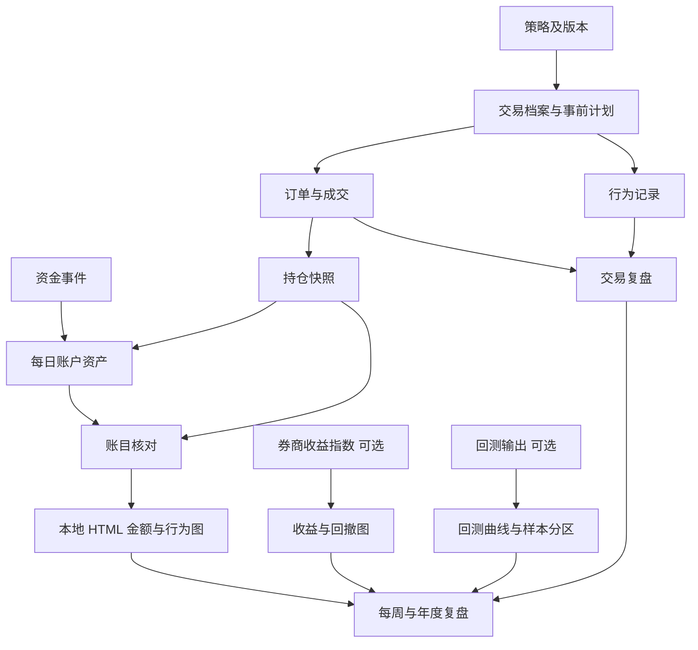

# Backtest-Review-System

个人交易与资产管理仓库，管理交易记录、资产变化、交易频次、行为偏差和复盘。一个账户可以使用多种策略；账户资产曲线连续记录，每笔交易归属明确的策略版本。

## Introduction 简介

本版使用 Markdown 与 CSV 记录，使用 Python 标准库核对账目并生成离线 HTML 图表。无需安装第三方库，无需行情 API、AI API 或付费账户；券商原始记录仍是数据依据。

适用范围：单一账户、单一记账币种、做多普通股票的现金账户。示例采用 MYR、Asia/Kuala_Lumpur 时区和虚构标的。多账户、多币种、融资、做空、期权和拆股等复杂事件需要扩展数据结构后使用。

开始使用：[逐步建立流程](docs/github-setup.md) → [完整文件清单](docs/file-manifest.md) → [字段字典](docs/data-dictionary.md) → [核算规则](docs/accounting-rules.md) → [图表指南](docs/visualization-guide.md)。

项目仓库：[CJA231/Backtest-Review-System](https://github.com/CJA231/Backtest-Review-System)。公开仓库用于模板、程序和虚构示例，真实交易记录与生成报告应保存在私密目录或单独的 Private 仓库。

立即预览：在仓库首页点击 **Code → Download ZIP**，解压后双击 `demo/report.html`，使用浏览器打开预生成的虚构报告。这一步无需 Python；普通 GitHub 文件页面显示 HTML 源码，不代表网站已经发布。

自行生成：在包含 `trading_journal/` 的项目文件夹打开终端，运行：

```bash
python3 -m trading_journal --data-dir examples/2026 --output output/demo-report.html --backtest-dir examples/backtests/demo-run
```

然后在浏览器打开 `output/demo-report.html`。这是本地报告；将源文件上传到 GitHub 不会自动运行程序或发布网站。

## Concepts 概念

| 对象 | 定义 |
|---|---|
| 成交 Fill | 一次实际成交；同一订单可能有多次成交 |
| 订单 Order | 发给券商的一条订单；本版记录已成交订单编号 |
| 完整交易 Trade | 一个策略持仓从首次建仓到完全平仓的过程 |
| 策略版本 | 固定的入场、退出与风险规则，例如 TREND/v1 |
| 外部资金流 | 入金与出金；不包括买卖、股息和利息 |
| 净资产 NAV | 现金加持仓市值；本版现金账户没有融资负债 |
| 策略贡献 | 归属于该策略的净损益金额；不等于策略收益率 |
| 期初基准 | daily-assets.csv 第一行的日末估值；后续变化按这个起点核算 |
| 收益指数 | 券商或回测工具提供的连续指数，区别于直接受到入出金影响的资产金额 |

改变规则时建立新版本，新交易使用新版本。旧记录保留原归属；持仓中途换规则要记录变更事件，不能直接改写历史。最小版避免同一持仓跨策略转移；采用新规则的持仓另外分配 trade_id，并记录真实成交或明确的内部转移扩展账本。

## Architecture 架构

| 模块 | 文件与输出 |
|---|---|
| 记录 | dataset.json 配置与七张核心 CSV；可选期初批次与券商收益指数 |
| 资产 | 每日账户资产、持仓快照与 FIFO 成本核对 |
| 复盘 | 交易、每周和年度 Markdown 模板 |
| 核对 | trading_journal/ledger.py 检查编号、关联、资金、数量、成本和净资产 |
| 可视化 | trading_journal/charts.py 将核对后的结果嵌入 HTML，无远程图表资源 |
| 回测展示 | 读取独立的 metadata.json 与 equity.csv；不生成交易信号或执行回测 |

| 架构项目 | 本版安排 |
|---|---|
| 数据流 | 券商导出 → 手动录入 → 程序核对 → 本地图表 → 人工复盘 |
| Agent flow | 人工维护及核实；本版没有 AI 代理或模型调用 |
| 数据库 | CSV 是结构化记录；未来可导入 DuckDB |
| 缓存 | 无实时行情缓存 |
| 记忆 | 事前计划、策略版本、行为记录与历史复盘 |
| API | 无；未来可接券商只读接口 |
| 部署 | GitHub 保存模板与源代码；Python 在自己的电脑生成报告 |
| 监控 | 生成时检查记录错误；收益指数覆盖不完整时警告并停用相关收益图 |
| 日志 | 券商原始文件加 Git 变更历史；Git 不能证明计划一定在成交前填写 |
| 安全 | 公开仓库只放模板与虚构示例；真实记录使用私有仓库 |

## Best Practices 最佳实践

1. 先写交易计划，再录入成交，最后写复盘。计划修改保留时间和原因。
2. 一笔交易关联多个成交；不要将每次加减仓都当成新的完整交易。
3. 每个交易日保存账户与持仓快照，持续到年底；没有交易也记录资产。
4. 采用同一估值时点和币种。示例以当日收盘且当天现金事件入账后为准。
5. 先对上数量和现金，再对上净资产，最后分析收益。
6. 规则遵守与盈亏分别评价；未记录计划的交易标为未知。
7. 更正错误时在 Git 提交说明写明原因，保留券商依据。
8. 定期导出备份；GitHub 编辑历史不能替代券商原始成交证据。
9. 第一张资产快照是日末基准，核心资金和成交文件只填基准日之后的事件；有期初持仓时填写 opening-lots.csv。
10. 缺失收益数据时保留金额图，不能用零代替未知，也不能把净资产涨幅冒充投资收益率。

## Examples 示例

[examples/2026](examples/2026) 是虚构的短期例子，不代表全年业绩。

| 核对项目 | 示例结果 |
|---|---:|
| 期初净资产 | 100000 MYR |
| 入金 | 10000 MYR |
| 利息 | 20 MYR |
| 趋势交易 TR-001 已实现净损益 | +196 MYR |
| 突破交易 TR-002 已实现净损益 | -204 MYR |
| 趋势交易 TR-003 未实现净损益 | +99 MYR |
| 期末现金 | 107011 MYR |
| 期末持仓市值 | 3100 MYR |
| 期末净资产 | 110111 MYR |
| 扣除外部资金流后的净损益 | +111 MYR |

完整计算见 [示例复盘](examples/2026/review.md)。不要将这些示例行复制进真实年度数据。

示例券商收益指数与示例回测也是虚构数据，只演示不同图表和覆盖标签。回测文件位于 `examples/backtests/demo-run/`，与真实账户记录分别读取。

```text
Backtest-Review-System/
├── README.md
├── .gitignore
├── docs/                   # 流程、字段、核算、图表和完整文件清单
├── templates/              # 空白记录表、配置与复盘模板
├── examples/
│   ├── 2026/               # 虚构账户数据
│   └── backtests/demo-run/ # 虚构回测输出
├── trading_journal/        # 核对与报告生成程序
└── tests/                  # 核算及报告行为验证
```

代码职责：`__main__.py` 处理命令与输入输出，`ledger.py` 核算账目和指标，`charts.py` 生成 SVG 和 HTML，`__init__.py` 定义程序包。只需 Python；本版没有前端构建或 TypeScript 运行环境。

## Workflow 工作流程

| 流程 | 输入 | 输出 | 依赖 | 预计耗时 | 成本与风险 | 自动化可能性 |
|---|---|---|---|---|---|---|
| 建立仓库 | 全部项目文件 | 可维护仓库 | GitHub 账户 | 批量上传 15–30 分钟；逐文件复制约 1–2 小时 | 无 API 费用；文件遗漏 | 可批量上传 |
| 生成示例报告 | 示例 CSV 与配置 | output/demo-report.html | Python 3.11+ 建议 | 小样本通常数秒 | 无 API 费用；路径错误 | 一条命令生成 |
| 交易前 | 策略规则与候选标的 | 交易档案与计划 | 明确风险预算 | 每笔 3–5 分钟 | 决策风险 | 计划可辅助生成 |
| 成交后 | 券商成交记录 | 成交行及行为事件 | 成交与订单编号 | 每笔 1–3 分钟 | 重复或漏记 | 可只读导入 |
| 收盘后 | 券商账户与持仓 | 两类每日快照与本地报告 | 一致估值时点 | 每日 5–10 分钟 | 估值不一致 | 报告已可自动生成 |
| 每周 | 本周记录 | 周复盘 | 核对后的账目 | 20–30 分钟 | 错误归因 | 统计可自动化 |
| 年度 | 全年记录 | 年度图表及复盘 | 完整资金流和快照 | 复盘 1–2 小时起 | 缺失导致偏差 | 图表已可自动生成 |

具体顺序：建立策略 → 写事前计划并创建 trade_id → 录入成交 → 记录行为 → 核对每日资产 → 平仓复盘 → 每周检查 → 年度归档。

真实数据的报告命令：

```bash
python3 -m trading_journal --data-dir records/2026 --output output/2026-report.html
```

程序核对通过才生成本次报告。失败时按提示修正 CSV 后重跑；旧 HTML 不会因此变成新报告，查看报告时确认区间与生成时间。

## Diagrams 数据关系



## Checklist 检查清单

- [ ] 成交编号唯一，订单编号和交易编号可追溯。
- [ ] 全部交易关联有效策略及版本。
- [ ] 交易计划包含固定风险预算，缺失时 R 指标留空。
- [ ] 数量、持仓成本、现金和净资产与券商一致。
- [ ] 每日资金流只包含入金和出金，费用没有重复扣除。
- [ ] 已实现与未实现损益都纳入报告。
- [ ] 没有独立策略资本账本时，只比较策略贡献金额。
- [ ] 公开文件全部是模板或虚构数据。
- [ ] dataset.json 的账户、币种和时区与记录一致。
- [ ] 有期初持仓时，每个历史批次的数量和成本均已提供。
- [ ] 收益指数与回测曲线注明来源、覆盖范围、成本和数据性质。
- [ ] 月度图显示实际覆盖期间，没有把短期示例称为全年收益。

## Common Mistakes 常见错误

| 错误 | 修正 |
|---|---|
| 把入金当成收益 | 单独记录外部资金流 |
| 成交次数当成交易次数 | 分别统计 fill、order、trade |
| 持仓上涨但未卖出就不记录 | 每日按市值估值 |
| 已经扣费的损益再次扣费 | fees_ytd 仅供展示 |
| 为了让某策略更好看而改标签 | 保留当时策略版本 |
| 两种策略收益率直接相加 | 使用贡献金额，或建立独立资本账本 |
| 所有亏损都归因于情绪 | 对照事前计划，不能确定时写未知 |
| 以为 .gitignore 能阻止网页上传 | 网页操作时人工检查文件范围 |
| 上传 Python 后认为 GitHub 会自动生成图表 | 下载到本地运行，再用浏览器打开 HTML |
| 回测曲线重置后仍连接成一条线 | 提供连续收益指数；无法确认时不生成合并收益图 |
| 回测图看起来平稳就认定策略有效 | 核实样本外、成本、成交假设及来源，图表本身不验证优势 |

## FAQ 常见问题

**必须全年只用一种策略吗？** 不需要。账户表现是全年所有交易与资金事件的综合结果。策略变化使用新版本记录。

**同一只股票可以有两种策略吗？** 可以，但分别创建 trade_id，分配成交数量和费用。本版一条成交行只归属一个 trade_id；实际单笔成交若需要拆分归属，先扩展分配账本，避免重复录入。

**没有历史每日净值怎么办？** 优先从券商取得历史报表；若无法恢复，标明缺失，不能声称完整年度回撤或精确 TWR。

**取消订单算交易频次吗？** 本版不保存未成交订单，所以订单频次仅代表已成交订单。要分析频繁撤单，另外扩展订单事件表。

**能直接得到收益图表吗？** 金额、频次和行为图由核心记录生成；收益、基准、回撤和月度收益图需要完整的券商 TWR 指数。程序不会从日末净资产猜测精确 TWR。

**这个项目会帮我运行回测吗？** 本版读取其他工具已经生成的连续回测指数，展示曲线、回撤及 IS/OOS 标签。它不是回测引擎，也没有参数搜索、交易自动下单或行情获取。

**电脑上必须安装什么？** 建议 Python 3.11 或以上，以及用于打开 HTML 的浏览器。标准库即可运行，无需 pip 安装。GitHub 网页不是程序运行环境。

## Summary 版本范围与后续优化

| 功能或工具 | 使用安排 |
|---|---|
| TradingView 与 Screening | 外部筛选和图表；信号出处写进交易计划 |
| Risk Management | 固定风险预算、退出规则和行为检查 |
| Portfolio | 每日资产、持仓、市值与策略贡献 |
| Backtesting | 读取回测输出与连续指数；保留版本、成本、来源及样本分区 |
| Optimization | 优先提高记录与核算质量；参数优化不在本版功能范围 |
| Visualization | 本地 SVG＋HTML；图表目录见图表指南 |
| Reporting | 交易、每周和年度模板，以及自动生成的 HTML |
| Notion | 可用于编辑计划；仓库保存归档版本 |
| Telegram | 未来发送个人提醒；本版没有接入 |
| Automation | 已有账目核对与报告生成；只读导入可以后续增加 |

进阶方向：多账户、多币种、策略资本转移、公司行动、订单事件、真实回测引擎和更丰富的交互。数据量较大时可将 CSV 导入 Polars 与 DuckDB；需要网站、实时服务或数据库时再评估 FastAPI、React、PostgreSQL、Redis、Docker 与 GitHub Actions，不为当前离线报告增加安装负担。
