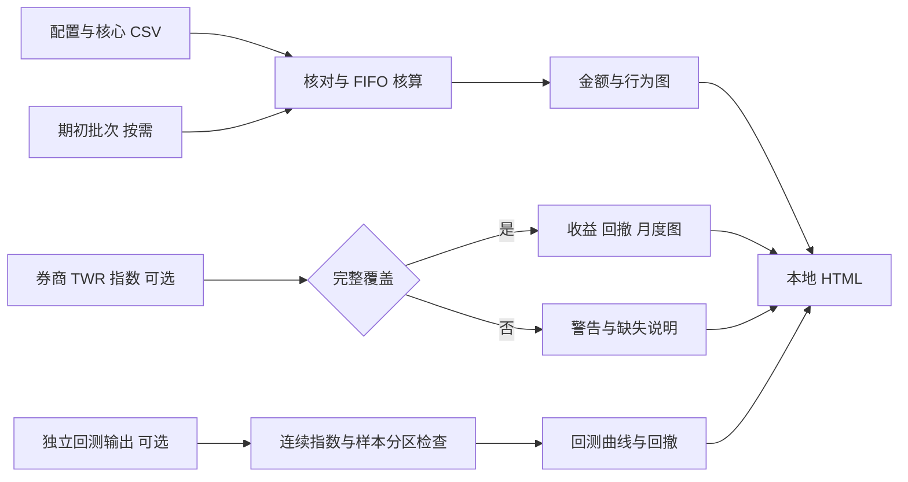

# 图表、数据来源与阅读流程

## Introduction 简介

本版在自己的电脑读取 CSV，经账目核对后生成一个离线 HTML 文件。图表使用嵌入 SVG，没有远程图表库、行情连接或第三方分析服务。可用浏览器查看，悬停图形可读取数值；本版没有缩放筛选仪表板或自动交易接口。

一个报告分为账户金额、交易与行为、券商收益、独立回测。各部分的数据来源与口径分别标示，虚构示例明确标注。

## Concepts 概念

| 指标 | 含义 | 不能替代什么 |
|---|---|---|
| 净资产金额 | 现金＋持仓市值 | 排除资金流影响的收益率 |
| 净投资损益 | 期末 NAV－期初 NAV－期间净入金 | 策略收益率或年化表现 |
| 策略金额贡献 | 已实现变化＋未实现变化＋归属现金收益 | 缺少独立资本账本的策略回报率 |
| TWR 指数 | 券商排除外部资金流影响的连续收益指数 | 未核实来源的净资产列 |
| 收益回撤 | 指数距提供区间内历史高点的跌幅 | 原始资产金额跌幅、未来风险上限 |
| 完整交易 R | 完整净损益÷事前固定风险预算 | 每次部分成交的收益率 |

## Architecture 架构

| 模块 | 输入 | 输出 |
|---|---|---|
| 配置 | dataset.json | 账户、币种、时区、虚构标记与 FIFO 方法 |
| 核算 | 七张核心 CSV；有期初持仓时加 opening-lots | 已核对的金额、持仓和期间贡献 |
| 行为 | trades、fills、behavior-events | 频次、R 样本、持有时间及偏差次数 |
| 券商收益 | 可选 broker-performance | 完整覆盖时生成收益、基准、回撤与月度图 |
| 回测读取 | 可选独立 metadata 与 equity | 连续指数、回撤与 IS/OOS 图 |
| 输出 | 上述核对结果 | 嵌入 SVG 的本地 HTML |

CSV 是数据库来源，原始券商文件是外部证据；没有 Redis 缓存、模型记忆、代理协作或 API。日志由命令错误与原始记录、Git 历史构成；本版没有持续运行的监控服务。安全上将真实数据和报告私密保存。

## 图表目录

### 已实现的核心图

| 图表 | 数据 | 主要问题 | 阅读限制 |
|---|---|---|---|
| 净资产折线 | daily-assets | 账户有多少钱，资产如何变化？ | 入出金影响金额，不直接代表收益率 |
| 现金与持仓堆叠图 | daily-assets | 现金占用和持仓金额如何变化？ | 金额构成，不是各策略收益率叠加 |
| 资产变化瀑布图 | 期初期末资产＋cash-events | 资产变化来自资金流还是投资损益？ | 起止时间以报告基准为准 |
| 策略贡献横条 | trades、fills、positions、cash-events | 哪个策略贡献或拖累本期损益？ | 正负金额；未分配现金收益留在账户层 |
| 月度频次分组柱 | fills、trades | 成交、订单、新建和平仓交易是否增多？ | 订单仅含已成交订单，每月去重不能直接加成全年数 |
| R 分布直方图 | 完整平仓交易与 initial_risk | 盈亏尾部是什么样？ | 期初已有持仓、未平仓或风险未知的交易排除 |
| 持有时间 × R 散点 | 同上及 opened_at/closed_at | 持有时间和结果有何关联？ | 样本少时只作记录观察，不做因果判断 |
| 行为偏差横条 | behavior-events | 哪些偏差频繁出现？ | 分别显示事件数和涉及交易数；同一笔交易可有多个事件 |

### 满足可选数据条件后显示

| 图表 | 必要条件 | 阅读限制 |
|---|---|---|
| 账户收益指数折线 | 完整 broker TWR 指数，与账户日期对齐 | 区间从 100 归一，不能当策略独立净值 |
| 同期基准线 | 基准指数全区间可用 | 输入者核实币种、股息和指数适用性 |
| 收益回撤面积 | 完整账户收益指数 | 最大回撤仅针对提供的区间 |
| 月度覆盖收益柱 | 完整账户收益指数 | 显示覆盖起止日期，部分月份不冒称完整月份 |
| 回测指数与回撤 | 有效 metadata、连续 equity、无资金流 | 来源已计入所声明的成本；本程序不重算回测 |
| IS/OOS 分区底色 | 回测 equity 的真实 phase 标签 | 展示来源分区，不证明不存在未来数据泄漏 |

### 后续可增加，需要额外数据

| 图表 | 所需扩展 |
|---|---|
| K 线＋买卖点＋计划止损 | 历史 OHLCV、公司行动处理和计划版本 |
| 多年年月收益热力图 | 多年连续收益指数与完整覆盖检查 |
| 行业或因子暴露 | 行业分类、因子数据与分类生效日期 |
| 参数稳健性热力图 | 多组参数的独立回测指标及试验记录 |
| 成本／滑点敏感度 | 成本变化后的重新回测结果 |
| 实盘与同期模拟差异 | 相同日历、规则、资金和成本假设的模拟记录 |
| 可筛选的交互仪表板 | 前端、筛选维度、缓存、访问控制与部署 |

后续目录是扩展路线，本版报告不会生成这些图。TradingView 可用于筛选和外部 K 线观察；Notion 可整理研究；Telegram 可在以后接入个人提醒，目前三者没有自动连接。

## Best Practices 最佳实践

1. 先检查报告顶部的数据性质、账户、币种、区间与警告，再看图。
2. 金额与收益分开阅读，策略金额贡献不除以整个账户本金伪造策略收益率。
3. 基准和账户收益同时从 100 展示；原始 NAV 单独保留金额单位。
4. 先读收益曲线，再读对应回撤；不要只看期末盈利。
5. 行为频率必须有事前计划支持；偏差与亏损同时出现不证明偏差造成了全部亏损。
6. 缺失数据显示原因，不显示为零；短期示例没有代表性的全年统计意义。
7. 图表与策略变更保留版本，修改规则后不改写旧标签。

## Examples 示例

完整示例命令：

```bash
python3 -m trading_journal --data-dir examples/2026 --output output/demo-report.html --backtest-dir examples/backtests/demo-run
```

虚构账户从 100000 MYR 到 110111 MYR，其中入金 10000 MYR，因此净投资损益为 111 MYR。资产折线和瀑布图表达不同角度；券商示例 TWR 指数另有明确来源标记，不直接用 10.111% 资产涨幅代替收益率。

真实数据命令：

```bash
python3 -m trading_journal --data-dir records/2026 --output output/2026-report.html
```

无需复制生成代码到自己的文件；完整 Python 包已在 trading_journal 中。保留文件树与相对导入，在项目根目录运行；本版没有适用的 TypeScript 前端示例。

## Workflow 工作流程

| 步骤 | 输入 | 输出 | 依赖 | 预计运行时间 | 成本／风险 | 自动化 |
|---|---|---|---|---|---|---|
| 1 准备记录 | 券商事实与计划 | CSV 和配置 | 正确基准与成本 | 人工录入决定 | 无 API 成本；漏记 | 后续可只读导入 |
| 2 核对 | 数据目录 | 核对结果或错误 | Python 标准库 | 小数据通常数秒 | 错误数据不能作为新报告发布 | 已实现 |
| 3 读取收益 | 可选券商指数 | 有效收益或覆盖警告 | 可靠且连续来源 | 通常小于总体运行时间 | 不能补造未知区间 | 已实现 |
| 4 读取回测 | 可选回测目录 | 回测图与来源说明 | 上游回测工具 | 同上 | 图不验证研究方法 | 已实现读取 |
| 5 查看报告 | 成功生成 HTML | 人工分析与复盘 | 浏览器 | 按复盘深度决定 | 选择性解读 | 图表已生成 |

错误先修记录再重跑，不修改程序来绕过已发现的数据问题。查看输出文件生成时间，防止误读旧报告。

## Diagrams 数据流



## Checklist 检查清单

- [ ] 报告区间与基准日明确，个人数据没有标成虚构或反之。
- [ ] 基准前持仓由历史剩余批次支持，没有重复录入旧买单。
- [ ] 资产、成本和策略贡献能与券商记录对上。
- [ ] 回报、回撤只来自允许的完整指数来源。
- [ ] 基准口径可比较，缺失时整条省略。
- [ ] 频次区分成交、订单和完整交易。
- [ ] 完整交易 R 的样本筛选清楚。
- [ ] 回测费用、滑点、版本、来源和 IS/OOS 已标示。
- [ ] 部分月份显示覆盖日期，没有用短期结果声称年度收益。

## Common Mistakes 常见错误

| 错误 | 修正 |
|---|---|
| 入金后资产增长就解释成策略赚了钱 | 先看瀑布图和净投资损益 |
| 出金导致金额下降当成投资回撤 | 使用连续 TWR 指数 |
| 有三张截图就连成全年收益曲线 | 恢复完整来源或标明不可用 |
| 同一个订单的多笔成交当成多次交易 | 分开统计四类频次 |
| 期初已有持仓的部分账目用于完整 R | 保留期间贡献，排除不完整生命周期样本 |
| 行为图零事件意味着没有违规 | 同时记录审查覆盖，未审查属于未知 |
| 样本外曲线重新归一后拼接 | 提供真正连续指数或单独展示 |
| 上传 HTML 到普通 GitHub 仓库就当网站 | 本地打开，在线部署作为独立扩展 |

## FAQ 常见问题

**没有券商收益指数还能用吗？** 可以。资产、现金与持仓、瀑布、策略金额贡献及行为图仍能使用，收益部分显示原因。

**回测数据必须与真实账户同期吗？** 本版可以展示独立回测，但分别标明区间和来源。不能将不同时期结果直接当作实盘与回测偏差比较。

**曲线看起来很好是否就能实盘？** 图表只呈现输入和核算结果；数据质量、样本外验证、成本假设、风险和执行都需独立检查。

**本版能点图进入交易吗？** 本版是离线图表与报告，不包含交易详情路由。CSV 中的 trade_id 和 Markdown 计划路径用于人工追溯。

## Summary 版本范围

本版把已有交易账本变为可核对、可阅读的离线报告；不增加付费 API 或前端服务。先保证数据、成本和区间可信，再扩展图表、模型或自动化。所有新增图应注明输入、口径、覆盖和限制。
